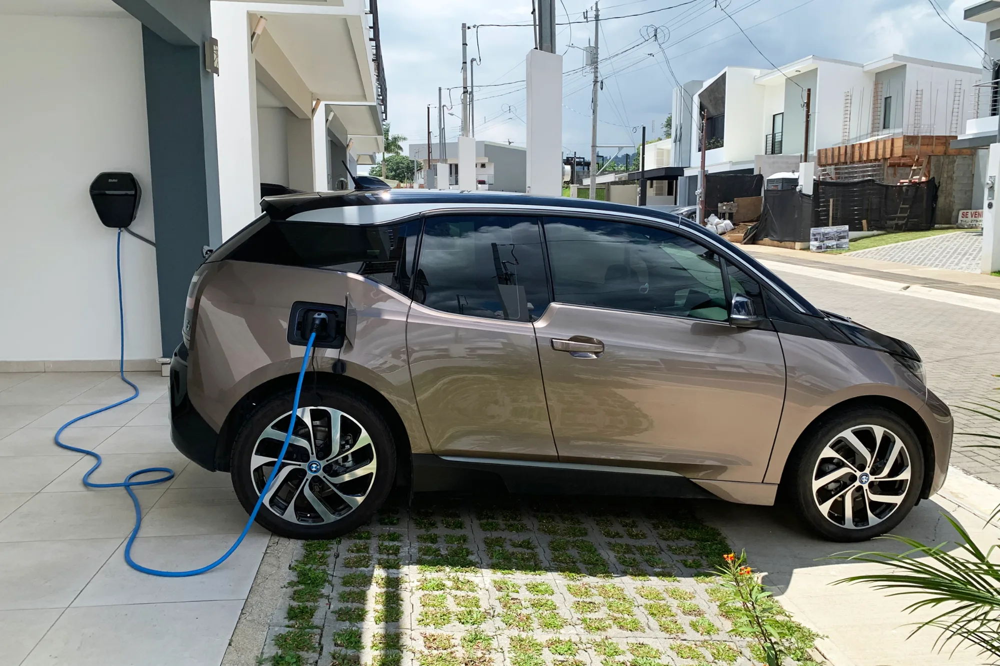

Buying an EV in Colombia takes more steps than buying a gasoline car, because several benefits depend on procedures after the purchase. A mistake on the invoice or in the order of the paperwork can cost you the VAT refund, which on a COP 90 million car is about COP 4.3 million. This is the full route.

## 1. Check that the trim has benefits

The VAT refund and income tax deduction require a **certificate from the UPME**, the country's energy planning unit, and it is only issued for vehicles on the lists in Resolution 135 of 2025. Pure EVs, plug-in hybrids (PHEV) and conventional hybrids (HEV) qualify. **Mild hybrids (MHEV) do not**. Ask the dealer whether the exact trim you are going to buy is on the list; two versions of the same model can be treated differently.

## 2. Get a loan quote before going to the dealer

Take a pre-approval from your bank. With it you can compare the brand's financing against a rate you already know, in effective annual terms and with the total payment. Green rates reported in 2026 run from about 12.5% to 16.6% effective annual. What to ask is in [the hidden costs of a loan](/es/notas/costos-ocultos-credito-vehicular/).

## 3. Check the invoice before signing

The electronic invoice must be **in the name of whoever will claim the benefits** and with the **VAT itemized**, which is 5% for EVs. Without that, the refund does not proceed. If the car is in a company's name, the benefits belong to the company, as we explain in [this article](/es/notas/comprar-carro-electrico-empresa-beneficios-tributarios/).

## 4. Insurance and SOAT

The bank will ask for comprehensive insurance with itself as beneficiary. SOAT, the mandatory accident insurance, has a **10% discount** on the premium for EVs. Get insurance quotes outside the bank's offer if you are allowed to choose: according to Seguro Canguro's 2026 study, the cheapest offer for an EV worth COP 90 to 120 million was around 2.07% of the car's value a year, about COP 1.86 million on a COP 89.99 million car. We compare it in [how much it costs to insure an EV](/es/notas/seguro-carro-electrico-colombia-2026-costo/).

## 5. Registration

In Bogotá, registering a car costs **COP 708,200** and the entry in RUNT, the national vehicle registry, **COP 22,100** in 2026. Many dealers do it for you and include the cost in the price; ask if that is your case. Registration produces the ownership card, which you will need for the UPME certificate.

*An installed wall charger costs about COP 3 million according to Enel; in residential complexes it requires authorization. Photo: Mariordo (Mario Roberto Durán Ortiz), CC BY-SA 4.0, via Wikimedia Commons.*

## 6. Home charger

If you live in a residential complex, the charger requires authorization from the management and an installation with its own circuit. Enel estimates about COP 3 million for an installed wall charger. We explain this in [how to install a charger in a residential complex](/es/notas/instalar-cargador-electrico-conjunto-residencial/).

## 7. UPME certificate

It is requested on the **Muévete Eléctrico** portal with the invoice, the vehicle data, the ownership card and payment of the fee. The UPME can take **up to 35 days** to respond. The firm RSM indicates that requests are received in two cycles a year, from February 15 to May 14 and from August 15 to November 14: if you bought in 2026, the open cycle closes on **November 14**.

## 8. VAT refund with the DIAN

With the certificate, you file with the DIAN, the tax authority, **Form 010**, the bank certification, the invoice with VAT itemized and, for people not required to keep accounts, a sworn statement. In Bogotá, Medellín, Cali and Bucaramanga you need an appointment; in other municipalities you can send it by email to the local office. The term is **five years from the invoice date**, and neither the appointment nor the UPME process suspends it. The detail is in [the step-by-step process with the DIAN](/es/notas/devolucion-iva-carro-electrico-dian-paso-a-paso/).

## 9. Income tax deduction, the following year

If you file income tax, the same certificate lets you deduct up to 50% of the car's value. According to the DIAN, the deduction begins in the tax year after the vehicle enters operation. For individuals it has limits that can leave it far below what is promised, as we calculate in [the article on the deduction](/es/notas/deduccion-renta-carro-electrico-ley-1715/).

> The step most often forgotten is the seventh. Without a UPME certificate there is no VAT refund or income tax deduction, and the cycle for requesting it is not open all year.

## Frequently asked questions

### What documents do I need for the UPME certificate?

The electronic purchase invoice, the ownership card and the vehicle data, plus payment of the fee on the Muévete Eléctrico portal.

### How long do I have to request the VAT refund?

Five years from the date of the sales invoice.

### Do hybrids also get the VAT refund?

Plug-in and conventional hybrids do. Mild hybrids (MHEV) do not.

*This article is for information only and does not replace advice from an accountant.*

---

**Sources:** [Portafolio: term and process of the VAT refund](https://www.portafolio.co/negocios/vehiculo/este-es-el-plazo-y-el-proceso-para-que-le-devuelvan-el-iva-si-compro-un-carro-hibrido-o-electrico-503819) · [RSM Colombia: tax benefit for buying EVs or hybrids](https://www.rsm.global/colombia/es/node/538) · [Valora Analitik: the DIAN explains when to apply the deduction](https://www.valoraanalitik.com/dian-aclara-como-aplicar-a-deduccion-en-renta-si-como-vehiculo-electrico-o-hibrido/) · [Infobae: Bogotá transit fees in 2026](https://www.infobae.com/colombia/2026/01/06/suben-los-precios-de-licencias-de-conduccion-y-tramites-de-transito-en-2026-en-bogota-consulte-las-nuevas-tarifas/) · [La Nota Económica: Seguro Canguro's study](https://lanotaeconomica.com.co/movidas-empresarial/el-carro-nuevo-mas-cotizado-para-asegurar-en-colombia-en-2026-es-un-tesla-y-asegurar-un-electrico-ya-cuesta-lo-mismo-que-uno-a-gasolina/) · [Blu Radio: cost of installing a charger](https://www.bluradio.com/motor/cuanto-cuesta-cargar-un-carro-electrico-en-colombia-so35)
