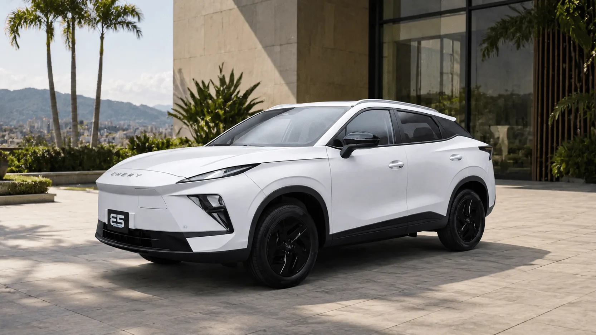

Comparing two electric cars spec sheet in hand is harder than comparing two gasoline cars. Brands publish figures measured under different test cycles, charging power the car only reaches for a few seconds, and battery sizes that include energy you cannot use. These are the figures worth looking at, in order of importance, along with the trap in each one.

## 1. Range, always under the same cycle

It is the most searched figure and the easiest to misread. A **CLTC** or **NEDC** range is more optimistic than a **WLTP** figure for the same car. The Geely EX5 Pro, for example, is rated at 490 km (304 miles) NEDC and 425 km (264 miles) WLTP. If one car publishes WLTP and the other only CLTC, there is no valid comparison until you find the same cycle for both. We explain it in [CLTC, NEDC or WLTP](/es/notas/autonomia-electricos-cltc-nedc-wltp-como-leerla/).

## 2. Consumption in kWh per 100 km

Consumption tells you how much energy the car uses, and so it decides what you pay each month. Two cars with the same range can have different consumption if one has a bigger battery. In Colombia, at Bogotá's residential electricity rate for socioeconomic stratum 4, a car that uses 15 kWh per 100 km costs about COP 130 per kilometer; one that uses 20 costs about COP 173. Over 20,000 km a year, that is a difference of about COP 860,000, every year.

## 3. Fast-charging time, not peak power

Peak charging power, say "110 kW", is a figure the car hits for a while before it tapers. What matters is the **time to go from 10% or 30% to 80%**, always from the same starting point: a car that charges from 30% to 80% in 30 minutes is not faster than one that charges from 10% to 80% in 29.

## 4. Safety of the exact trim

Euro NCAP or Latin NCAP stars apply to the version that was tested. If the version the dealer sells has fewer airbags or lacks automatic emergency braking, the rating does not apply in the same way. Compare the list of driver assistance features on the two trims you are considering, not on the top-spec versions.

## 5. Warranty, weight, trunk and connector

These are the figures people forget most. The car's warranty can range from three to eight years depending on the brand. Weight affects consumption and tire wear. The trunk decides whether the luggage for a family trip or a baby seat will fit. And the connector determines which charging stations you can use without an adapter.

*The entry-level Chery E5 costs COP 12.9 million less than the EX5 SE, but that trim has no driver assistance systems. Photo: Chery Colombia.*

## An example: Chery E5 vs Geely EX5 SE

Two Chinese compact SUVs competing in Colombia for under COP 95 million:

| Spec | Chery E5 Comfort | Geely EX5 SE |
|---|---|---|
| Price | COP 79.99 million | COP 92.9 million |
| Battery | 50.6 kWh | 49.5 kWh |
| WLTP range | 350 km (217 miles) | 345 km (214 miles) |
| Fast charging | 30% to 80% in 30 minutes | Not published |
| Curb weight | 1,735 kg | 1,620 kg |
| Trunk | 442 L | 461 L |
| Automatic emergency braking and lane assist | No | Yes |
| Euro NCAP | The European Omoda E5 has 5 stars, with different equipment | 5 stars, with equipment similar to the Colombian car |
| Warranty | 8 years or 200,000 km | Not published in the sources consulted |

Spec sheets from Chery Colombia and Geely Colombia, and specialist press reports.

On range and battery they are almost identical, so the decision rests elsewhere. The E5 Comfort costs COP 12.9 million less and has a long warranty. The EX5 SE comes with the driver assistance systems the E5 only offers in its Luxury trim, and its European rating is a closer match to the Colombian version. For someone who does a lot of highway driving, that safety gap carries more weight than the price.

> Before you decide, put the two cars side by side in the [comparator](/es/comparador/), which only matches figures from the same cycle and shows which one wins in each area.

## Frequently asked questions

### What matters more, range or fast charging?

If you charge at home, range. If you often travel by highway or rely on public charging stations, fast charging matters as much or more.

### How do I know which one uses less energy?

Compare consumption in kWh per 100 km measured under the same cycle. If the brand does not publish it, divide the battery capacity by the WLTP range for an approximation.

### Is it useful to compare horsepower?

For normal use, not much. Almost every EV accelerates with ease. Power matters more on the highway, when passing, and on long climbs.

---

**Sources:** [Chery Colombia: E5 spec sheet](https://www.chery.com.co/wp-content/uploads/2026/04/FICHATECNICA_E5_2026_v3.pdf) · [El Carro Colombiano: Chery E5 test drive](https://www.elcarrocolombiano.com/resenas/chery-e5-primer-contacto-suv-electrica-precio-colombia/) · [Portafolio: Geely EX5 SE](https://www.portafolio.co/negocios/vehiculo/nueva-suv-electrica-llega-a-colombia-este-es-el-precio-de-lanzamiento-y-las-caracteristicas-de-la-geely-ex5-se-497330) · [El Carro Colombiano: Geely EX5 SE](https://www.elcarrocolombiano.com/novedades/geely-ex5-se-suv-electrica-barata-precio-colombia/) · [Geely Colombia: EX5 spec sheet](https://geely.com.co/wp-content/uploads/2026/03/EX5_Bajav4.pdf) · [Enel Colombia: August 2026 rates](https://www.enel.com.co/content/dam/enel-co/español/personas/1-17-1/2026/pliego%20tarifario%20digital%20_agosto_2026.pdf)
