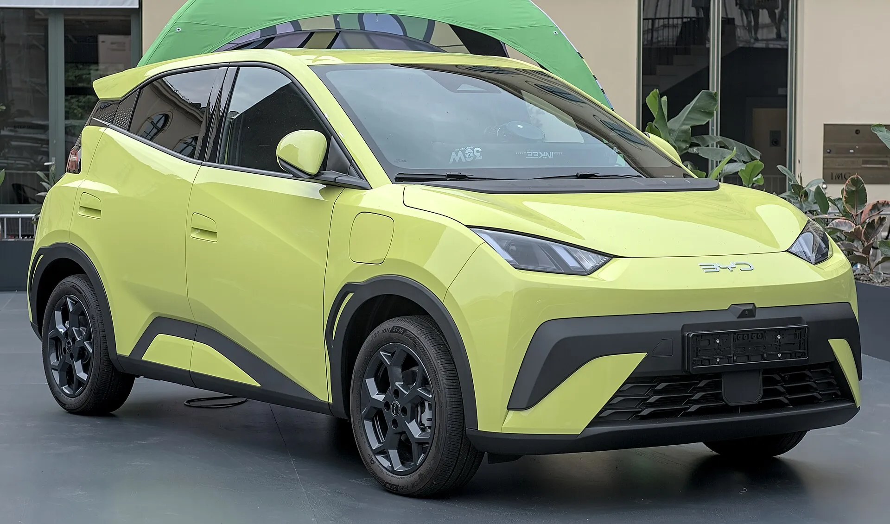

In several of Latin America's big markets, most buyers leaving gasoline choose a **hybrid**, not an EV. In Mexico, between January and September 2026, 99,147 conventional hybrids were sold against 21,794 pure EVs. In Chile, in the first half, 20,344 non-plug-in hybrids against 9,978 plug-ins. Colombia is the exception: EVs grew more than 220% in 2026 and are already one in six new cars. Which one suits you depends on how you use the car and where you live.

## The types of hybrid

**Conventional hybrid (HEV):** it has a gasoline engine and an electric motor with a small battery that recharges by itself, through braking and the engine. It does not plug in. It uses less gasoline than a conventional car, especially in the city.

**Plug-in hybrid (PHEV):** it has a larger battery that charges from an outlet and lets it cover tens of kilometers on electricity alone. When that runs out, it works as a hybrid.

**Mild hybrid:** it has a small electric system that helps the engine, but it almost never moves the car on electricity alone. It saves the least.

And the **range extender**, which always moves on the electric motor, is explained in [this article](/es/notas/que-es-un-carro-electrico-de-rango-extendido/).

## Head to head

| Aspect | Conventional hybrid | Electric |
|---|---|---|
| Needs a plug | No | Yes |
| Long trips | No planned stops | Charging must be planned |
| Cost per kilometer | Lower than gasoline, higher than electric | The lowest, with home charging |
| Maintenance | Like a gasoline car, with oil and filters | No engine oil; more spent on tires |
| Purchase price | Usually lower than an equivalent EV | Higher, although the gap narrowed in 2026 |

## The benefits in Colombia

| Benefit | Electric | Hybrid |
|---|---|---|
| Pico y placa driving restrictions in Bogotá | Exempt by national law | Exempt until December 31, 2027, by city decree |
| Bogotá vehicle tax discount | 60% for five years | 40% |
| VAT refund and income tax deduction | Yes, with a UPME certificate | Yes for HEV and PHEV with a UPME certificate |
| VAT | 5% | Under discussion in recent tax reforms; confirm the current rate when buying |

The difference that weighs most in Bogotá is **pico y placa**. The EV exemption comes from a national law and does not depend on the city. The one for hybrids is a city decision with an expiry date, and on the car-free day of February 2026 hybrids could not circulate while EVs could. We explain this in [this article](/es/notas/pico-y-placa-bogota-hibridos-electricos-2028/).

*In Bogotá, the EV exemption from pico y placa comes from a national law; the hybrid one depends on the city. Photo: Alexander Migl, CC BY-SA 4.0, via Wikimedia Commons.*

## When each one suits you

**An EV suits you** if you have somewhere to charge at home or at work, drive mainly in the city and want the lowest cost per kilometer. In Bogotá, at Enel's August 2026 tariff, a kilometer in an EV using 15 kWh per 100 km costs about COP 130. The comparison with gasoline is in [how much you save](/es/notas/electrico-vs-gasolina-cuanto-se-ahorra-2026/).

**A hybrid suits you** if you have nowhere to charge, often travel by road to areas without charging stations or live in a country with a thin public charging network. It also suits people who want to cut consumption without changing their habits.

**A plug-in hybrid** sits in the middle: it covers the city in electric mode if charged daily, and travels without depending on the network. But if you do not plug it in, it carries the weight of a big battery without using it.

> The deciding question is not which technology is better, but whether you have an outlet where you park. With an outlet, the EV usually wins. Without one, the hybrid is the more realistic option.

## Frequently asked questions

### Which is better, a hybrid or an EV?

It depends on whether you can charge at home. With home charging, the EV costs less per kilometer and has wider benefits in Colombia. With nowhere to charge, a hybrid is more practical.

### Do hybrids have pico y placa in Bogotá?

They are exempt until December 31, 2027. From 2028, it depends on what City Hall decides.

### Does a conventional hybrid plug in?

No. Its battery charges by itself through the engine and braking. Only plug-in hybrids connect to the grid.

---

**Sources:** [Líder Empresarial: electrified cars in Mexico through September 2026](https://www.liderempresarial.com/guanajuato-vehiculos-electrificados-ventas-tercer-trimestre-2026/) · [El Mostrador: sales in Chile through June 2026](https://www.elmostrador.cl/agenda-pais/movilidad/2026/08/03/electromovilidad-acelera-en-chile-ventas-se-duplican-pero-desafio-para-cumplir-meta-2030-sigue/) · [Portafolio: pico y placa exemption until 2027](https://www.portafolio.co/economia/regiones/pico-y-placa-en-bogota-hibridos-y-electricos-tendran-exencion-hasta-503940) · [Valora Analitik: vehicle tax discounts in Bogotá](https://www.valoraanalitik.com/carros-electricos-en-bogota-tendran-hasta-70-de-descuento-en-impuesto-vehicular/) · [DIAN, Opinion 000673 of 2026](https://normograma.dian.gov.co/dian/compilacion/docs/oficio_dian_0673_2026.htm) · [Valora Analitik: VAT on hybrids in the tax reform](https://www.valoraanalitik.com/gobierno-petro-redefine-iva-para-carros-hibridos-en-reforma-tributaria/) · [Enel Colombia: August 2026 tariffs](https://www.enel.com.co/content/dam/enel-co/español/personas/1-17-1/2026/pliego%20tarifario%20digital%20_agosto_2026.pdf)
