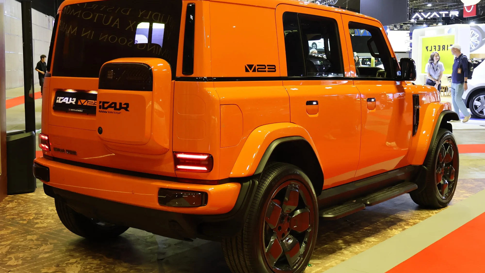

**iCAUR**, another of the **Chery Group's** new brands, opened reservations in Colombia in September 2026. Its first electric model is the **V23**, a square-lined off-roader reminiscent of classic 4x4s, with an entry price below COP 100 million. Colombia was also chosen for the brand's regional launch. It is imported by **Grupo Vardí**.

## The essentials

- **V23 4x2:** COP 94,990,000.
- **V23 4x4:** COP 110,990,000.
- **Battery:** CATL, 59.93 kWh in the 4x2 and 81.8 kWh in the 4x4.
- **WLTP range:** 295 km (183 miles) in the 4x2 and 355 km (221 miles) in the 4x4.
- **Airbags:** 4 in both versions.
- **Battery and electric system warranty:** 8 years or 200,000 km (124,000 miles).
- **Reservation:** COP 1,000,000 online; first deliveries in November 2026.

## The two versions

| | V23 4x2 | V23 4x4 |
|---|---|---|
| Price | COP 94,990,000 | COP 110,990,000 |
| Drive | Rear | All-wheel, one motor per axle |
| Power | 134 hp | 208 hp |
| Battery | 59.93 kWh, LFP | 81.8 kWh, NMC |
| NEDC / WLTP range | 350 / 295 km (217 / 183 miles) | 420 / 355 km (261 / 221 miles) |
| Fast charging, 20% to 80% | 26 min, up to 85 kW | 26 min, up to 104 kW |
| Connector | Type 2 and CCS2 | Type 2 and CCS2 |

The two range figures show the difference between cycles well: WLTP sits about 55 to 65 km (34 to 40 miles) below NEDC. For a boxy car like this one, with high air resistance, WLTP is the figure to use.

*The square shape, inspired by traditional off-roaders, is also clear from behind. Photo: S5A-0043, CC BY 4.0, cropped, via Wikimedia Commons.*

## The V27, with a range extender

iCAUR also launched the larger **V27**, priced at COP 133,990,000 (4x2) and COP 148,990,000 (4x4). It is not a pure EV: it is **range-extended**, with a gasoline engine that generates electricity for the battery.

## The weak point: safety

This is where the V23 falls below rivals at a similar price:

- Only **four airbags** (two front and two side), with no curtain airbags.
- **No version has autonomous emergency braking, lane keeping or adaptive cruise.**
- The 4x4 adds a 540° camera, forward collision warning, blind spot and cross-traffic alert. These are alerts: they warn, but they do not brake or correct.

At a similar price, the **Kia EV2** (COP 89.99 million), the **new BYD Dolphin** (COP 89.99 million) or the **Arcfox T1** (COP 99.99 million) have standard autonomous braking.

The V23 is a purchase for style and for the top version's 4x4 traction, not for active safety. If you will use it mainly in the city, compare the driver assistance equipment first.

## Frequently asked questions

### How much does the iCAUR V23 cost in Colombia?

COP 94,990,000 for the 4x2 and COP 110,990,000 for the 4x4, according to launch prices. Some media published COP 95,990,000 for the 4x2 before the official event, so confirm the current price on the brand's website.

### Does it have autonomous braking?

No. Neither version has it.

### What range does it have?

295 km (183 miles) WLTP for the 4x2 and 355 km (221 miles) WLTP for the 4x4.

### Who imports iCAUR?

Grupo Vardí.

Compare electric SUVs in the [Mejor Eléctrico comparison tool](/es/comparador/?a=chery-icar-03-allroad-iwd-2025-co&b=kia-ev2-air-2026-co).

---

**Sources:** [El Carro Colombiano: iCAUR V23 in Colombia](https://www.elcarrocolombiano.com/lanzamientos/icaur-v23-colombia-precio-versiones-datos-campero-electrico/) · [Revista Autosmás: regional launch in Colombia](https://revistaautosmas.com/2026/09/18/colombiaescenario-del-lanzamiento-regional-de-icaur-con-los-v23-y-v27/) · [Enter.co: prices and reservations](https://www.enter.co/chips-bits/gadgets/icaur-llega-a-colombia-con-suv-electricos-desde-94-990-000-precios-y-como-reservar/)
