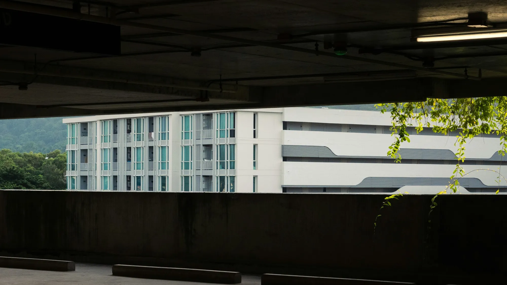

It is the number one problem for anyone living in an apartment who wants an EV: the car is paid for, but the building management says the charger cannot be installed. EV owners' groups repeat the same stories of assemblies denying the request. The law does not give a yes or no answer: it gives a procedure.

## First: whose parking space is it?

Everything depends on how it appears in the deed and in the condominium bylaws:

| Parking type | Who decides | What the complex can do |
|---|---|---|
| **Private property** (with its own property registration) | The owner, complying with the bylaws | Regulate the installation, but not ban it |
| **Common property for exclusive use** | The assembly, if the work modifies common areas | Approve or deny according to the majorities in the bylaws |

Lawyers consulted by the business press agree that a complex **cannot ban** a charger in a private parking space, although it can require safety conditions, an electrical design and insurance.

## When it has to go to the assembly

Colombia's Ministry of Housing explained in a legal opinion that any alteration of common areas, such as conduits or wiring running through the complex, is governed by **Law 675 of 2001**. Those works need approval by the assembly with **at least 70% of the ownership shares**.

If the assembly decides against you and you consider that the decision violates the law or the bylaws, article 49 of the same law allows you to **challenge it before a judge** within the following two months.

*Many buildings built before 2019 have no electrical supply for chargers, and the work crosses common areas. Photo: set.sj on Unsplash.*

## New buildings: Law 1964 does require it

Article 10 of **Law 1964 of 2019** requires residential and commercial buildings whose construction license was filed after the law took effect to have an **electrical supply for charging** vehicles. The developer must leave the infrastructure ready.

Older buildings have no such obligation, and the law does not require the complex to pay for chargers either. Whoever installs one bears the cost of the work and the energy.

## How to submit the request

1. **Check the bylaws** and the deed to find out whether the parking space is private or common.
2. **Get an electrical design** signed by a licensed electrician. It must say where the power comes from, where the cable runs and what the maximum load is.
3. **Propose an independent meter** or a system that bills consumption to your account. Law 1964 asks that charging access allow the owner to bear the cost.
4. **File the request in writing** with the management, with the design, the charger's spec sheet and insurance if the bylaws require it.
5. **If it touches common areas**, ask for the topic to go on the agenda of the next assembly.

> A point in your favor at the assembly: propose that the conduit be left ready for other neighbors to connect later. It turns your request into an improvement for the building.

## Frequently asked questions

### Can I plug the car into the parking space outlet?

Only if that outlet is connected to your own meter. Using a common area outlet without authorization charges your consumption to the co-owners.

### How much does installation cost in a complex?

The utility Enel estimated about COP 3 million for a home charger, but in buildings the cost rises if wiring has to come from far from the meter. Get a quote before starting the work.

### Do I need a building permit?

It depends on the work. The Ministry of Housing says a minor repair does not need one, but a significant modification of the building may need a modification license.

Check how long each model takes to charge in the [Mejor Eléctrico comparison tool](/es/comparador/).

*This article is for information only and does not replace advice from a lawyer.*

---

**Sources:** [Ministry of Housing: installing chargers in condominiums](https://www.minvivienda.gov.co/sites/default/files/conceptos_juridicos/instalacion-cargador-vehiculos-electricos-en-ph.pdf) · [Asuntos Legales: basics of installing a charger in your complex](https://www.asuntoslegales.com.co/consumidor/abc-para-instalar-cargador-vehicular-en-su-conjunto-4380717) · [RCN Radio: what the condominium law says](https://newsroom.rcnradio.com/colombia/como-pedir-la-instalacion-de-un-cargador-para-carro-electrico-en-un-conjunto-residencial-en-colombia-esto-dice-la-ley) · [Vivienda.com.co: 70% majority](https://vivienda.com.co/cargadores-electricos-en-propiedad-horizontal/) · [Law 1964 of 2019](https://www.alcaldiabogota.gov.co/sisjur/normas/Norma1.jsp?i=85510)
