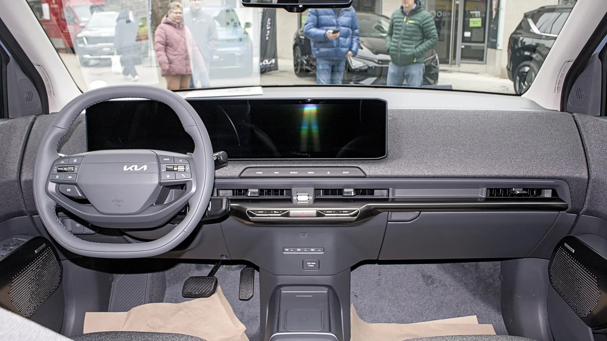

In June 2026, Kia put the **EV2** on sale in Colombia, its smallest electric SUV and, for now, the brand's cheapest in the country. It comes in a single trim, **Air**, for **COP 89,990,000**, to compete in the segment of the Chery E5, the BYD Yuan Up and several Chinese urban SUVs.

## The essentials

- **Price:** COP 89,990,000, Air trim.
- **Battery:** 42.2 kWh LFP.
- **Range:** 312 km (194 miles) on the WLTP cycle.
- **Motor:** 145 hp and 250 Nm, front-wheel drive.
- **Fast charging:** from 10% to 80% in 29 minutes.
- **Warranty:** 8 years or 160,000 km (99,000 miles).

## Range and charging

The EV2's 312 km (194 miles) is measured on **WLTP**, the most realistic of the cycles brands publish. That matters when comparing it: a rival advertising 400 km (249 miles) on the NEDC or CLTC cycle may deliver the same or less in real life. We explain this in our [article on range cycles](/es/notas/autonomia-electricos-cltc-nedc-wltp-como-leerla/).

For charging, the EV2 accepts up to **11 kW on AC**, which gives a full charge in about **4.1 hours** on a suitable wall charger. For fast charging, compatibility of up to 350 kW is advertised, with **29 minutes from 10% to 80%**.

A key detail for Colombia: the local version uses **Type 1 and CCS1 connectors**, the US standard, not the Type 2 and CCS2 that the interoperability rule proposes as the minimum at charging stations. It is worth checking which stations you have nearby.

*The EV2's dashboard joins the instrument cluster and the 12.3-inch central screen. Photo: Alexander Migl, CC BY-SA 4.0, cropped, via Wikimedia Commons.*

## Equipment and safety

For its price, the EV2 is well equipped with driver assistance:

- **Seven airbags**, stability and traction control, Isofix.
- **Autonomous emergency braking**, forward collision warning, lane keeping and lane following, and adaptive cruise control.
- 12.3-inch screen with **wireless Android Auto and Apple CarPlay**, wireless charger, dual-zone climate control and keyless entry.

What it lacks: **blind spot sensor and 360° camera**.

## Specs

| Item | Value |
|---|---|
| Length | 4.06 m |
| Width | 1.80 m |
| Height | 1.57 m |
| Wheelbase | 2.56 m |
| Ground clearance | 14.6 cm |
| Weight | 1,625 kg |
| Power | 145 hp |
| Torque | 250 Nm |
| 0 to 100 km/h | 8.7 seconds |
| Top speed | 161 km/h |
| Battery | 42.2 kWh, LFP |
| WLTP range | 312 km (194 miles) |
| AC charging | Up to 11 kW, 4.1 hours |
| DC charging | 10% to 80% in 29 minutes |
| Connector | Type 1 and CCS1 |
| Trunk | 362 liters; 1,201 with the seats folded; 15 liters up front |
| Warranty | 8 years or 160,000 km (99,000 miles) |

## Against its rivals

Against the **Chery E5**, which starts at COP 79.9 million, the EV2 is smaller, more expensive and has less range, but it offers driver assistance from its single trim and the backing of a wide dealer network. The entry E5 has no advanced driver assistance.

> Who it makes sense for: an urban buyer who values the brand, the service network and active safety more than size or range.

## Frequently asked questions

### How much does the Kia EV2 cost in Colombia?

COP 89,990,000 in its Air trim, the only one available at launch.

### How much range does it have?

312 km (194 miles) on the WLTP cycle.

### How long does it take to charge?

About 4.1 hours on an 11 kW charger, and 29 minutes from 10% to 80% on fast charging.

### Does it have tax benefits?

As an EV, it pays 5% VAT and can qualify for the VAT refund and the income tax deduction with a certificate from the UPME, Colombia's energy planning unit.

Compare it with the Chery E5 or the BYD Yuan Up in the [Mejor Eléctrico comparison tool](/es/comparador/).

---

**Sources:** [El Carro Colombiano: Kia EV2 in Colombia](https://www.elcarrocolombiano.com/lanzamientos/kia-ev2-colombia-precio-caracteristicas-suv-electrico/) · [El Carro Colombiano: Chery E5](https://www.elcarrocolombiano.com/resenas/chery-e5-primer-contacto-suv-electrica-precio-colombia/)
