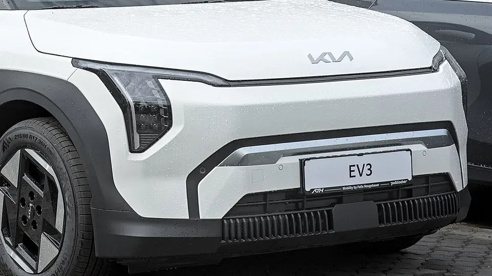

Many stories say the **Kia EV3** has five **Euro NCAP** stars. That is only half true. The rating published on May 21, 2025 has two results: **four stars with standard equipment** and **five stars with the optional driver assistance pack**, which Kia calls DriveWise. The difference comes down to a single score.

## Key facts

- **Rating:** 4 stars as standard, 5 with the driver assistance pack.
- **Tested version:** 150 kW (201 hp), 58.3 kWh battery, front-wheel drive, 1,790 kg. The rating also covers the 81.4 kWh battery.
- **Adult occupant protection:** 83%.
- **Child occupant protection:** 84%.
- **Vulnerable road users:** 77%.
- **Safety assist, standard equipment:** 67%.

## Why it stopped at four stars

Euro NCAP requires a minimum in each of its four areas to award five stars. In safety assist, the floor is **70%**. The EV3 with standard equipment scored **67%**, so it lost the fifth star even though it did well in the crash tests.

The weakest point was **autonomous emergency braking against other cars**: 5.3 out of 9, rated adequate. With the optional pack, Euro NCAP recorded better responses at junctions and with cyclists approaching from behind, and that was enough for the fifth star.

*The EV3 is built on a variant of Kia and Hyundai's electric platform. Photo: Alexander Migl, CC BY-SA 4.0, cropped, via Wikimedia Commons.*

## The crash tests

| Test | Result |
|---|---|
| Frontal, mobile barrier | Stable passenger compartment, but femur loads exceeded the limit and the driver's head could hit the steering wheel |
| Frontal, full-width rigid wall | Good protection for the driver and the rear passenger |
| Side impact against another vehicle | Maximum score |
| Side pole impact | Marginal chest protection |
| Whiplash | Good front, marginal rear |

The airbag finding stands out most: Euro NCAP noted that **the driver's airbag did not have enough pressure** and that the head could make contact with the steering wheel, so it downgraded that rating to adequate.

## Children and pedestrians

In the crash tests with child dummies it scored **23.6 out of 24**, and every child seat tested fitted correctly. What cost it points is that it **does not have standard child presence detection** in the cabin.

For pedestrians, head protection ranged from adequate to marginal over most of the hood, and was poor on the windshield pillars. Autonomous braking for pedestrians was adequate (5.4 out of 9) and for cyclists, good (7.5 out of 8).

## What to ask in Colombia

Kia sells the EV3 in Colombia in the **Light** trim, with the 58.3 kWh battery, and the **Light+**, with the 81.4 kWh pack. Both have six airbags. At launch, Kia mentioned forward collision warning, lane keeping assist, lane change warning and driver fatigue warning, but did not specify whether it includes the same autonomous braking as the European pack.

> Before buying, ask the dealer for the trim's list of driver assistance systems and compare it with the European DriveWise pack. That determines whether your EV3 is closer to the four-star or the five-star car.

## Frequently asked questions

### Does the Kia EV3 have five Euro NCAP stars?

Only with the optional driver assistance pack. With standard equipment it has four stars.

### Why did it lose the fifth star?

Because it scored 67% in safety assist and the minimum for five stars is 70%.

### Is it unsafe in a crash?

No. It scored 83% in adult protection and 84% for children, both above the five-star minimum. The difference lies in the systems that help avoid a crash.

Compare the EV3 with other electric SUVs in the [Mejor Eléctrico comparison tool](/es/comparador/?a=kia-ev3-long-range-2026-eu&b=volvo-ex30-p5-2026-eu).

---

**Sources:** [Euro NCAP: Kia EV3, 2025 rating](https://www.euroncap.com/en/results/kia/ev3/54845) · [Euro NCAP: EV3 test datasheet](https://cdn.euroncap.com/media/87655/euroncap-2025-kia-ev3-datasheet.pdf) · [Xataka Colombia: Kia EV3 in Colombia](https://www.xataka.com.co/vehiculos/esta-colombia-vehiculo-electrico-kia-ev3-suv-que-puede-llegar-605-km-autonomia-caracteristicas-precio)
