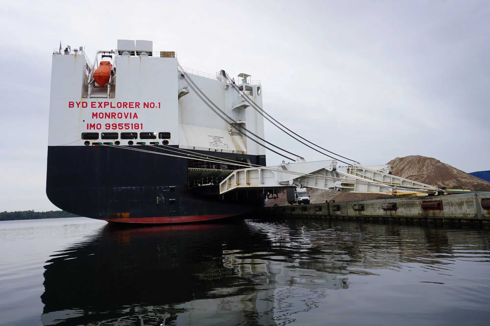

Latin America crossed a symbolic figure in 2026: **more than a million EVs and plug-in hybrids** on the road, 1,016,034 as of June, according to the Latin American and Caribbean Energy Organization (Olade). In 2020 there were 17,541. In the first half of 2026 alone, **285,785** were added, and these cars are now **10% of light vehicle sales** in the region.

## The fastest-growing countries

| Country | Annual sales growth, first half of 2026 |
|---|---|
| Argentina | +873% |
| Ecuador | +261% |
| Colombia | +236% |
| Brazil | +193% |
| Uruguay | +151% |

Growth in sales of EVs and plug-in hybrids against the same period of 2025, according to Olade.

The highest percentages usually come from markets starting from very little. Argentina multiplied its sales almost tenfold, but in June 2026 it registered 865 EVs in the whole month. **Colombia's** case is different: it is growing 236% on a base that was already the region's third largest.

## The size of each market

To compare volume, the most complete reference is 2025, with all electrified cars, including EVs and hybrids:

| Country | Electrified cars sold in 2025 | Growth against 2024 |
|---|---|---|
| Brazil | 278,462 | +56.4% |
| Mexico | 147,110 | +17.3% |
| Colombia | 87,677 | +69% |
| Chile | 37,544 | +92.3% |
| Ecuador | 22,646 | +56.1% |
| Uruguay | 20,585 | +107.2% |
| Costa Rica | 14,058 | −0.4% |
| Peru | 10,239 | +54.1% |

Figures published by Bloomberg Línea based on a regional report cited by Aconauto.

*BYD has its own fleet of ships to carry cars from China. Photo: Ein Dahmer, CC BY-SA 4.0, via Wikimedia Commons.*

## What is happening inside each country

**Brazil** has more than 580,000 EVs on the road, more than half of the region. In June 2026, the three best-selling cars in retail were electric: the BYD Dolphin Mini, BYD Dolphin and Geely EX2. Something similar happened in Colombia in September, when the Tesla Model Y was the best-selling car in the country across all technologies.

**Mexico** sold 53,430 plug-in and range-extended electrified cars in the first half of 2026, 22% more than a year earlier, according to the Electro Movilidad Asociación. The mix differs from Colombia's: **plug-in hybrids** (31,063) outnumber **pure EVs** (22,236). BYD took 35.7% of all hybrids and EVs sold in the half.

**Colombia** registered **39,784 EVs** between January and September 2026, 221.7% more than in the same period of 2025, and in September they were 17.4% of the country's new cars. Tesla holds four out of ten. The detail is in [how September closed](/es/notas/ventas-carros-electricos-colombia-septiembre-2026/).

**Argentina** is the Dolphin Mini's market: in September 2026 it accounted for 495 of the EVs registered, 57.2% of the total.

## What explains the jump

Each country has its own explanation. In Colombia, tax benefits weigh in, such as 5% VAT for EVs, along with the arrival in the past year of Tesla and a long list of Chinese brands. Brazil is going the other way on taxes: in July 2026 it raised the tariff on imported EVs to 35% to push local production. Its first-half sales, before that increase, almost tripled. We report on it in [this article](/es/notas/brasil-arancel-carros-electricos-importados-35-por-ciento/).

## Frequently asked questions

### How many EVs are sold in Latin America?

Between January and June 2026, 285,785 EVs and plug-in hybrids, 10% of light vehicle sales.

### Which Latin American country sells the most EVs?

Brazil, with more than half of the region's EV fleet.

### Is Colombia the regional leader in EVs?

It is the third market by volume of electrified cars, behind Brazil and Mexico, and one of the fastest growing.

---

**Sources:** [Forbes Perú: Latin America passes a million EVs, Olade data](https://forbes.pe/negocios/2026-09-22/latinoamerica-supera-el-millon-de-vehiculos-electricos-con-mas-de-la-mitad-en-brasil/) · [Bloomberg Línea: electrified sales by country in 2025](https://www.bloomberglinea.com/2026/02/11/los-paises-lideres-en-ventas-de-autos-electricos-y-estaciones-de-carga-en-latinoamerica/) · [UnoTV: Mexico's electromobility barometer](https://www.unotv.com/negocios/mexico-rompe-record-en-ventas-de-autos-electricos-en-el-primer-semestre-de-2026/) · [El CEO: BYD in Mexico](https://elceo.com/negocios/byd-vende-4-de-cada-10-autos-hibridos-y-electricos-en-mexico/) · [Webmotors: best sellers in Brazil in June 2026](https://www.webmotors.com.br/wm1/noticias/3-carros-eletricos-dominam-vendas-varejo) · [Ámbito: EVs in Argentina, June 2026](https://www.ambito.com/autos/los-electricos-avanzan-el-pais-fuerte-dominio-ventas-y-un-lider-indiscutido-n6294766) · [Autotest: the Dolphin Mini in Argentina](https://autotest.com.ar/noticias/byd-dolphin-mini-cuanto-cuesta-y-que-ofrece-el-auto-electrico-mas-vendido-en-septiembre-2026/) · [Portafolio: EVs in Colombia in September 2026](https://www.portafolio.co/negocios/vehiculo/tesla-domina-los-electricos-mas-vendidos-en-colombia-concentro-41-3-de-las-matriculas-durante-septiembre-504120)
