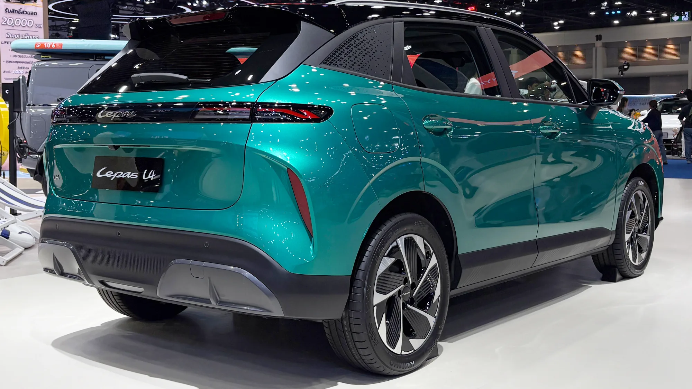

The **Chery Group**, which already sells the Chery E5, the iCar models and the Tiggo in Colombia, is adding another brand: **Lepas**. According to El Carro Colombiano, it will arrive in the **fourth quarter of 2026**, around the Bogotá Auto Show. The importer has not been announced yet.

## The essentials

- **Group:** Chery. Lepas was unveiled in October 2024 and went on sale worldwide in April 2025.
- **Arrival in Colombia:** fourth quarter of 2026.
- **Importer:** to be announced.
- **Models:** L4 (electric), L6 (electric or plug-in hybrid) and L8 (plug-in hybrid).
- **Prices:** not announced.

## The models

| Model | Type | Power | Battery | Range |
|---|---|---|---|---|
| L4 EV | Urban electric SUV, 4.42 m | 215 hp | 67 kWh LFP | Up to 450 km (280 miles) WLTP |
| L6 EV | Electric SUV | 242 hp | 67.1 kWh LFP | Up to 450 km (280 miles) WLTP |
| L6 plug-in hybrid | SUV | 279 hp combined | No data | About 90 km (56 miles) electric and over 1,100 km (684 miles) in total |
| L8 | Plug-in hybrid SUV, 4.69 m | 279 hp combined | No data | Over 1,300 km (808 miles) in total |

The EVs' range being stated on the **WLTP** cycle is good news: it is more realistic than the NEDC or CLTC cycles many Chinese brands publish.

*The L4 is built on the Chery Group's LEX platform. Photo: Andra Febrian, CC BY 4.0, cropped, via Wikimedia Commons.*

## Why so many Chery brands?

Lepas is not the only one. **iCAUR** (on sale since September), **Jaecoo**, **Omoda** and **Soueast**, all from the Chery Group, are also expected around the Show. Lepas sits on a rung the group calls semi-premium, above Chery, while iCAUR targets adventure-style off-roaders.

The strategy is working for Chery in Colombia: between January and September 2026 it sold **2,518 EVs**, **527.9% more** than a year earlier, and it is the country's third-largest EV brand.

For buyers, the key question with these sub-brands is who provides service. If they share workshops and parts with Chery, the risk is lower than with a fully independent brand.

## Frequently asked questions

### What is Lepas?

A Chery Group brand of electric and plug-in hybrid SUVs, launched in 2025.

### When does it reach Colombia?

In the fourth quarter of 2026, around the Bogotá Auto Show.

### How much will it cost?

Prices for Colombia have not been announced.

Compare it with the Chery models already sold in the country in the [Mejor Eléctrico comparison tool](/es/comparador/?a=chery-e5-luxury-2026-co&b=chery-icar-03-allroad-iwd-2025-co).

---

**Sources:** [El Carro Colombiano: Lepas reaches Colombia](https://www.elcarrocolombiano.com/industria/lepas-nueva-marca-suv-electricos-hibridos-llegada-colombia/) · [El Carro Colombiano: new brands at the 2026 Show](https://www.elcarrocolombiano.com/lanzamientos/carros-nuevas-marcas-vienen-colombia-salon-del-automovil-bogota-2026/) · [Infobae: EVs from January to September 2026](https://www.infobae.com/colombia/2026/10/10/crece-la-venta-de-vehiculos-electricos-en-colombia-cerca-de-40000-automotores-en-lo-corrido-del-2026/)
