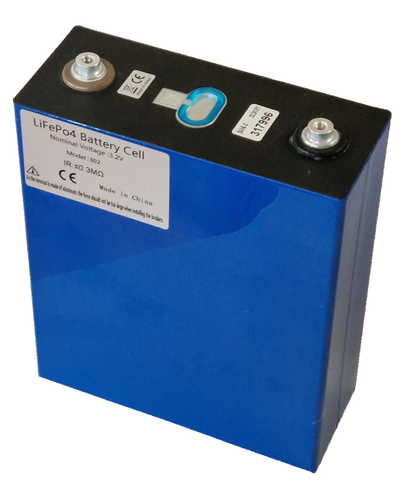

Almost every electric car sold in Latin America uses one of two chemistries: **LFP** (lithium iron phosphate) or **NMC** (nickel manganese cobalt). A third one, **sodium-ion**, started going into passenger cars in 2026. The spec sheet rarely highlights it, but it changes three things an owner cares about: weight, the right way to charge and price.

## The differences in one table

| | LFP | NMC | Sodium-ion |
|---|---|---|---|
| Energy per kilo | Lower | About 30% more per cell; 5% to 20% more at the full pack level | Up to 175 Wh/kg according to CATL, close to an LFP |
| Average pack price in 2025 | US$81 per kWh | US$128 per kWh | No comparable public figure |
| Recommended daily charge | Up to 100% at several manufacturers | Usually up to 80% or 90% | No published recommendations yet |
| Where you find it | Chery E5, Kia EV2, BYD, entry-level Model 3 | High-end and long-range EVs | First Changan models in China |

The prices come from BloombergNEF; the energy differences, from a McKinsey analysis. The sodium-ion column relies on figures from CATL, the world's largest battery maker, which have not yet been confirmed by independent testing in production cars.

*An LFP cell from CATL. This chemistry uses neither nickel nor cobalt, which is why it is the cheapest. Photo: Aeroid, CC BY-SA 4.0, via Wikimedia Commons.*

## LFP: the battery behind cheaper EVs

LFP uses no nickel or cobalt, the two most expensive metals in a battery and the ones with the most supply problems. That is why it costs less: according to BloombergNEF, an LFP pack averaged **US$81 per kWh** in 2025, against **US$128** for an NMC pack. In a 60 kWh battery, the difference comes to around US$2,800 on the battery pack alone.

That is one of the reasons mid-priced Chinese EVs reach Latin America with LFP, and why its share of electric passenger cars in China rose from 45% in 2021 to 60% in 2023.

The downside is weight. For the same range, an LFP needs more cells. McKinsey illustrates it with the Tesla Model 3: the 55 kWh LFP version covers about 450 km (280 miles) WLTP, and the 82 kWh NMC version about 630 km (391 miles).

There is a practical advantage many owners do not know about: **LFP handles charging to 100% better**. Tesla, for example, recommends that owners of the LFP Model 3 leave the charge limit at 100%, even for daily use, and fill the battery completely at least once a week so the car estimates its range correctly. With an NMC, the usual advice is to stay at 80% or 90% except before a long trip.

## NMC: more range per kilo, at a higher price

NMC stores more energy in the same space. That is why it goes into cars chasing ranges of 600 km (373 miles) or more without carrying a huge battery, and into sports cars, where every kilo counts. In return it is more expensive and depends on metals whose prices swing a lot.

Some brands use their own blends. The Chevrolet Equinox EV sold in Colombia, for example, lists an NMCA chemistry, which adds aluminum.

## Sodium-ion: arriving in 2026

In February 2026, CATL and Changan presented what they describe as the first mass-production passenger car with a sodium-ion battery, with a launch in the Chinese market planned for mid-year. According to CATL, its Naxtra battery stores up to **175 Wh/kg**, a density similar to an LFP, and a 45 kWh pack gives about **400 km (249 miles)** of range. Where it pulls furthest ahead is in the cold: it keeps more than **90% of its capacity at −40 °C** and, at −30 °C, delivers almost three times the power of an equivalent LFP.

Sodium is abundant and cheap, and it does not depend on lithium. Its big selling point is cold-weather performance, which matters less in most of Latin America than in northern China. What could help the region most is something else: if sodium-ion lowers the cost of small batteries, electric city cars could get cheaper. For now, no model with a sodium-ion battery has been announced for Latin America.

## How to tell which battery a car has

The brand's spec sheet usually says so on the battery line: "LFP", "lithium iron phosphate", "lithium ferrophosphate" or "Blade", BYD's trade name for its LFP battery. If it says "ternary" or "NCM", it belongs to the NMC family. In the [comparator](/es/comparador/), the chemistry appears on each trim's spec sheet when the brand publishes it.

## Frequently asked questions

### Which battery lasts longer, LFP or NMC?

LFP usually withstands more charge cycles before degrading, but real-world lifespan depends more on how the car is used and on thermal management than on chemistry. Warranties do not change by chemistry either: most brands cover the battery for eight years.

### Can I charge my LFP battery to 100% every day?

Several manufacturers recommend it, Tesla among them. Check your car's owner's manual, because the brand's instruction is the one that counts for the warranty.

### Are there cars with sodium-ion batteries in Latin America yet?

Not as of October 2026. The first ones went on sale in China.

---

**Sources:** [BloombergNEF: battery prices in 2025](https://about.bnef.com/insights/clean-transport/lithium-ion-battery-pack-prices-fall-to-108-per-kilowatt-hour-despite-rising-metal-prices-bloombergnef/) · [McKinsey: the battery chemistries powering EVs](https://www.mckinsey.com.br/industries/automotive-and-assembly/our-insights/the-battery-chemistries-powering-the-future-of-electric-vehicles) · [CnEVPost: CATL and Changan, first car with a sodium-ion battery](https://cnevpost.com/2026/02/05/catl-sodium-batteries-begin-deployment-in-production-passenger-vehicles/) · [InsideEVs: Tesla's charging recommendation for LFP](https://insideevs.com/news/557527/tesla-model3-lfp-charging-recommendations/) · [El Carro Colombiano: Chevrolet Equinox EV in Colombia](https://www.elcarrocolombiano.com/lanzamientos/chevrolet-equinox-ev-colombia-precio-datos-respuesta-americana-a-byd/)
