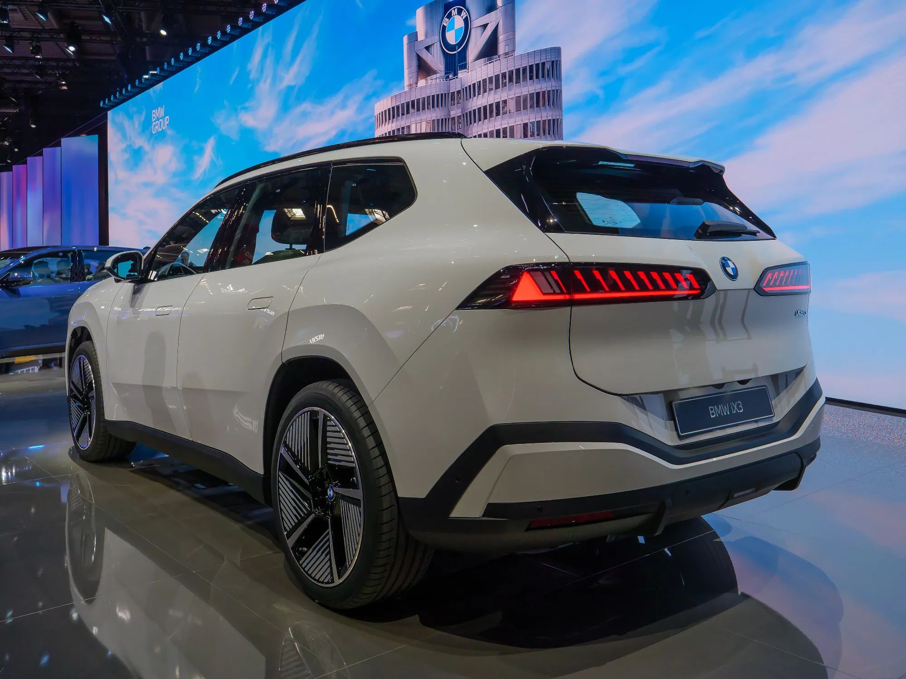

The electric car with the longest certified range in the world in 2026 is the **Lucid Air Grand Touring**, at **960 km (597 miles) WLTP**. Behind it come the **Mercedes EQS 450+**, at 920 km (572 miles), and the **BMW i3 50 xDrive**, BMW's new electric sedan, at 906 km (563 miles).

## The top ten by WLTP range

| Rank | Model and version | WLTP range |
|---|---|---|
| 1 | Lucid Air Grand Touring | 960 km (597 miles) |
| 2 | Mercedes-Benz EQS 450+ (800-volt version) | 920 km (572 miles) |
| 3 | BMW i3 50 xDrive First Edition | 906 km (563 miles) |
| 4 | BMW iX3 50 xDrive | 805 km (500 miles) |
| 5 | Mercedes-Benz CLA 250+ | 792 km (492 miles) |
| 6 | Audi A6 Sportback e-tron Performance | 777 km (483 miles) |
| 7 | Mercedes-Benz electric C-Class C 400 4Matic | 753 km (468 miles) |
| 8 | Tesla Model 3 Premium Long Range RWD | 750 km (466 miles) |
| 9 | DS N°8 FWD Long Range | 749 km (465 miles) |
| 10 | Lucid Gravity Grand Touring | 748 km (465 miles) |

Ranking published in July 2026 by the German site Elektroquatsch, using European type-approval figures.

Seven of the ten are sedans or low-roof cars. That is no coincidence: above 100 km/h, air resistance is what consumes the most energy, and a long, low body reduces it. An SUV with the same battery covers less distance.

*The new BMW iX3 50 xDrive reaches 805 km WLTP, the highest figure for an SUV in the ranking. Photo: Matti Blume, CC BY-SA 4.0, via Wikimedia Commons.*

## Why these figures don't hold up on the road

The WLTP cycle mixes city, rural-road and highway driving at moderate speeds and at around 23 °C. In real conditions the figure drops, especially on the highway, with the air conditioning on or with a lot of climbing. In Colombia, mountains matter more than climate: a long climb uses a lot of energy, and the descent only recovers part of it. The details are in [real-world range in Colombia](/es/notas/autonomia-real-carro-electrico-colombia-montana-autopista/).

These figures shouldn't be compared with those on Chinese spec sheets either. A **CLTC** range is almost always higher than the WLTP figure for the same car, and so is **NEDC**. Only compare figures from the same cycle, as we explain in [CLTC, NEDC or WLTP](/es/notas/autonomia-electricos-cltc-nedc-wltp-como-leerla/).

## Range of the electric cars sold in Colombia

Most of the top ten are not sold in Colombia, or not in the version listed. These are the published WLTP ranges for some of the EVs on the Colombian market:

| Model and version in Colombia | Published WLTP range |
|---|---|
| Chevrolet Equinox EV LT AWD | 552 km (343 miles) |
| Geely EX5 Pro and Max | 425 km (264 miles) |
| Chery E5 | 350 km (217 miles) |
| Geely EX5 SE | 345 km (214 miles) |
| Chevrolet Captiva EV | 318 km (198 miles) |
| Kia EV2 Air | 312 km (194 miles) |
| Chevrolet Spark EUV | 298 km (185 miles) |

Several brands publish only the NEDC or CLTC figure in Colombia, so not every model on the market can be included in this table.

> If you drive 40 km (25 miles) a day in the city, a car with 300 km (186 miles) of WLTP range needs charging once or twice a week. Paying for 600 km (373 miles) only makes sense if you take long trips often and have nowhere to charge along the way.

## Frequently asked questions

### Which electric car has the longest range?

The Lucid Air Grand Touring, at 960 km (597 miles) WLTP, according to the July 2026 ranking.

### Which electric car has the longest range in Colombia?

Among models with a published WLTP figure in Colombia, the Chevrolet Equinox EV, at 552 km (343 miles).

### How much does range drop on the highway?

It depends on the car, the speed, the temperature and the gradient. The most reliable reference is the real-world range tests that the specialist press publishes for each model.

---

**Sources:** [Elektroquatsch: 2026 WLTP range ranking](https://www.elektroquatsch.de/artikel/reichweiten-ranking-2026-drei-e-autos-ueber-900-km-wltp-lucid-eqs-bmw-i3) · [El Carro Colombiano: Chevrolet Equinox EV in Colombia](https://www.elcarrocolombiano.com/lanzamientos/chevrolet-equinox-ev-colombia-precio-datos-respuesta-americana-a-byd/) · [El Carro Colombiano: Geely EX5 in Colombia](https://www.elcarrocolombiano.com/lanzamientos/geely-ex5-colombia-precios-datos-suv-electrica-mas-completa-por-su-precio/) · [Portafolio: Geely EX5 SE](https://www.portafolio.co/negocios/vehiculo/nueva-suv-electrica-llega-a-colombia-este-es-el-precio-de-lanzamiento-y-las-caracteristicas-de-la-geely-ex5-se-497330) · [Chevrolet Colombia: Captiva EV](https://www.chevrolet.com.co/vehiculos-electricos/captiva-ev) · [Chevrolet Colombia: Spark EUV](https://www.chevrolet.com.co/vehiculos-electricos/spark-euv) · [Kia Colombia: EV2 Air](https://kia.com.co/nuestros-vehiculos/ev2/especificaciones/air) · [Chery Colombia: E5 spec sheet](https://www.chery.com.co/wp-content/uploads/2026/04/FICHATECNICA_E5_2026_v3.pdf)
