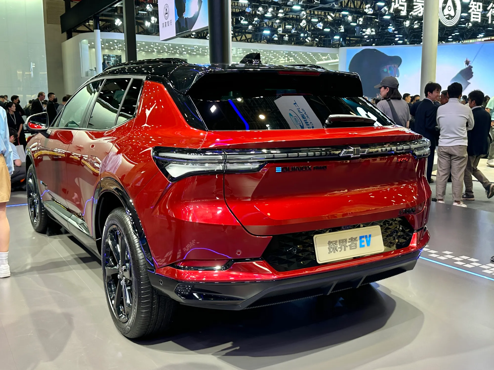

Mexico sold **146,183 electrified cars** between January and September 2026, 45.1% more than in the same period of 2025, according to the Mexican Automotive Industry Association (AMIA) with data from the national statistics institute, INEGI. Two out of three are conventional hybrids, which do not plug in. **Pure EVs** numbered **21,794**, with growth of 41.8%, and **plug-in hybrids** **25,242**, more than triple the figure a year earlier.

## The figures by technology

| Technology | January to September 2026 | Growth against 2025 |
|---|---|---|
| Conventional hybrids | 99,147 | +27.8% |
| Plug-in hybrids | 25,242 | +223.7% |
| Pure EVs | 21,794 | +41.8% |
| Total electrified | 146,183 | +45.1% |

AMIA with INEGI data.

The table shows the big difference with Colombia. In the Colombian market, pure EVs grew 221.7% between January and September, driven by Tesla and by benefits such as 5% VAT. In Mexico, buyers moving to a plug-in car more often choose a **plug-in hybrid**, which can travel without depending on the charging network.

## Why the figures do not always add up

Mexican EV statistics depend on who reports them. The Electro Movilidad Asociación (EMA), which groups several brands, counted **22,236 pure EVs in the first half of 2026 alone**, more than AMIA records in nine months. The most likely explanation is that not all brands report to the same registers. When reading a sales figure in Mexico, it is worth checking the source.

*General Motors sold 157 electric Equinoxes in Mexico in the first half of 2026. Photo: JustAnotherCarDesigner, public domain (CC0), via Wikimedia Commons.*

## BYD, the dominant brand

Between January and June 2026, **BYD sold 33,969 cars** across hybrids, plug-ins and EVs, **35.7%** of the segment total, according to calculations by the Mexican Association of Automotive Distributors (AMDA) published by El CEO. Its entry hatchback is the Dolphin Mini, the same car called the Seagull in Colombia.

The other brands are far behind. In the same half, MG sold 2,499 units of these technologies and Kia 2,212, almost all Sportage hybrids. Changan sold 475, of which 351 were the [range-extended](/es/notas/que-es-un-carro-electrico-de-rango-extendido/) Deepal S07. General Motors sold 157 electric Chevrolet Equinoxes, the same model that in Colombia has one of the highest WLTP ranges on the market.

## Where they sell

**Mexico City** accounted for 34,054 electrified cars between January and September, 23.3% of the national total. The State of Mexico, Nuevo León and Jalisco follow. The concentration resembles Colombia's, where Bogotá and Medellín hold most of the EVs.

## Charging, mostly at home

In June 2026, EMA counted **60,934 charging positions**, 55% more than a year earlier, but **56,279 were private**, in homes and companies. The public network, though it grew fast in 2026, remains a small fraction. Charging at home costs between about 1.8 and 3.5 Mexican pesos per kWh depending on the tariff of CFE, the state power company, as we explain in [how much a charge costs](/es/notas/cuanto-cuesta-una-carga-de-carro-electrico-latinoamerica/).

## Frequently asked questions

### How many electric cars are sold in Mexico?

21,794 pure EVs between January and September 2026, according to AMIA. EMA, with a different set of brands, counts more.

### What is the best-selling EV brand in Mexico?

BYD, with 35.7% of the hybrids, plug-ins and EVs sold in the first half of 2026.

### What sells more in Mexico, EVs or plug-in hybrids?

In 2026, plug-in hybrids: 25,242 against 21,794 pure EVs between January and September.

---

**Sources:** [Líder Empresarial: electrified cars in Mexico through September 2026, AMIA data](https://www.liderempresarial.com/guanajuato-vehiculos-electrificados-ventas-tercer-trimestre-2026/) · [UnoTV: EMA's electromobility barometer](https://www.unotv.com/negocios/mexico-rompe-record-en-ventas-de-autos-electricos-en-el-primer-semestre-de-2026/) · [El CEO: BYD sells 4 out of 10 electrified cars in Mexico](https://elceo.com/negocios/byd-vende-4-de-cada-10-autos-hibridos-y-electricos-en-mexico/) · [Portafolio: EVs in Colombia in September 2026](https://www.portafolio.co/negocios/vehiculo/tesla-domina-los-electricos-mas-vendidos-en-colombia-concentro-41-3-de-las-matriculas-durante-septiembre-504120) · [Motorpasión México: cost of charging in 2026](https://www.motorpasion.com.mx/industria/cuanto-cuesta-cargar-auto-electrico-mexico-2026)
