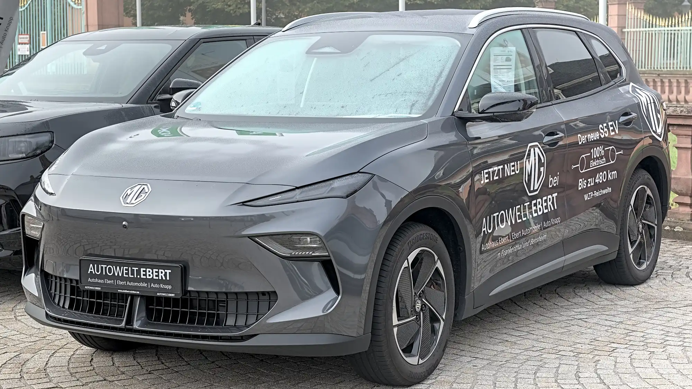

The **MG S5 EV** arrived in Colombia in 2026 with one of the most aggressive prices among electric SUVs, from COP 94.99 million. A low price usually raises the question of where the brand cut costs. On safety, **Euro NCAP**'s answer is not much: it gave the car **five stars** in May 2025, with **90% for adult occupant protection**.

## Key facts

- **Rating:** 5 stars, published in May 2025.
- **Tested version:** single-motor MG S5 EV, two-wheel drive, 1,725 kg.
- **Adult occupant protection:** 90%.
- **Child occupant protection:** 82%.
- **Vulnerable road users:** 82%.
- **Safety assist:** 78%.

## The crash tests

| Test | Result |
|---|---|
| Frontal, mobile barrier | Stable passenger compartment, good knee and leg protection. Dashboard structures on the driver's side pose a risk to some occupants |
| Frontal, full-width rigid wall | Good or adequate for the driver and the rear passenger |
| Side impact against another vehicle | Maximum score |
| Side pole impact | At least adequate for every body region |
| Whiplash | Good front and rear |

Euro NCAP also rated it as **low in aggressiveness toward the other car** in a frontal crash. The concern is the dashboard: some structures on the driver's side could strike the knees of occupants of a different size, and it lost points for that.

*The MG S5 EV arrived in Colombia imported by Los Autos. Photo: Alexander-93, CC BY-SA 4.0, cropped, via Wikimedia Commons.*

## Children and pedestrians

For children, protection was good for the 6-year-old dummy and good or adequate for the 10-year-old in the frontal crash, and good for both in the side impact. What cost it points is that it **has no child presence detection**.

With pedestrians and cyclists, autonomous emergency braking worked very well: 8 out of 9 with pedestrians, 8 out of 8 with cyclists and 6 out of 6 with motorcyclists. Head impacts were good or adequate on the hood and poor on the windshield pillars and edges, as in most cars.

## Driver assistance

| System | Score |
|---|---|
| Autonomous emergency braking, car-to-car | 7.6 out of 9 |
| Lane keeping | 3 out of 3 |
| Lane keeping with motorcycles | 0.5 out of 3 |
| Driver monitor | 0.9 out of 2 |

The driver monitor uses a camera and detects drowsiness, microsleep and sleep, but did not receive the full score. The lane assist barely reacts when the risk is a motorcycle, a result that matters in Colombian cities, where motorcycles are everywhere.

## The S5 in Colombia

In Colombia it is sold in two trims: **Comfort**, from COP 94.99 million, and **Deluxe**, from COP 104.99 million. Both have six airbags and stability control. The MG Pilot driver assistance pack includes autonomous emergency braking, adaptive cruise control, lane keeping, blind spot monitoring, rear cross-traffic alert and a 360° camera, although part of that equipment depends on the trim.

> Before choosing the Comfort on price, check which MG Pilot systems it includes. They earned the S5 a large share of its Euro NCAP score.

## Frequently asked questions

### How many Euro NCAP stars does the MG S5 EV have?

Five stars, published in May 2025.

### What was its weakest point?

The driver monitor (0.9 out of 2), lane assist with motorcycles (0.5 out of 3) and the lack of child presence detection.

### How much does it cost in Colombia?

From COP 94.99 million for the Comfort and COP 104.99 million for the Deluxe, according to 2026 launch prices.

Compare the S5 with the Geely EX5 in the [Mejor Eléctrico comparison tool](/es/comparador/?a=mg-mgs5-ev-64-kwh-2026-eu&b=geely-ex5-se-2026-co).

---

**Sources:** [Euro NCAP: MG S5 EV test datasheet](https://cdn.euroncap.com/media/87623/euroncap-2025-mg-mgs5-ev-datasheet.pdf) · [Portafolio: the S5 EV in Colombia](https://www.portafolio.co/negocios/vehiculo/la-s5-ev-de-la-marca-mg-entro-a-romper-precios-en-el-mercado-489053)
