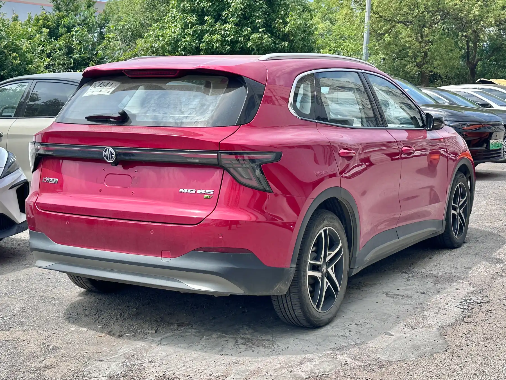

The most serious confirmed problem with the **MG S5 EV** is a **worldwide recall over fire risk**, published in July 2026, that affects **9,806 cars** built between January 22, 2025 and January 29, 2026. The other faults circulating online come from owner forums: they are real for the people who experience them, but there is no data showing how common they are.

The S5 EV is one of the best-selling electric SUVs in Colombia, fourth in EV registrations in September 2026, and it has five stars from Euro NCAP. That makes it worth separating what is confirmed from what is anecdotal.

## The recall: a fan that freezes

According to Germany's Federal Motor Transport Authority (KBA), which oversees the recall in Germany, the problem lies in the **radiator fan**. In very low temperatures the fan can freeze and seize. If the cabin heater is running at that moment, a resistor in the fan controller can overheat and, in the worst case, start a fire.

The KBA received reports of incidents involving property damage or injuries, although it did not say how many. MG's fix is a **software update** to the control unit that prevents overheating under those conditions. In Germany, 1,830 cars are affected.

*MG's fix for the recall is a software update. Photo: JustAnotherCarDesigner, public domain (CC0), via Wikimedia Commons.*

## What it means in Colombia

The fault depends on the fan freezing, which is very unlikely across almost all of Colombia. That does not mean the recall doesn't apply: it is based on build date, not country. If your S5 EV was built between January 2025 and January 2026, ask the dealer whether it is covered by the recall and whether the update has already been installed. The MG S5 EV arrived in Colombia in 2026, so a large share of the units in the country could fall within that range.

In Colombia, the Superintendency of Industry and Commerce (SIC) publishes the vehicle safety campaigns reported in the country on its website, and that is where you can check whether the recall has been registered.

## What owners report on forums

On the MGEVs owner forum, which mostly brings together drivers in the UK and Australia, two complaints come up again and again.

**An intermittent motor fault.** Several owners, about five or six in Australia and one in Malta according to the thread, described sudden power losses when slowing down from highway speed, with a "motor fault" warning on the dashboard. In one case a software update did not fix the problem and the workshop ended up replacing a motor component. These are cars registered between May and June 2025, and MG has not announced a campaign for this issue.

**A power tailgate that doesn't open to the programmed height.** Some owners reported that the tailgate doesn't reach its maximum height or doesn't close properly and triggers a warning on the dashboard. There is no confirmed cause.

A forum is not a statistic. People with a problem post more than people without one, and a handful of cases can look like many. They are useful as a warning to check those points on a test drive and at the first service.

> If you own an S5 EV and it develops a fault, ask the dealer to record it on the work order even if they can't reproduce it that day. That record is what backs a warranty claim if the fault comes back.

## Frequently asked questions

### Does the MG S5 EV have problems?

It is subject to a worldwide recall over fire risk in extreme cold, which is fixed with software. The other known problems are individual owner reports on forums.

### How do I know if my MG S5 EV is part of the recall?

Ask the dealer using the vehicle identification number (VIN). The recall applies to cars built between January 22, 2025 and January 29, 2026.

### Is the MG S5 EV safe?

It has five stars from Euro NCAP, with 90% for adult occupant protection. We explain it in [our safety story](/es/notas/mg-s5-ev-euro-ncap-5-estrellas/).

---

**Sources:** [Electrive: MG recalls the S5 EV over fire risk](https://www.electrive.com/es/2026/07/20/mg-retira-del-mercado-el-s5-ev-debido-a-un-posible-riesgo-de-incendio/) · [MGEVs: thread on MG S5 motor faults](https://www.mgevs.com/posts/435682/) · [MGEVs: thread on tailgate opening](https://www.mgevs.com/threads/brand-new-s5-boot-opening-problems.24252/) · [Portafolio: best-selling EVs in September 2026](https://www.portafolio.co/negocios/vehiculo/tesla-domina-los-electricos-mas-vendidos-en-colombia-concentro-41-3-de-las-matriculas-durante-septiembre-504120) · [Euro NCAP: MG S5 EV test datasheet](https://cdn.euroncap.com/media/87623/euroncap-2025-mg-mgs5-ev-datasheet.pdf)
