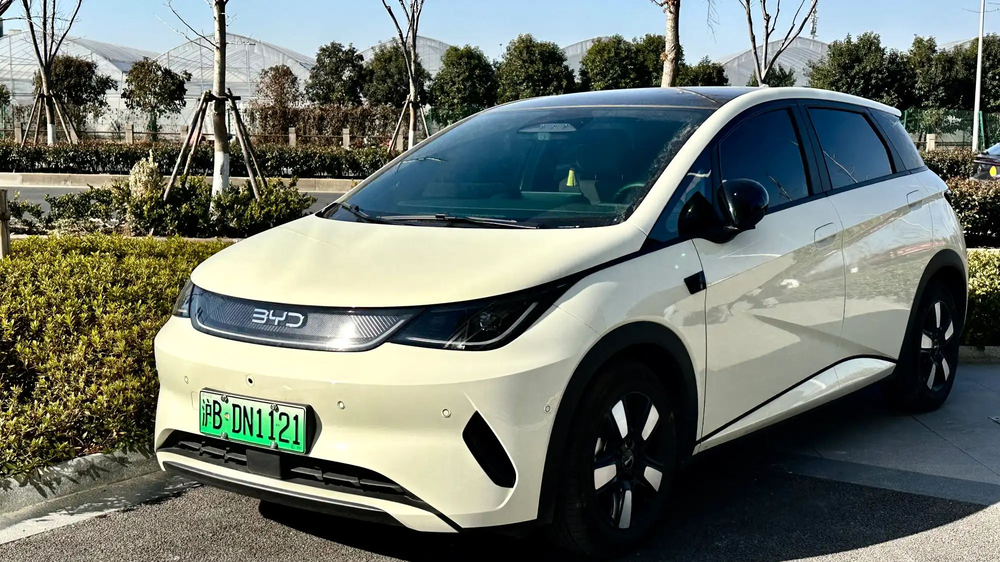

BYD has refreshed the **Dolphin** in Colombia, and the change answers the main criticism of the previous model: it lacked driver assistance. The new Dolphin arrived in a single trim, **GS**, for **COP 89,990,000**, and now has standard autonomous emergency braking, adaptive cruise, lane keeping and a 540° camera. It is distributed by **Motorysa**.

## The essentials

- **Price:** COP 89,990,000, single GS trim.
- **Battery:** 45.1 kWh Blade LFP.
- **Range:** 405 km (252 miles) on the NEDC cycle.
- **Motor:** 174 hp and 290 Nm.
- **Fast charging:** up to 80 kW; from 30% to 80% in about 20 minutes.
- **Warranty:** 6 years or 150,000 km (93,000 miles) for the car and 8 years or 150,000 km (93,000 miles) for the battery.

## What changed from the previous Dolphin

| | Previous Dolphin in Colombia | New Dolphin GS |
|---|---|---|
| Length | 4.12 m | 4.28 m |
| Airbags | 6 | 6 |
| Autonomous emergency braking | No | Yes |
| Adaptive cruise | No | Yes |
| Lane keeping and blind spot | No | Yes |
| Rear suspension | Torsion beam | Independent multi-link |
| Central screen | Rotating | Fixed 12.8-inch, with built-in Google |

The previous Dolphin was at the center of some confusion: in December 2024, Latin NCAP gave five stars to the **Dolphin Plus** sold in Brazil, which did have driver aids, but that rating did not apply to the Colombian Dolphin, which lacked them. We explain it in [our article on that test](/es/notas/byd-dolphin-plus-latin-ncap-5-estrellas/). The new Dolphin closes much of that equipment gap, although no crash test program has evaluated its Colombian version.

*The refreshed Dolphin grew 16 cm and gained a new front end, lights and bumpers. Photo: JustAnotherCarDesigner, public domain (CC0), via Wikimedia Commons.*

## What did not improve

The **trunk** is still small: 250 liters, less than a compact gasoline hatchback's. And range is published on the optimistic **NEDC** cycle; in real use, a prudent estimate is 15% to 20% less.

## Against its rivals

At COP 89.99 million, the Dolphin is priced the same as the **Kia EV2** and above the entry **Chery E5** (COP 79.99 million), which has no driver aids in that trim. Against the EV2, the Dolphin offers more power (174 hp against 145) and a 540° camera, while the Kia has a bigger trunk (362 liters) and range measured on WLTP.

With this change, the Dolphin joins the Kia EV2 among the EVs under COP 90 million with standard autonomous braking.

## Frequently asked questions

### How much does the new BYD Dolphin cost in Colombia?

COP 89,990,000 in its single GS trim.

### Does it have autonomous braking?

Yes. Unlike the previous model, it has autonomous emergency braking, adaptive cruise and lane keeping.

### How much range does it have?

405 km (252 miles) on the NEDC cycle.

### What is the battery warranty?

8 years or 150,000 km (93,000 miles), whichever comes first.

Compare the Dolphin with the Kia EV2 in the [Mejor Eléctrico comparison tool](/es/comparador/?a=byd-dolphin-60-4-kwh-2026-eu&b=kia-ev2-air-2026-co).

---

**Sources:** [El Carro Colombiano: new BYD Dolphin in Colombia](https://www.elcarrocolombiano.com/novedades/byd-dolphin-nuevo-colombia-precio-versiones-caracteristicas-2026/) · [Latin NCAP: BYD Dolphin Plus](https://www.latinncap.com/es/area-de-prensa/noticia/867617e084abbd/byd-dolphin-plus-primer-fabricante-chino-y-primer-auto-electrico-en-lograr-cinco-estrellas-en-latin-ncap)
