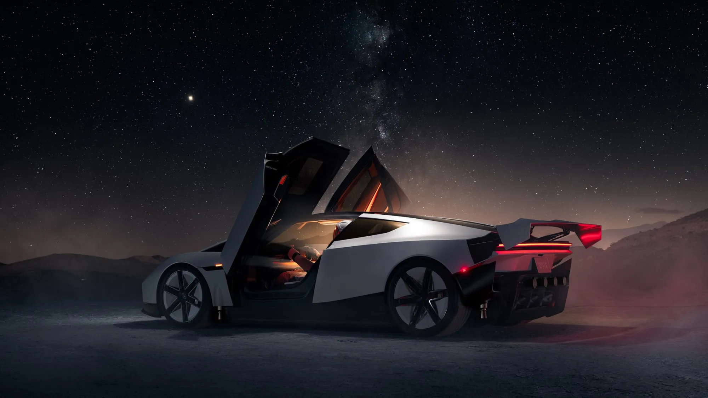

Nine years after its first appearance, the **Tesla Roadster** finally has a production version. Elon Musk unveiled it on **October 15, 2026** in Texas, with a demonstration that looked more like a movie set than a motor show: the car climbed an inverted ramp, spun in the air and cleared a Cybercab, a Cybertruck, a Semi, a Model Y and a Model 3 using compressed-air thrusters.

## Key facts

- **Unveiling:** October 15, 2026, in Texas.
- **Versions:** Performance, Thrust and Rocket.
- **Claimed range:** about 483 km (300 miles) on all three.
- **Claimed top speed:** over 370 km/h.
- **0 to 100 km/h:** under 1 second in the Thrust version, according to Tesla.
- **Production:** 2028, according to Musk.
- **Final price:** not announced.

## The three versions

| Version | Seats | What sets it apart | US reservation |
|---|---|---|---|
| Performance | 2 | Active aerodynamics and a suction system that pins the car to the road | US$50,000 |
| Thrust | 2 | Adds cold-gas thrusters at the rear | US$250,000 |
| Rocket | 1 | Ten thrusters around the car that let it lift off the ground | By invitation only |

The **Rocket** version is not approved for public roads, and Tesla warns it may not be available in every region. According to vice president of engineering Lars Moravy, the ten thrusters on the demonstration car use **600 litres of compressed air**, which can be refilled.

*Tesla says the Roadster uses magnesium, titanium and carbon fiber to cut weight. Photo: Tesla.*

## What to take with caution

The Roadster has a history of broken promises. It was unveiled in 2017 with US$50,000 reservations and has since been delayed in 2020, 2021, 2023 and 2024. This year's event was scheduled for October 1 and was pushed back because of the weather. The **2028** production date is also just a promise.

Safety questions also remain unanswered. Tesla said it filled “every useful space” in the car with high-pressure tanks, and Musk himself said safety is **“not the primary goal.”** YouTuber Marques Brownlee, one of the guests, asked publicly whether it was a joke.

That makes the Roadster, for now, a technology demonstration with a production date two years out: the acceleration and flight figures come from Tesla, and nobody has measured them independently.

## Is it coming to Colombia?

Tesla's Colombian website already shows the Roadster, but only with a button to receive information. Unlike the US and Europe, **reservations are not open in Colombia**. Local media calculated that, based on the euro reservation amounts, the Performance version would equal about COP 178 million and the Thrust about COP 892 million. Those figures are only the converted reservation amount, not a sale price, and they exclude import duties and taxes.

## FAQ

### When does the new Tesla Roadster come out?

Musk said production will begin in 2028.

### How much does it cost?

Tesla has not given a final price. To reserve one in the US, it asks for US$50,000 for the Performance version and US$250,000 for the Thrust.

### Does it really fly?

The Rocket version uses thrusters to lift off and jump over obstacles in a controlled demonstration. It is not approved for public roads.

### Can you reserve one in Colombia?

Not for now. Tesla Colombia's website only lets you register to receive information.

In the meantime, compare the Teslas that are actually sold in the country in the [Mejor Eléctrico comparison tool](/es/comparador/?a=tesla-model-y-rwd-2026-eu&b=tesla-model-3-rwd-2026-eu).

---

**Sources:** [TechCrunch: Roadster unveiling](https://techcrunch.com/2026/10/15/tesla-reveals-spacex-powered-roadster-that-flies-and-falls-with-style/) · [The EV Report: versions and reservations](https://theevreport.com/tesla-roadster-unveil-spacex-cold-gas-thrusters) · [Tesla Colombia: Roadster page (in Spanish)](https://www.tesla.com/es_co/roadster) · [Semana: estimated price in Colombia (in Spanish)](https://www.semana.com/vehiculos/articulo/cuanto-costaria-en-colombia-el-tesla-roadster-el-vehiculo-electrico-con-la-capacidad-de-volar/202626/)
