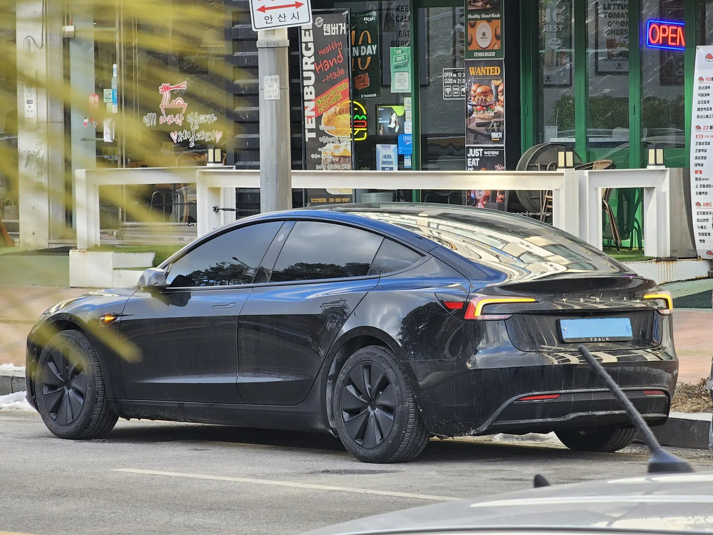

A used electric car can be the best buy on the market or a nasty surprise, and the difference is rarely the mileage. EVs depreciate faster than gasoline cars, so a used one comes cheap. In exchange, the buyer gets less warranty, loses some of the tax benefits and ends up with technology one or two generations old. The decision comes down to how much each of those things matters to you.

## Why used EVs are cheap

In Spain, where the used market is more mature, a study by Ganvam and DAT found that after three years an electric car **retains 52.9% of its value**, compared with **71.5%** for a gasoline car and **72.6%** for a conventional hybrid. That is almost 19 points below the gasoline car.

Latin America does not yet have enough price data to run the same calculation. In Colombia, the used EV market is in its infancy, and the specialist press agrees that, for now, prices depend more on perception than on data. There is one clear signal, though: the price war that began with Tesla's arrival in late 2025 cut some new models by **up to COP 80 million**, according to Fasecolda figures reported by Blu Radio. Anyone who bought in 2024 is now competing against cheaper new cars and has to lower the price to sell.

Spanish magazine ONMOTOR attributes the drop in used EV prices in Europe to fear of second-hand batteries and to how quickly new generations arrive, each with more range and more driver assistance. The battery fear is the part the data supports least.

*The refreshed Model 3 brings design and equipment changes over the first generation. A used buyer skips the first price drop but keeps the older technology. Photo: Damian B Oh, CC BY-SA 4.0, via Wikimedia Commons.*

## The battery, a fear the data does not back up

Recurrent, a company that analyzes EV battery data in the United States, found that a modern electric car keeps on average **97% of its range after three years** and **95% after five**. Only **0.3%** of the cars it tracked needed a battery replacement. Extreme heat and daily DC fast charging speed up degradation, but under normal conditions the loss is slow.

That does not mean you can skip checking it. An out-of-warranty battery replacement can cost between **40% and 45% of the car's value**, according to industry sources cited by Noticias Caracol. That is why the battery state-of-health report is the most important document when buying a used EV.

## New or used: when each makes sense

| Situation | Better choice |
|---|---|
| You want the lowest possible price and will charge at home | Used, two to three years old, with a battery report |
| You want the VAT refund or the income tax deduction (Colombia) | New |
| You drive a lot, more than 20,000 km a year | New, for the full mileage warranty |
| Safety assistance systems matter to you | New, or a used car from a generation that already had them |
| You plan to sell within a few years | Used: it has already absorbed the first price drop |
| You cannot check the battery or get the service history | New |

## What you lose buying used in Colombia

Some benefits go to the buyer of a new car and do not pass to the second owner. The **VAT refund** and the **income tax deduction** are tied to the original purchase with a certificate from UPME, Colombia's mining and energy planning agency. The **60% discount on Bogotá's vehicle tax** lasts five years from registration: if the car is three years old, you have two left. The **exemption from *pico y placa*** (Bogotá's license-plate driving restriction) and the 1% cap on vehicle tax do stay with the car. The details are in [the benefits of buying an electric car](/es/notas/beneficios-tributarios-carro-electrico-2026/).

With the **warranty**, you need to do the math. The battery warranty usually lasts eight years with a mileage cap, so a three-year-old car with 60,000 km still has five years of coverage if the cap is 160,000 km. The car's general warranty, on the other hand, can be as short as three years, as with the Chevrolet Equinox EV. We explain it in [how long an electric car warranty lasts](/es/notas/cuanto-dura-la-garantia-de-un-carro-electrico/).

## What to check on a used EV

Before you pay, ask for five things:

1. **The battery state-of-health report**, done at the brand's dealer or with diagnostic equipment, in writing.
2. **The valid warranty certificate**, with the start date and the mileage cap, confirmed at the dealer with the VIN.
3. **The service history** at the authorized network. Without it, the brand can deny a warranty claim.
4. **A check in RUNT**, Colombia's national vehicle registry, to confirm the car has no liens, seizures or outstanding fines, and that the powertrain is listed as electric.
5. **The original charging cables** and the connector, which must match the charging stations you plan to use.

The full checklist, including what to inspect on tires, brakes and software, is in [what to check when buying a used electric car](/es/notas/comprar-carro-electrico-usado-que-revisar/).

> A rule of thumb: if the used car costs almost as much as a new entry-level model from another brand, the new one usually wins, because it brings a full warranty, tax benefits and more recent driver assistance. The used car wins when the price gap is large and the battery has been verified.

## Frequently asked questions

### Is a used electric car worth buying?

Yes, if the price gap with a new one is large and the battery has a report showing it is in good condition. EVs depreciate fast, so the second owner skips the first price drop.

### How much does an electric car depreciate?

In Spain, an electric car keeps about 53% of its value after three years, compared with about 72% for a gasoline car. Latin America does not yet have enough data for a reliable figure.

### How long does a used EV's battery last?

According to Recurrent's data, a modern electric car keeps on average 95% of its range after five years. What wears it most is extreme heat and daily fast charging.

---

**Sources:** [El Carro Colombiano: Ganvam and DAT study on EV values after three years](https://www.elcarrocolombiano.com/notas-de-interes/cuanto-vale-un-carro-electrico-despues-de-tres-anos-estudio-revela-datos-impactantes/) · [InsideEVs: battery health in used EVs, Recurrent data](https://insideevs.com/features/794674/used-ev-battery-health-guide-2026/) · [ONMOTOR: real problems with electric cars in 2026](https://onmotor.es/problemas-reales-en-los-coches-electricos-en-2026/) · [Pulzo: EV resale in Colombia](https://www.pulzo.com/carros/venta-carros-electricos-segunda-colombia-clopatofsky-dice-que-pasara-PP5103945) · [Blu Radio: the cars whose prices fell most, according to Fasecolda](https://www.bluradio.com/motor/los-20-carros-byd-kia-y-mas-que-mas-han-bajado-de-precio-tras-exito-de-tesla-segun-fasecolda-so35) · [Valora Analitik: vehicle tax discounts in Bogotá](https://www.valoraanalitik.com/carros-electricos-en-bogota-tendran-hasta-70-de-descuento-en-impuesto-vehicular/)
