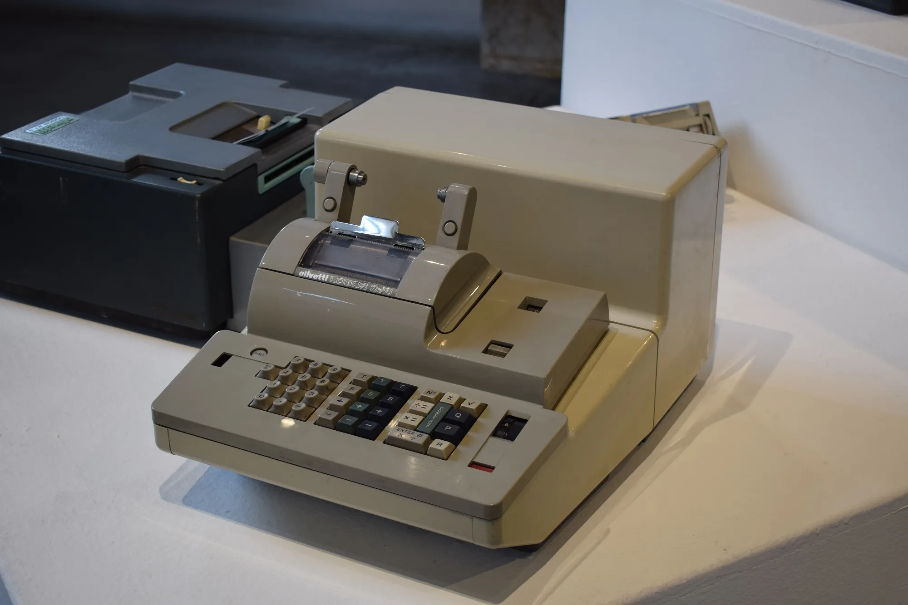

A payment on principal is an extra payment that goes straight to reducing what you owe, not to interest. In Colombia, **Law 1555 of 2012** made it a consumer right to prepay peso loans **with no penalty**, and it gave borrowers the decision on whether the payment reduces the **term** or the **installment**. For anyone buying an EV, there is a natural source for that payment: the VAT refund.

## What the law says

Law 1555 added a right to the financial consumer protection regime:

- any loan in national currency can be prepaid **with no penalty or compensation** for the interest the bank stops receiving;
- the borrower decides whether a partial payment **reduces the term or the installment**;
- it does not apply to loans with a balance above **880 minimum monthly salaries**, or to mortgages.

A car loan for an individual buyer is far below that cap, so the right applies. The Superintendencia Financiera, Colombia's financial regulator, describes it as a consumer right that cannot be waived.

## The math: using the VAT refund

We take a **COP 89.99 million** EV with 20% down: **COP 71.99 million** is financed over 60 months at 12.5% effective annual. The payment is **COP 1,595,473**. If the buyer requests the VAT refund, the DIAN, the tax authority, returns the 5% paid on the invoice, about **COP 4.29 million**. Suppose it arrives a year after the purchase and all of it goes to principal.

| Option when paying COP 4.29 million in month 12 | Result | Interest saved |
|---|---|---|
| Reduce the term | The payment stays the same and the loan ends about 4 months earlier | About COP 2.47 million |
| Reduce the installment | The term stays the same and the payment falls to about COP 1,482,977 | About COP 1.11 million |

Our own calculation, without insurance. The saving is the difference between what would have been paid without the extra payment and what is paid with it, after subtracting that payment.

**Reducing the term saves more than double** what reducing the installment does, because the balance falls and stops generating interest for longer. Reducing the installment makes sense if what you need is relief for the monthly budget.

*Reducing the term with a COP 4.29 million payment saves about COP 2.47 million in interest in our example, more than double what reducing the installment saves. Photo: Piergiovanna Grossi, CC BY-SA 4.0, via Wikimedia Commons.*

## How to make the payment correctly

**Say it in writing.** When making the extra payment, state at the branch, in the app or in an email to the bank that it is a **payment on principal** and whether you want to reduce the term or the installment. If you do not, the bank may apply it as an advance on upcoming installments, which saves no interest.

**Ask for the new payment plan.** After the payment, request the updated amortization table and check that the balance has fallen by the amount paid.

**Check that no fee is charged.** Under Law 1555, prepaying peso loans below the cap carries no penalty. If a charge appears, complain to the lender and, if it does not respond, to the Superintendencia Financiera.

## Where the payment can come from

The VAT refund is the most obvious source for a new EV with a certificate from the UPME, the energy planning unit. It must be processed within **five years** of the invoice date, as we explain in [the step-by-step process with the DIAN](/es/notas/devolucion-iva-carro-electrico-dian-paso-a-paso/). The December bonus or what you save on gasoline against a combustion car are other sources.

> A payment made early yields more than the same payment made late. In the first month of our example, about COP 710,000 of the COP 1.6 million installment is interest; at the end of the loan, almost the whole installment is principal.

## Frequently asked questions

### Can I be charged for paying off my car loan early?

No, if it is a peso loan with a balance below 880 minimum salaries. Law 1555 of 2012 prohibits a prepayment penalty.

### Which is better, reducing the term or the installment?

Reducing the term saves more interest. In our example, about COP 2.47 million against COP 1.11 million.

### Can I use the car's VAT refund to pay down the loan?

Yes. It is your money once the DIAN returns it, and paying down principal is one of the ways it yields most.

---

**Sources:** [Law 1555 of 2012, in the DIAN's legal register](https://normograma.dian.gov.co/dian/compilacion/docs/ley_1555_2012.htm) · [Superintendencia Financiera: opinion on loan prepayment](https://www.superfinanciera.gov.co/publicaciones/61676) · [Portafolio: term and process of the VAT refund](https://www.portafolio.co/negocios/vehiculo/este-es-el-plazo-y-el-proceso-para-que-le-devuelvan-el-iva-si-compro-un-carro-hibrido-o-electrico-503819)
