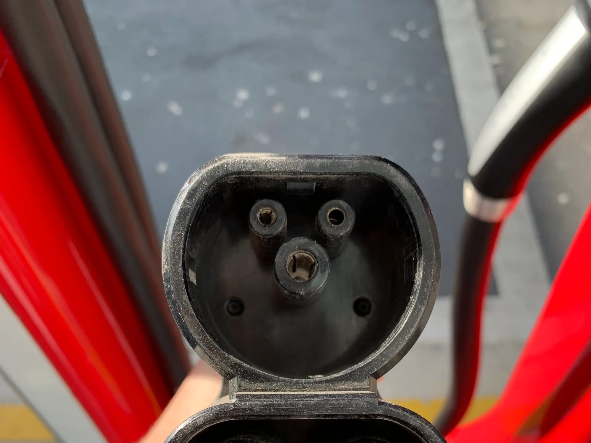

A long EV trip is planned the opposite way to one in a gasoline car. With gasoline, you set off and fill up wherever there is a station, because they are almost everywhere. With an EV, the route is built around fast chargers, which in Latin America are still concentrated in cities and on a few corridors. With the right planning, a trip of 300 or 400 km (186 or 249 miles) is perfectly possible; without it, it can end in a wait of hours.

## 1. Calculate with real range, not the spec sheet's

The spec sheet range, especially if it is NEDC or CLTC, is higher than what the car achieves on the highway. At 100 or 110 km/h (62 or 68 mph), with air conditioning and climbs, expect considerably less. A prudent rule is to plan stops so you reach each charger with 15% or 20% of battery to spare, in case it is busy or out of service. The differences between cycles are explained in [this article](/es/notas/autonomia-electricos-cltc-nedc-wltp-como-leerla/).

In Colombia, mountains count for more than distance. A long climb uses far more energy than a flat stretch of the same length, although the descent returns part of it thanks to [regenerative braking](/es/notas/freno-regenerativo-como-funciona/).

## 2. Use the charging apps

Apps show on a map where chargers are, what connector and power each one has, whether they are free at that moment and what other drivers think. In Colombia, Blu Radio mentions **Enel X**, **Evsy** and **Electromaps** among the free ones, and the big operators have their own, such as Terpel's for its Voltex network. Recent reviews are key: they warn if a charger has been broken for days.

Before setting off, filter by your car's connector. Not all stations work for all EVs, and a charger with a different connector is no use without an adapter. The connector guide is [here](/es/notas/conectores-carga-electricos-colombia-tipo-1-tipo-2-ccs-gbt/).

*The CCS connector of a Tesla Supercharger. Before setting off, filter the app by your car's connector. Photo: Panagiotis Katoikos, CC BY-SA 4.0, cropped, via Wikimedia Commons.*

## 3. Prefer fast chargers and short stops

A DC fast charger can take the battery to 80% in about 30 minutes; a semi-fast AC charger can take more than an hour. That is why on the road it pays to stop at fast chargers and charge to 80%, not 100%: the last stretch of charging is much slower and lengthens the stop without adding as much distance. If the stop coincides with lunch, you barely feel the wait. And it is always worth having a second charger identified within your range.

## 4. Check what is on your route

The corridors with the most chargers in Colombia, according to Blu Radio, are Bogotá to Villavicencio, Medellín to Cartagena and the Caribbean Trunk Road, and expansion is concentrated around Bogotá, Medellín, Cali and Bucaramanga. In 2023, trade groups presented the Andean Electric Route, which proposes fast or semi-fast chargers every 200 km (124 miles) between Cartagena and Ipiales, with connections to Ecuador and Peru.

Tesla has Superchargers in Bogotá and Medellín, at the Andino and Unicentro shopping centers, but not on highways, so a Tesla on the road depends on other operators' networks.

## 5. Have a plan B

Carry the car's portable charger: in an emergency, a household outlet can recover some distance, though very slowly. And before leaving, charge to 100% at home, where energy is cheaper.

> The most common mistake is not running out of battery on the road, but reaching a busy or broken charger with no other nearby. Always plan the next stop.

## Frequently asked questions

### Can you drive from Bogotá to Medellín in an EV?

Yes, with planning. Check the fast chargers on the route in an app and work out your stops with a margin, because the terrain increases consumption.

### Which app helps find charging stations?

In Colombia, those from Enel X, Evsy and Electromaps, plus the charging operators' own apps.

### To what percentage should you charge on the road?

To 80% on fast chargers. From there, charging becomes much slower.

---

**Sources:** [Blu Radio: how to plan an EV trip in Colombia](https://www.bluradio.com/motor/como-planear-viaje-carro-electrico-colombia-so35) · [Portafolio: the Andean Electric Route](https://www.portafolio.co/sostenibilidad/detalles-de-la-ruta-electrica-andina-que-inauguro-latinoamerica-en-colombia-588814) · [Semana: Tesla Superchargers in Colombia](https://www.semana.com/vehiculos/articulo/mapa-lista-de-ciudades-con-supercargadores-de-tesla-en-colombia-y-cuanto-cuesta-usarlos/202633/)
