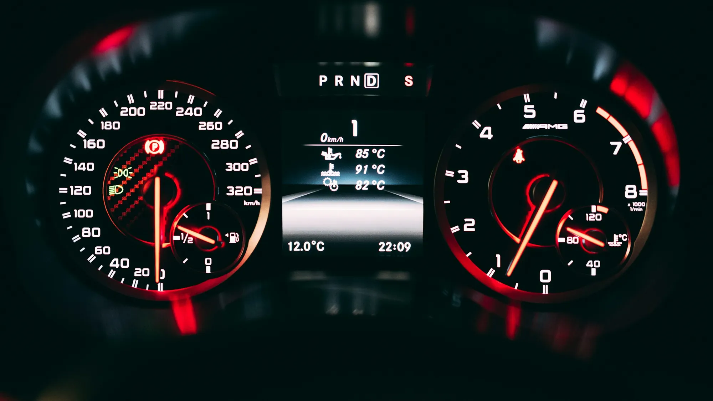

The range figure on the spec sheet is a starting point, not a promise. In Colombia, what moves it most is **slopes**, more than the climate that worries European drivers. And unlike speed or air conditioning, mountains also work in your favor: what you use climbing is partly recovered going down.

## The essentials

- **Going down, the car recovers energy.** In a test from Bogotá to Villavicencio, the descent used 6% of the battery.
- **Going up, it uses much more.** The return to Bogotá consumed 34%.
- **At 120 km/h (75 mph)**, several EVs lost between 25% and 26% of their WLTP range in tests in Europe.
- **Cold**, which takes off up to 35% or 45% in Europe, matters little in most of Colombia.

## Mountains: what you use climbing comes back descending

In a test published by GAC Motor Colombia with a **GAC Aion Y**, the car left Bogotá with 88% battery and reached Villavicencio with 82%. On the way down, after the Naranjal toll, the battery even **rose from 80% to 83%** thanks to regenerative braking, which turns braking into electricity. The return was another story: it left Villavicencio with 61% and reached Bogotá with **27%**.

In another test, in Santander, with a **JAC E10X** carrying four people, the descents on the way back recovered between 5% and 6% of charge. Using the test's data, real range came to between 225 and 257 km (140 and 160 miles) per full charge, against 360 km (224 miles) on the spec sheet.

These tests were published by the brand or its distributor, so they should be taken as a reference, not as independent measurements. Even so, they show the pattern: **what matters on a mountain trip is the balance of climbing and descending**, not total distance.

*Speed is the other big factor: above 100 km/h (62 mph), air resistance sends consumption soaring. Photo: Claude Gabriel on Unsplash.*

## The highway: speed punishes

An EV uses less in the city than on the road, the reverse of a gasoline car. In tests by the Spanish magazine ONMOTOR, at 120 km/h (75 mph) and 8 °C, four EVs lost between **24.6% and 26.3%** of their advertised WLTP range. Some large SUVs came close to 30%.

On Colombian dual carriageways, at 80 or 100 km/h (50 or 62 mph), the loss is smaller, but still significant on a long trip.

## Climate: air conditioning yes, cold hardly

In Europe, extreme cold can take off between 35% and 45% of range, because the battery and heating use a lot of energy. In Colombia that only partly applies in Bogotá in the mornings. In the hot lowlands, the drain comes from **air conditioning**, which uses less than heating but shows on long trips and in traffic jams.

## How to work out your real range

This table is a reference guide from Mejor Eléctrico based on the tests cited, not a measurement of our own.

| Use | How much to subtract from the WLTP figure |
|---|---|
| City, normal traffic | Little or nothing; sometimes it does better |
| Road at 80 or 100 km/h (50 or 62 mph), flat terrain | 10% to 20% |
| Highway at 120 km/h (75 mph) | 25% to 30% |
| Trip with a long climb and no descent on return | Much more; calculate by stretches |

And if the spec sheet figure is **NEDC** or **CLTC**, first subtract 15% to 25% to bring it to something like WLTP. We explain this in [our article on range cycles](/es/notas/autonomia-electricos-cltc-nedc-wltp-como-leerla/).

> For a mountain trip, plan to charge on the high part of the route, not the low one: the descent gives you energy back and the climb charges you for it.

## Frequently asked questions

### What is an EV's real range in Colombia?

It depends on use. In the city it usually comes close to the WLTP figure; on the highway at 120 km/h (75 mph) it can lose between 25% and 30%.

### Does an EV use more climbing to Bogotá?

Yes. In a test with a GAC Aion Y, the descent to Villavicencio used 6% of the battery and the climb back, 34%.

### Does air conditioning cut range much?

It shows on long trips and in traffic jams, but much less than heating in cold climates.

### Which EV has the most range in Colombia?

Use the [Mejor Eléctrico comparison tool](/es/comparador/) to see each version's range and the cycle it was measured on.

---

**Sources:** [GAC Motor Colombia: Bogotá to Villavicencio test](https://gacmotorcolombia.com/blog/bogota-villavicencio-carro-electrico-gac-aion-y) · [El Carro Colombiano: JAC E10X range test](https://www.elcarrocolombiano.com/pruebas/jac-e10x-electrico-autonomia-real-y-costos-de-uso-prueba-definitiva-auteco-video/) · [ONMOTOR: real problems with EVs in 2026](https://onmotor.es/problemas-reales-en-los-coches-electricos-en-2026/)
