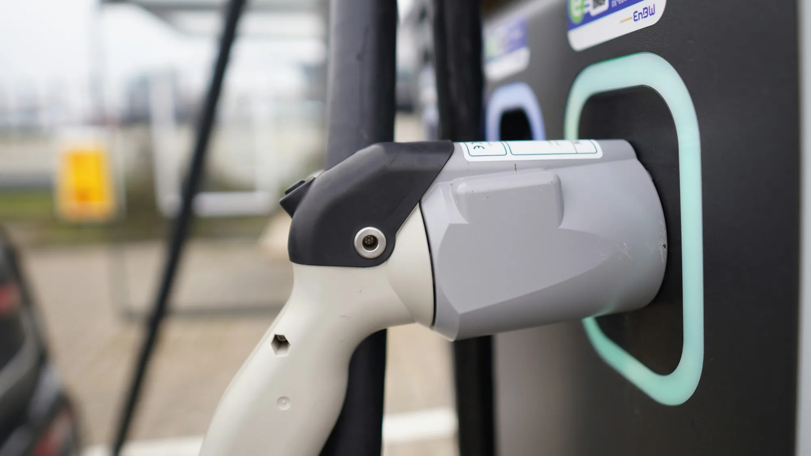

EVs have fewer moving parts than a gasoline car and need no oil changes. That does not mean they have no problems. With about 40,000 EVs registered in Colombia between January and September 2026, and several years of accumulated experience in Europe, it is now possible to separate what really fails from what is myth.

## The essentials

- **The traction battery rarely fails.** The most common problems are software and the 12-volt auxiliary battery.
- **Public charging** is the number one complaint in Colombia, with 229 public points for about 40,000 EVs in May.
- **Workshops prepared** for high voltage are still few.
- **Resale** is uncertain, because the used market is very young.
- **The risk of fire** is lower than in a gasoline car, but putting one out is harder.

## 1. Software and electronics

According to European reliability studies cited by ONMOTOR, without identifying them, **software and infotainment** faults are the first cause of EV workshop visits, ahead of suspension or brakes. In practice these are screens that freeze or cameras that stop working. They almost never immobilize the car, and most are solved with an update, but each workshop visit costs the owner a day without the car.

## 2. The 12-volt battery

It is the number one cause of stranded EVs in many models: according to roadside assistance figures cited by ONMOTOR, **12% of EV calls** in the first quarter of 2026 were for this battery. We explain it in [our article on the 12-volt battery](/es/notas/bateria-12-voltios-carro-electrico-varado/).

## 3. Not enough public charging

Colombia has about **229 public charging points** for around **40,000 EVs**, about 174 cars per charger, according to figures from the Ministry of Mines and the trade group Andemos published in May. The International Energy Agency uses one charger per ten EVs as a reference. With 17 times more cars per charger than that reference, a busy station translates into waits of several hours, which is what users report. People who cannot charge at home are the most affected.

*In Europe, only 61% of ultra-fast chargers delivered their power reliably in early 2026, according to ONMOTOR. Photo: Sophie Jonas on Unsplash.*

## 4. Workshops and parts

Batteries work at between 200 and 800 volts, and not all workshops have the technicians or equipment to touch them. In Europe, a high-voltage part can take about three weeks to arrive, so a minor fault can leave the owner without a car for almost a month. We report on it in [our article on workshops](/es/notas/talleres-reparacion-electricos-800-voltios-colombia/).

## 5. Insurance with fewer offers

Price is no longer the problem: insuring an EV costs the same in percentage terms as a gasoline car. The issue is that **fewer insurers** are willing to offer a policy, and battery cover has conditions. We explain it in [our article on insurance](/es/notas/seguro-carro-electrico-colombia-2026-costo/).

## 6. Range below what is advertised

On the highway at 120 km/h (75 mph), several EVs lose between 25% and 30% of their WLTP range. In Colombia, long climbs weigh more than cold. We detail it in [our article on real range](/es/notas/autonomia-real-carro-electrico-colombia-montana-autopista/).

## 7. Uncertain resale

In Europe, some models lost up to 52% of their value in three years. In Colombia there is not enough data yet. Battery condition will be the factor that weighs most, as we report in [our article on the battery and resale](/es/notas/bateria-carro-electrico-cuanto-cuesta-cambiarla-reventa/).

## What is not as big a problem as people think

- **The battery failing within a few years.** Manufacturers estimate a service life of 15 to 20 years, and the warranty is usually 8 years.
- **Fires.** According to insurers and firefighters cited by ONMOTOR, an EV is about ten times less likely to catch fire than a gasoline car. When it does, though, putting it out can take up to 15,000 liters of water, and it can reignite days later.

> Most of the real problems with EVs are not in the car, but around it: chargers, workshops, insurance and the used market. Before buying, check those four fronts in your city.

## Frequently asked questions

### What is the most common fault in an EV?

Software and electronics, followed by the 12-volt battery.

### Does an EV battery fail quickly?

No. It is estimated to last between 15 and 20 years, with a capacity loss of about 1.8% a year.

### Do EVs catch fire more often?

No. They catch fire less often than gasoline cars, although the fire is harder to put out.

Compare models, warranties and range in the [Mejor Eléctrico comparison tool](/es/comparador/).

---

**Sources:** [ONMOTOR: real problems with EVs in 2026](https://onmotor.es/problemas-reales-en-los-coches-electricos-en-2026/) · [El Colombiano: charger shortage in Colombia](https://elcolombiano.com/negocios/colombia-deficit-cargadores-vehiculos-electricos-estaciones-por-carro-IG36034738) · [Portafolio: workshops and high voltage](https://www.portafolio.co/sostenibilidad/baterias-de-hasta-800-voltios-el-reto-de-los-talleres-para-reparar-carros-electricos-e-hibridos-en-colombia-504460) · [La Nota Económica: EV insurance](https://lanotaeconomica.com.co/movidas-empresarial/el-carro-nuevo-mas-cotizado-para-asegurar-en-colombia-en-2026-es-un-tesla-y-asegurar-un-electrico-ya-cuesta-lo-mismo-que-uno-a-gasolina/) · [Semana: battery service life](https://www.semana.com/vehiculos/articulo/marcas-revelan-cuando-duran-y-cuanto-valen-las-baterias-de-los-autos-electricos-que-llegan-a-colombia/202637/)
