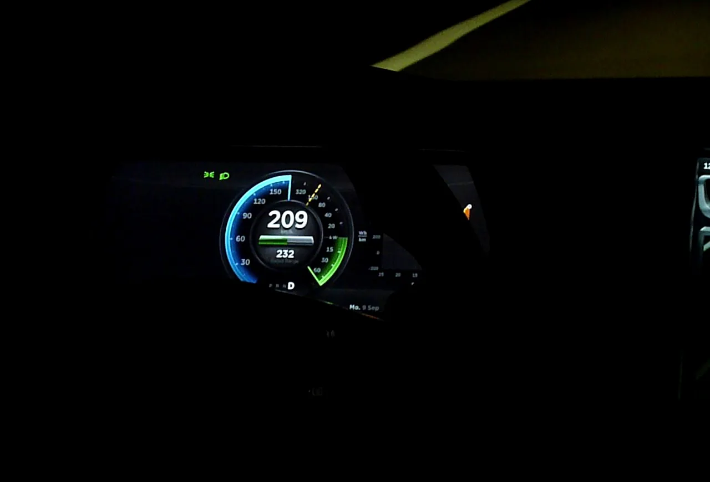

In a gasoline car, every time you brake, the energy of motion turns into heat and is lost. In an electric car, much of it is recovered. When the driver lifts off the accelerator or presses the brake gently, the electric motor runs in reverse, as a generator: it slows the car and sends electricity back to the battery. That is **regenerative braking**.

## How much energy it recovers

The system does not recover all of the braking energy. According to figures cited by Tesla and reported by Electrek, round-trip efficiency is around **60% to 70%**: between 10% and 20% is lost converting motion into electricity, and a similar amount when that electricity is used again to accelerate.

That does not mean range grows by 70%. It means that, of the energy the car was going to lose by braking, it gets back about two thirds. How much that adds to total range depends on the route:

- On **normal trips**, Tesla drivers reported recovering between **15% and 20%** of the total energy they used.
- On a **trip with a long climb and descent**, a Model S owner reported recovering up to **32%**.

Routes with lots of braking, such as city traffic, and long descents are where it pays off most. On the highway at a steady speed there is very little braking, and the contribution is small.

*A Tesla Model S brakes from 209 km/h and the motor sends more than 60 kW (80 hp) back to the battery, according to the power meter. Photo: Lklundin, CC BY-SA 4.0, via Wikimedia Commons.*

## Why it matters so much in Colombia

Colombia's geography makes regenerative braking count for more than it does in a flat country. On a long descent, such as from Bogotá down to the Magdalena valley or to the Llanos plains, the car can recover a significant share of the energy it used climbing.

It does not make up for the whole climb. Going up always uses more energy than coming down returns, because the system loses some in every conversion. We explain it with examples in [real-world range in Colombia](/es/notas/autonomia-real-carro-electrico-colombia-montana-autopista/).

## Regen levels and one-pedal driving

Almost every EV lets you choose how strongly the car regenerates when you lift off the accelerator:

- **Low:** the car coasts almost like a gasoline car in neutral. It is comfortable on the highway.
- **High:** the car slows noticeably when you lift your foot. It recovers more in the city.
- **One-pedal:** the car brakes to a full stop without touching the brake pedal. Kia calls it i-Pedal, and on the EV3 it offers it alongside a smart regeneration mode and a manual one with paddles on the steering wheel.

Strong regen takes some getting used to. At first, some passengers feel it as sudden braking.

## A bonus: the brakes last longer

Because the motor does much of the braking, the pads and discs work less and usually last longer than on a gasoline car. There is a downside: if they are barely used, the discs can build up rust. That is why it is a good idea to use the brake pedal now and then and to have the brakes checked at every service, as we cover in [electric car maintenance](/es/notas/mantenimiento-carro-electrico-que-incluye/).

> On long mountain descents, the high regeneration mode is your best ally: it recovers energy and spares the brakes.

## Frequently asked questions

### What is regenerative braking?

A system that uses the electric motor as a generator to slow the car and recharge the battery with the energy of motion.

### How much range does regenerative braking add?

It depends on the route. On normal trips, Tesla owners report recovering between 15% and 20% of the energy they use, and more on long descents.

### Can you charge the battery just by driving downhill?

You recover energy, but never more than you spent climbing to that point. Only a charger fills the battery.

---

**Sources:** [Electrek: how regenerative braking works](https://electrek.co/2018/04/24/regenerative-braking-how-it-works/) · [Valora Analitik: the Kia EV3's i-Pedal](https://www.valoraanalitik.com/kia-presento-en-colombia-el-electrico-ev3/)
