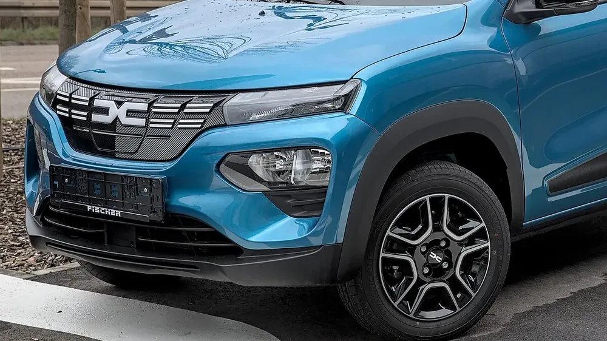

The **Renault Kwid E-Tech** is one of the cheapest electric cars in Colombia. In Europe, the same car is sold as the **Dacia Spring**, and in December 2021 **Euro NCAP** gave it **one star**, one of the worst ratings in recent years. The question for anyone buying one today is whether that result still applies to the updated Kwid E-Tech. The short answer: the car gained equipment, but nobody has published a new test that proves it is safer.

## Key facts

- **Rating:** 1 star, published on December 8, 2021, for the Dacia Spring of that era.
- **Adult occupant protection:** 49%.
- **Child occupant protection:** 56%.
- **Vulnerable road users:** 39%.
- **Safety assist:** 32%.
- **Kwid E-Tech in Colombia, 2026:** six airbags and autonomous emergency braking, according to Renault.

## What Euro NCAP found in 2021

The results were poor in almost every test:

- In the **frontal crashes**, there was a high risk of serious injury to the **driver's chest** and the **rear passenger's head**. Leg injury risk was high for all occupants in the mobile barrier test.
- In the **side impact**, chest protection was only marginal.
- For **children**, head and neck protection for the 6-year-old dummy was weak in the frontal crash.
- **Autonomous emergency braking** performed marginally and could not detect pedestrians or cyclists. The car also had no lane assist and no driver fatigue detection.

Michiel van Ratingen, then secretary general of Euro NCAP, said occupant protection was worse than that of "any vehicle we have seen in many years" and called it cynical to offer a cheap, green car at the cost of a higher risk of injury.

*The updated Spring got a new front end and interior. The Colombian Kwid E-Tech was updated in 2025. Photo: Alexander Migl, CC BY-SA 4.0, cropped, via Wikimedia Commons.*

## What changed in the Colombian Kwid E-Tech

In October 2025, Renault launched the updated Kwid E-Tech in Colombia in a single trim, **Techno**, from **COP 72.99 million**. According to the brand, it comes with:

| Equipment | Kwid E-Tech 2026 in Colombia |
|---|---|
| Airbags | 6: front, side and curtain |
| Autonomous emergency braking | Yes |
| Lane departure warning and lane keeping assist | Yes |
| Fatigue detection | Yes |
| Speed sign recognition | Yes |
| Rearview camera and front and rear sensors | Yes |

That is considerably more equipment than the Spring tested in 2021 had. That car notably lacked lane assist and fatigue detection, and its braking system did not recognize pedestrians.

## What we don't know

Equipment helps, but the structure is what determines how occupants are protected in a crash. Neither Euro NCAP nor Latin NCAP has published a test of the Kwid E-Tech or the updated Spring. Until one exists, the only public rating is the one star from 2021.

> If you are considering the Kwid E-Tech, factor both the 2021 result and the new equipment into your comparison, but don't assume a rating the car doesn't have. Good or bad.

## FAQ

### How many stars does the Renault Kwid E-Tech have?

It has no rating of its own. Its European twin, the Dacia Spring, scored one star from Euro NCAP in 2021, in the previous version of the car.

### Is the current Kwid E-Tech safer?

It has more equipment: six airbags, autonomous emergency braking and lane assist. But no crash test has been published to measure how much it improved.

### How much does the Kwid E-Tech cost in Colombia?

From COP 72.99 million for the Techno trim, according to the October 2025 launch.

Compare the Kwid E-Tech with other electric city cars in the [Mejor Eléctrico comparison tool](/es/comparador/?a=renault-kwid-e-tech-techno-2026-co&b=byd-seagull-gl-300-2026-co).

---

**Sources:** [Euro NCAP: press release on the Dacia Spring, December 2021](https://euroncap.newsmarket.com/latest-release/renault-laguna-s-legacy-ruined-as-zoe-and-spring-debase-electric-car-safety/s/7b157f99-83e7-42b3-a18e-54102dde0bdb) · [The Car Expert: Dacia Spring scores](https://www.thecarexpert.co.uk/dacia-spring-2024/) · [CarDekho: test details](https://www.cardekho.com/india-car-news/dacia-spring-renault-kwid-ev-scores-just-1-star-in-euro-ncap-crash-test-28306.htm) · [Renault Colombia: updated Kwid E-Tech](https://cdn-prensa.renault.com.co/wp-content/uploads/2025/10/17152750/EL-KWID-E-TECH-EVOLUCIONA-CON-DISENO-MODERNO-TECNOLOGIA-AVANZADA-Y-SEGURIDAD-SUPERIOR.pdf)
