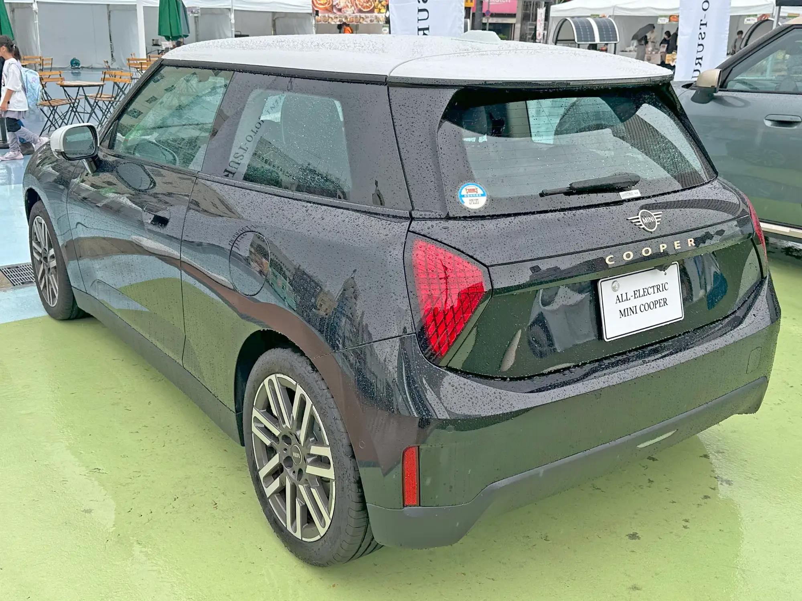

The safest sedan Euro NCAP tested in 2025 is the **Mercedes-Benz CLA**. It did more than win its class: it was the highest-scoring car of the year, with **94% for adult occupant protection**. The European body published its "Best in Class" awards on January 14, 2026, and all six winners are offered with an electric powertrain.

That every winner has an electric version is no accident. The battery sits in the floor and needs a very stiff lower structure to protect it, which helps in side impacts. New electric platforms also tend to debut each brand's latest driver assistance systems, an area that carries more and more weight in the rating.

## Winners by class

| Class | Winner | Adults | Children | Pedestrians and cyclists | Driver assistance |
|---|---|---|---|---|---|
| Best overall and small family car | Mercedes-Benz CLA | 94% | 89% | 93% | 85% |
| City and supermini | MINI Cooper E | 89% | 87% | 77% | 79% |
| Large family car | Tesla Model 3 | 90% | 93% | 89% | 87% |
| Small SUV | Tesla Model Y | 91% | 93% | 86% | 92% |
| Large SUV | smart #5 | 88% | 93% | 84% | 92% |
| Executive | Polestar 3 | 90% | 93% | 79% | 83% |

The four columns are the areas Euro NCAP assesses. Each has a minimum threshold for five stars, which is why a car that excels in crash tests can end up with four if it falls short on driver assistance.

*The MINI Cooper E won the city car class, with 89% for adult occupant protection. Photo: Tokumeigakarinoaoshima, CC BY-SA 4.0, via Wikimedia Commons.*

## What each result means

**The CLA** wins on balance. None of the other five tops 90% for adults and for pedestrians at the same time, and the pedestrian figure is the harder one to achieve: it depends on the design of the hood and windshield, and on how well the car brakes on its own for a person. Euro NCAP tested the electric version.

**Tesla** places two cars on the list, and the Model Y has the best driver assistance score of the whole group, tied with the smart #5. For Latin America this is the most useful figure in the table: the Model 3 and the Model Y are by far the best-selling winners in the region. Their full results are in our articles on the [Model Y](/es/notas/tesla-model-y-euro-ncap-2025-5-estrellas/) and the [Model 3](/es/notas/tesla-model-3-euro-ncap-5-estrellas/).

**The MINI Cooper E** is the only city car. Its weak spot is pedestrians and cyclists (77%), common in short cars, where there is less room between the hood and the motor to absorb an impact.

**The Polestar 3** scores 93% for children, tied for the best mark of the year in that area, but stays at 79% for pedestrians and cyclists, the second lowest on the list.

## Why a European test matters in Latin America

Latin NCAP tests few models a year and very few EVs. That makes the European result the only crash reference for many Chinese or European cars arriving in the region. The usual caveat applies: the rating is valid for the car that was tested. If the Latin American version has fewer airbags or loses autonomous emergency braking, the score cannot be carried over. That happened with the [Chery E5](/es/notas/chery-e5-omoda-e5-euro-ncap-estrellas/) and the [BYD Seagull](/es/notas/byd-seagull-dolphin-surf-euro-ncap-5-estrellas/).

Before buying, compare the equipment list of the version the dealer sells with that of the car Euro NCAP tested. The datasheet for each test is published on euroncap.com.

## Frequently asked questions

### What is the safest electric sedan?

Among those tested in 2025, the Mercedes-Benz CLA, with 94% for adults, 89% for children, 93% for pedestrians and cyclists and 85% for driver assistance. Among large sedans, the Tesla Model 3.

### What is the safest electric SUV?

Among small SUVs, the Tesla Model Y; among large SUVs, the smart #5. Both score 92% for driver assistance.

### Do Euro NCAP and Latin NCAP rate cars the same way?

No. They use similar but not identical protocols, and they test different cars. A European star is not automatically equal to a Latin American one.

---

**Sources:** [Euro NCAP: 2025 Best in Class winners](https://www.euroncap.com/articles/euro-ncap-names-best-in-class-cars-tested-in-2025) · [Carwow: scores of the safest cars of 2025](https://www.carwow.co.uk/news/10124/euro-ncap-safest-cars-2025) · [BMWBlog: MINI Cooper E scores](https://www.bmwblog.com/2026/01/15/mini-cooper-electric-euro-ncap-best-in-class-2025/) · [ArenaEV: five stars for the electric CLA](https://www.arenaev.com/ncap_awards_the_new_electric_mercedesbenz_cla_five_stars-news-5414.php)
