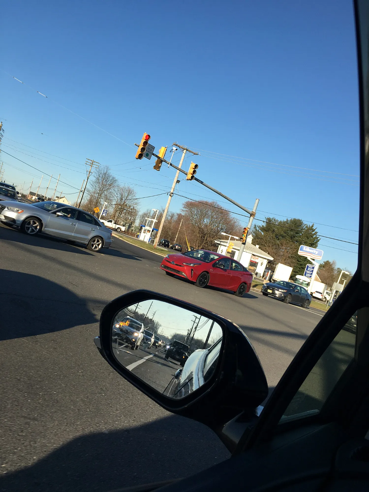

Since July 7, 2024, every new car registered in the European Union must have **autonomous emergency braking** and an **emergency lane keeping system**, among other aids. Colombia has no such obligation, which is why the same model can arrive with all the driver aids in Europe and none in Bogotá. In small EVs, where brands trim equipment to lower the price, the difference is more noticeable.

The **blind spot monitor**, which warns with a light in the mirror when a car is where you cannot see it, is not even mandatory in Europe for passenger cars: the rule only requires it on buses and trucks. That is why it is the aid most often missing from city cars.

## What each one has in Colombia

| Model and trim | Autonomous braking | Lane assist | Blind spot | Adaptive cruise |
|---|---|---|---|---|
| New BYD Dolphin GS | Yes | Yes | Yes | Yes |
| Chery E5 Luxury | Yes | Yes | Yes | Yes |
| Chery iCar 03 (both trims) | Yes | Yes | Yes | Yes |
| Kia EV2 Air | Yes | Yes | No | Yes |
| Chevrolet Spark EUV | Yes | Yes | No | Yes |
| Renault Kwid E-Tech Techno | Yes | Yes | Not published | No |
| Chery E5 Comfort | No | No | No | No |
| iCAUR V23 | No | No | Only on the 4x4, as an alert | No |

Equipment published by the brands or the specialist press for the versions sold in Colombia. "Not published" means the source does not say, not that the car lacks it.

*The blind spot monitor warns with a light in the mirror; it neither brakes nor moves the steering wheel. Photo: Jonathan Schilling, CC BY-SA 4.0, via Wikimedia Commons.*

## What the table shows

**Full equipment is now available for under COP 90 million.** The new BYD Dolphin, at COP 89.99 million, has all four aids in the table. It is the biggest change from the previous Dolphin, which had none. The Kia EV2, at the same price, goes without blind spot.

**Same body, two levels of safety.** The Chery E5 Comfort has no driver aids and the Luxury has them all. For anyone driving a lot on urban highways, such as Bogotá's Avenida Boyacá or Autopista Norte, blind spot and autonomous braking are the strongest reasons to pay the difference between the two trims.

**An alert is not an assist.** The iCAUR V23 4x4 warns of the blind spot and a possible crash, but it neither brakes nor corrects. We explain this in [the V23 article](/es/notas/icaur-v23-colombia-precio-versiones/).

## How to check before buying

The equipment list changes between trims and model years. Ask for the spec sheet of the exact trim and look for the abbreviations brands usually use: **AEB** for autonomous braking, **LKA** or **LKAS** for lane assist, **BSD** or **BSM** for blind spot and **ACC** for adaptive cruise. If the sheet says "warning" or "alert" instead of "assist", the system only warns.

On the test drive, ask the advisor to show you how to turn them on and off. In many cars these systems are active by default and can be disabled from the screen. More detail in [what each driver assistance system does](/es/notas/asistentes-de-conduccion-adas-que-hace-cada-uno/).

## Frequently asked questions

### Which small EVs have a blind spot monitor in Colombia?

Among those in the table, the new BYD Dolphin, the Chery E5 Luxury and the Chery iCar 03. The iCAUR V23 4x4 has it as an alert.

### Which EVs have lane assist?

The Dolphin, E5 Luxury, iCar 03, Kia EV2, Spark EUV and Kwid E-Tech Techno, according to the equipment published for Colombia.

### Is autonomous braking mandatory in Colombia?

Not as of October 2026. In the European Union it has been mandatory for all new cars since July 2024.

---

**Sources:** [SIMI: systems required by the EU General Safety Regulation](https://www.simi.ie/en/road-safety/gsr) · [El Carro Colombiano: new BYD Dolphin in Colombia](https://www.elcarrocolombiano.com/novedades/byd-dolphin-nuevo-colombia-precio-versiones-caracteristicas-2026/) · [El Carro Colombiano: Chery E5](https://www.elcarrocolombiano.com/resenas/chery-e5-primer-contacto-suv-electrica-precio-colombia/) · [El Carro Colombiano: Chery iCar 03](https://www.elcarrocolombiano.com/resenas/chery-icar-03-el-4x4-electrico-definitivo-candidato-a-el-carro-del-ano-2025-en-colombia/) · [El Carro Colombiano: Kia EV2](https://www.elcarrocolombiano.com/lanzamientos/kia-ev2-colombia-precio-caracteristicas-suv-electrico/) · [Xataka Colombia: Chevrolet Spark EUV](https://www.xataka.com.co/vehiculos/asi-chevrolet-spark-euv-vehiculo-100-electrico-que-renueva-diseno-esta-iconica-linea-al-llegar-a-colombia-formato-suv-precio-caracteristicas) · [Renault Colombia: Kwid E-Tech](https://cdn-prensa.renault.com.co/wp-content/uploads/2025/10/17152750/EL-KWID-E-TECH-EVOLUCIONA-CON-DISENO-MODERNO-TECNOLOGIA-AVANZADA-Y-SEGURIDAD-SUPERIOR.pdf) · [El Carro Colombiano: iCAUR V23](https://www.elcarrocolombiano.com/lanzamientos/icaur-v23-colombia-precio-versiones-datos-campero-electrico/)
