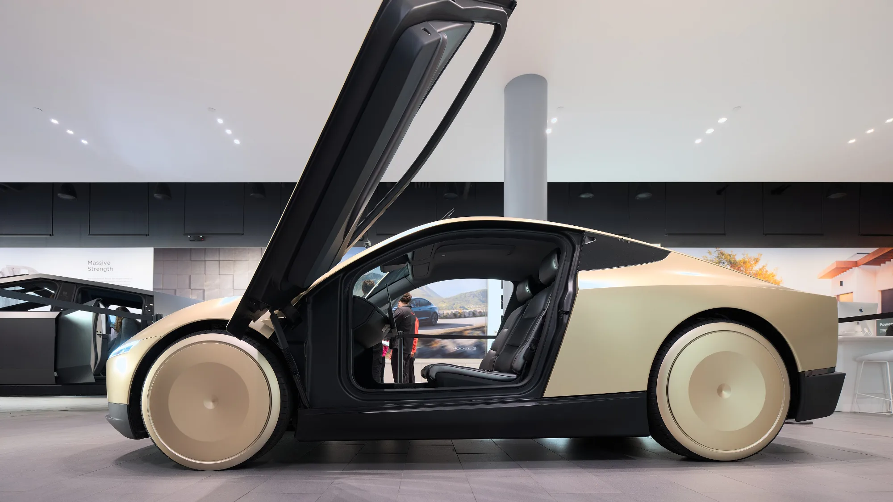

The **Cybercab**, Tesla's robotaxi with no steering wheel or pedals, is already coming off the production line at the Austin, Texas factory. At the Roadster unveiling on October 15, 2026, Musk even included it among the cars the sports car jumped over with its thrusters. But between building it and seeing it run on its own on public streets there is a gap Tesla has yet to close.

## Key points

- **Start of production:** the first Cybercab rolled out in February 2026, and continuous production began in April at Giga Texas.
- **Volume production:** Tesla admitted in July that it **will not reach it in 2026**.
- **Unsupervised driving:** still not solved. Musk talked about bringing it to customer cars “probably” in the fourth quarter.
- **Design:** two seats, no steering wheel or pedals.
- **Motor:** one, front-mounted, rated at about 219 hp (163 kW), according to documents filed with the EPA.

## What Tesla said

In its second-quarter shareholder letter, published in July, Tesla said the Cybercab, the Semi truck and the Megapack 3 will no longer reach volume production in 2026, as it had promised in January. One reason is that it needs to ramp up production of its 4680 battery cells.

Spending has soared: Tesla expects to spend about **US$25 billion** in 2026, roughly triple its usual level, and posted negative free cash flow of US$1 billion in the second quarter.

*The Cybercab's doors open upward, butterfly-style. Photo: Dllu, CC BY-SA 4.0, cropped, via Wikimedia Commons.*

## The core problem: driving itself

The Cybercab only makes sense if it can drive with no one on board, and that is still not solved. According to Electrek, the robotaxi service Tesla runs today with supervised cars has a crash rate about **four times** that of an average human driver. For now, the Cybercab only operates in small pilots within geofenced areas.

There is also a regulatory issue. In the United States, cars that don't meet every federal safety standard, for example because they have no steering wheel, need an exemption capped at 2,500 units per year per manufacturer. Tesla maintains that the Cybercab is designed to meet the standards without that exemption.

> Tesla's dates for self-driving have slipped many times. A Cybercab running unsupervised is, for now, a goal, not a fact.

## Will it come to Colombia?

There has been no announcement. Colombia also has no legal framework today for cars without a steering wheel or pedals to be on the road, so its arrival would first depend on a change in traffic regulations.

## Frequently asked questions

### Is the Tesla Cybercab already in production?

Yes. Continuous production began in April 2026 in Texas, though at low volume.

### When will it work without a driver?

Tesla has no firm date. Musk mentioned the fourth quarter of 2026 for unsupervised driving, but the brand has missed similar dates before.

### How much does it cost?

Tesla has not published an official retail price.

### Will it be sold in Colombia?

There has been no announcement, and Colombian regulations currently have no framework for cars without a steering wheel.

In the meantime, compare the Teslas that are on sale in Colombia in the [Mejor Eléctrico comparison tool](/es/comparador/?a=tesla-model-y-rwd-2026-eu&b=tesla-model-3-rwd-2026-eu).

---

**Sources:** [Electrek: Cybercab production starts](https://electrek.co/2026/04/23/tesla-cybercab-production-starts-no-nhtsa-2500-vehicle-cap/) · [TechCrunch: volume production delayed](https://techcrunch.com/2026/07/22/tesla-spending-skyrockets-as-cybercab-semi-megapack-production-timeline-slips/) · [Wikipedia: Tesla Cybercab](https://en.wikipedia.org/wiki/Tesla_Cybercab) · [TechCrunch: Roadster unveiling](https://techcrunch.com/2026/10/15/tesla-reveals-spacex-powered-roadster-that-flies-and-falls-with-style/)
