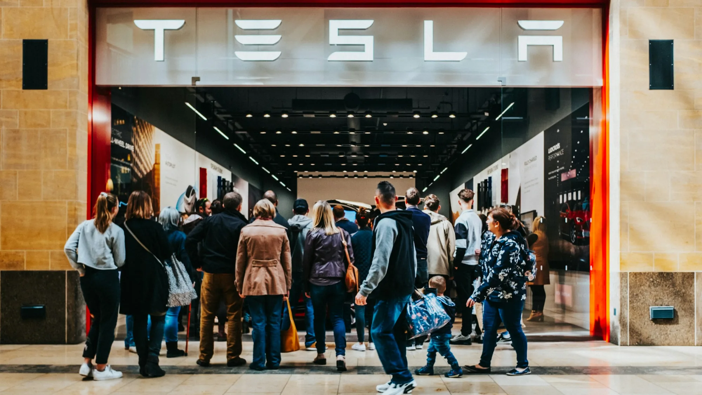

Less than a year ago Tesla did not sell cars in Colombia. Today it is the brand registering the most EVs by a wide margin: **2,435 units in September 2026**, **41.3%** of all EVs that month, and **16,542 so far this year**, 41.6% of the total.

## The figures

| Indicator | Tesla | Second place |
|---|---|---|
| EVs in September 2026 | 2,435 (41.3%) | BYD, 887 (15%) |
| EVs from January to September | 16,542 (41.6%) | BYD, 8,219 (20.7%) |
| Best-selling model of the year | Model Y, 14,381 | BYD Yuan Up, 3,908 |

The **Model Y** alone accounts for **36.1%** of all EVs registered this year. In June it was the best-selling car in the country across all technologies, with 2,295 units and 7.9% of the total market.

## Why it sells so well

- **Price.** Tesla arrived with the Model 3 from COP 114.9 million and the Model Y from COP 119.9 million, in the range of Chinese midsize SUVs with less brand recognition.
- **Timing.** It coincided with the tax benefits confirmed by the DIAN, Colombia's tax authority, green loan rates of 12% to 16.6% and the exemption from pico y placa, the driving restrictions in Colombian cities.
- **Direct sales.** Cars are bought online at a fixed price, with no dealer negotiation.
- **Its own Supercharger network**, announced from the launch.

*Tesla opened its first stores in Colombia in Bogotá and Medellín in late 2025. Photo: Chris Boland on Unsplash.*

## What it means for the rest of the market

Its arrival pushed other brands' prices down, a phenomenon the sector already calls the **"Tesla effect"**. We analyze it in [our article on the price war](/es/notas/guerra-de-precios-carros-electricos-efecto-tesla/).

But the competition is reacting. In September, the **Chery E5** was the second best-selling EV with 483 units, ahead of the BYD Yuan Up (409) and the MG S5 (324). Chinese brands compete with entry prices below Tesla's.

## The risks of so much concentration

- **After-sales service.** A fleet of more than 16,000 new cars in one year demands workshops, parts and technicians. Service capacity will be the test of 2027.
- **Charging.** Many of those cars charge in the same areas of Bogotá and Medellín, which already concentrate most of the charging stations.
- **Variable prices.** Tesla adjusts prices often in all its markets. Someone buying today may see the same car cheaper tomorrow, or more expensive.

> If you are torn between a Model Y and a similarly priced Chinese SUV, the key comparison is not only range: it is warranty, service network and charging connector.

## Frequently asked questions

### How many Teslas have been sold in Colombia?

Between January and September 2026, 16,542 were registered, according to the trade groups Fenalco and Andi, with data from RUNT, Colombia's national vehicle registry.

### What is the best-selling Tesla?

The Model Y, with 14,381 units this year. The Model 3 adds 2,161.

### Where are Tesla's stores in Colombia?

Tesla has stores in Bogotá and Medellín.

Compare the Model Y with its rivals in the [Mejor Eléctrico comparison tool](/es/comparador/).

---

**Sources:** [Portafolio: Tesla took 41.3% in September](https://www.portafolio.co/negocios/vehiculo/tesla-domina-los-electricos-mas-vendidos-en-colombia-concentro-41-3-de-las-matriculas-durante-septiembre-504120) · [Blu Radio: best sellers of June 2026](https://www.bluradio.com/motor/los-20-carros-mas-vendidos-en-colombia-en-junio-de-2026-so35) · [La República: Tesla prices in Colombia](https://www.larepublica.co/empresas/tesla-eleva-sus-precios-de-entrada-despues-de-su-lanzamiento-a-114-9-millones-4276858) · [ABC Economía: Tesla's arrival and expansion plans](https://abceconomia.co/?p=44147)
