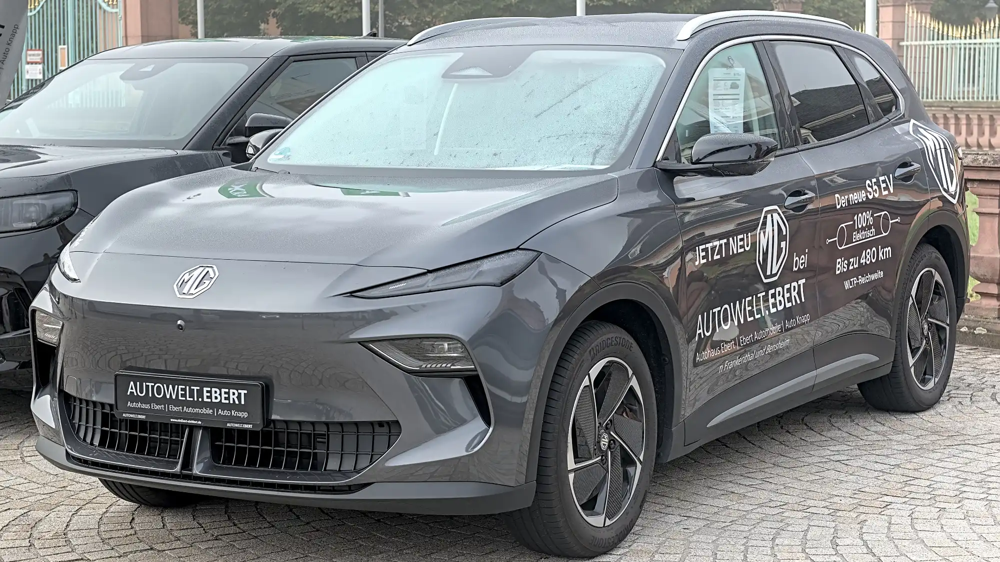

In November 2025, Tesla opened orders in Colombia with the **Model 3 from COP 109.9 million**. A few days later it raised that to **COP 114.9 million**, and the **Model Y** started **from COP 119.9 million**. Those prices, in the range of many midsize SUVs from Chinese brands, changed the market within months.

## Who moved prices

A report based on April 2026 figures from Fasecolda, Colombia's insurers' association, showed that several cars cut their price between 2025 and 2026, **with drops of up to COP 80 million** on some models. The list includes brands such as BYD and Kia.

At the same time, competitors arrived with the same aggressive strategy. The **Chery E5** went on sale in May from **COP 79.9 million**, and the **MG S5 EV** also landed in the low-price bracket for its size. Both are already among the best-selling EVs.

## What happened to sales

| Indicator | Figure |
|---|---|
| EVs registered from January to September 2026 | 39,784 |
| Growth against the same period of 2025 | 221.7% |
| Tesla's share of the year's EVs | 41.6% |
| EV share in September | 17.4% of the total market |

The effect spread to gasoline cars: urban EVs and quadricycles now appear in the ranking of the cheapest cars of 2026, and some gasoline models had to adjust their price so as not to sit above an equivalent EV.

*The MG S5 is one of the models that arrived with aggressive prices to compete with Tesla. Photo: Alexander-93, CC BY-SA 4.0, cropped, via Wikimedia Commons.*

## The other side: used cars

People who bought an EV in 2024 or early 2025 saw their car lose value faster than normal, because it now competes with cheaper new ones. For used-car buyers it is an opportunity; for sellers, a loss. We explain what to check in our [used EV guide](/es/notas/comprar-carro-electrico-usado-que-revisar/).

## Is it worth waiting for further drops?

There is no single answer, but there are arguments on both sides:

**To buy now:**

- Tax benefits and the exemption from pico y placa, the driving restrictions in Colombian cities, are in force today. Their continuity depends on future decisions.
- EV loan rates are between 12% and 16.6% effective annual, far below those for combustion cars.
- Each year you wait is a year without the energy savings, which can exceed COP 3 million.

**To wait:**

- Brands and models keep arriving, and competition keeps pressing prices.
- Batteries and charging technology improve with each generation.
- If your current car is in good shape, waiting has no immediate cost.

> The lowest price is not always the best buy. Before deciding on price, compare warranty, workshop network and charging connector.

## Frequently asked questions

### How much does a Tesla cost in Colombia?

At launch, the entry Model 3 was COP 114.9 million and the Model Y from COP 119.9 million. Prices may have changed; confirm them on the brand's website.

### Why are EV prices falling?

Because of competition from new brands, the zero tariff, Chinese manufacturers' production scale and the pricing strategy Tesla arrived with.

Compare specs in the [Mejor Eléctrico comparison tool](/es/comparador/).

---

**Sources:** [La República: Tesla raises its entry price](https://www.larepublica.co/empresas/tesla-eleva-sus-precios-de-entrada-despues-de-su-lanzamiento-a-114-9-millones-4276858) · [Blu Radio: the cars with the biggest price drops according to Fasecolda](https://www.bluradio.com/motor/los-20-carros-byd-kia-y-mas-que-mas-han-bajado-de-precio-tras-exito-de-tesla-segun-fasecolda-so35) · [Portafolio: best-selling EVs in September](https://www.portafolio.co/negocios/vehiculo/tesla-domina-los-electricos-mas-vendidos-en-colombia-concentro-41-3-de-las-matriculas-durante-septiembre-504120) · [El Carro Colombiano: the 10 cheapest cars of 2026](https://www.elcarrocolombiano.com/?p=316791) · [El Carro Colombiano: Chery E5](https://www.elcarrocolombiano.com/resenas/chery-e5-primer-contacto-suv-electrica-precio-colombia/) · [Portafolio: loan rates](https://www.portafolio.co/negocios/vehiculo/carros-electricos-ganan-terreno-en-colombia-por-tasas-bajas-iva-reducido-y-alivios-tributarios-493822)
