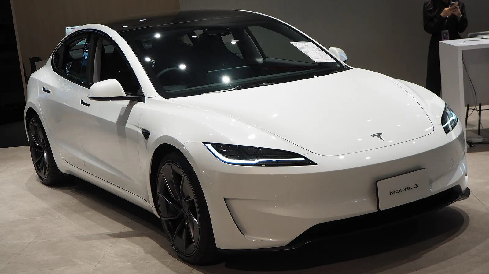

The refreshed **Tesla Model 3** earned **five stars** from **Euro NCAP** in May 2025, and the program also named it best in its class. The results are very high almost across the board, with one exception worth knowing about: the system that monitors whether the driver is distracted.

## Key facts

- **Rating:** 5 stars, published on May 21, 2025.
- **Tested version:** rear-wheel-drive (RWD) Model 3, 1,761 kg. The rating covers the other versions.
- **Adult occupant protection:** 90%.
- **Child occupant protection:** 93%.
- **Vulnerable road users:** 89%.
- **Safety assist:** 87%.

## The crash tests

In the **frontal crash** against a mobile barrier, the passenger compartment stayed stable and knee and leg protection was good for both front occupants. The only weak point in this part came in the full-width rigid barrier test: **chest protection for the rear passenger was marginal**, a problem shared by many cars tested under the current protocol.

In the **side impacts**, against another vehicle and against a pole, it scored the maximum: 16 out of 16. Whiplash protection in a rear-end crash was also good, front and rear.

## Children and pedestrians

For **children**, it scored 24 out of 24 points in the crash tests, and every child seat tested installed correctly. It has a child presence detection system in the cabin, and the passenger airbag can be disabled for a rear-facing seat.

For **pedestrians**, the hood pops up when it detects an impact, moving the head away from the motor and the structure underneath. Protection was good for the legs and pelvis; the weak points are the windshield pillars and the lower and upper edges of the glass, which are stiff.

*The Performance version shares its structure and rating with the rear-wheel-drive car that was tested. Photo: Chanokchon, CC BY-SA 4.0, via Wikimedia Commons.*

## The weak spot: driver monitoring

In safety assist, the Model 3 posted near-perfect results in autonomous emergency braking: 8.8 out of 9 against other cars, 8 out of 9 with pedestrians, 8 out of 8 with cyclists and 6 out of 6 with motorcycles. Lane support scored 3 out of 3.

The low mark is for **driver monitoring**: **0.4 out of 2**, rated weak. Euro NCAP acknowledges that it detects fatigue, but it received no data showing that the system reliably detects distraction, for example when the driver looks at a phone.

| Assist system | Score |
|---|---|
| AEB car-to-car | 8.8 out of 9 |
| AEB pedestrian | 8 out of 9 |
| AEB cyclist | 8 out of 8 |
| AEB motorcyclist | 6 out of 6 |
| Lane support | 3 out of 3 |
| Speed assistance | 2.6 out of 3 |
| Driver monitoring | 0.4 out of 2 |

> In the November 2025 round, the Model Y already showed improvements in distraction detection with new software. It is reasonable to expect the same for the Model 3, but the current rating is the one from May 2025.

## FAQ

### How many stars does the Tesla Model 3 have from Euro NCAP?

Five stars, published on May 21, 2025.

### What was its lowest score?

Driver monitoring, with 0.4 out of 2 points, because it did not demonstrate that it reliably detects distraction.

### Is it safer than the Model Y?

They have very similar crash results. The Model Y, tested six months later, scored higher in safety assist (92% vs. 87%).

Compare the two Teslas in the [Mejor Eléctrico comparison tool](/es/comparador/?a=tesla-model-3-rwd-2026-eu&b=tesla-model-y-rwd-2026-eu).

---

**Sources:** [Euro NCAP: Tesla Model 3 results](https://www.euroncap.com/en/results/Tesla/Model%203/54892) · [Drive Tesla Canada: Model 3 five stars](https://driveteslacanada.ca/news/tesla-model-3-scores-perfect-5-star-safety-rating-from-euro-ncap/)
