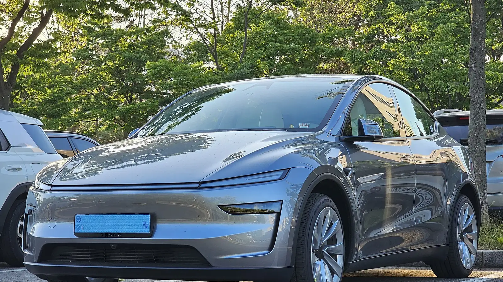

The best-selling electric car in Colombia is also one of the best-rated for safety. **Euro NCAP**, the European program that crash-tests new cars and publishes the results, gave **five stars** to the refreshed **Tesla Model Y** in its final round of 2025, published on November 19 of that year. In January 2026, it also named it the best small SUV tested in 2025.

## Key facts

- **Rating:** 5 stars, 2025 protocol.
- **Adult occupant protection:** 91%.
- **Child occupant protection:** 93%, the highest score in its group of 23 cars, tied with two others.
- **Vulnerable road users** (pedestrians, cyclists and motorcyclists): 86%.
- **Safety assist:** 92%, the best score of the entire round.
- **Weight of the tested car:** 1,979 kg.

## How to read a Euro NCAP rating

Euro NCAP doesn't give a single score. It rates four areas separately, and the number of stars depends on the car clearing a minimum in **all** of them. That's why a car with a very high score in one area can end up with four stars if it falls short in another.

The tests include a frontal crash against a mobile barrier that simulates another car, a frontal crash against a rigid wall, a side impact from another vehicle and a side impact against a pole. On top of that come autonomous emergency braking tests with cars, pedestrians, cyclists and motorcycles, and an assessment of systems such as driver monitoring.

## Where it stood out

The biggest jump over the previous Model Y is in **safety assist**. According to coverage of the test, Tesla improved autonomous emergency braking and added driver distraction and microsleep detection through software updates, without changing sensors. That earned it **92%**, ahead of the Volvo EX90, which scored 86% in the same round.

For **children**, Euro NCAP gave it full marks in the crash tests with the 6- and 10-year-old dummies, and every recommended child seat could be installed correctly. The car also has an **in-cabin radar** that warns if a child is left behind in the rear seat, one of the features the 2025 protocol rewards.

*The front of the refreshed Model Y, with no grille and a light bar running from side to side. Photo: Damian B Oh, CC BY-SA 4.0, via Wikimedia Commons.*

## Against other cars in the same round

| Car | Adults | Children | Vulnerable users | Safety assist |
|---|---|---|---|---|
| Tesla Model Y | 91% | 93% | 86% | 92% |
| Volvo EX90 | 92% | 93% | 82% | 86% |
| BYD Seal 6 | 92% | 90% | 84% | 85% |
| Škoda Elroq | 90% | 87% | 77% | 78% |
| Kia EV5 | 83% | 85% | 74% | 80% |

Every car in the table earned five stars. The Model Y's edge isn't in the crash tests, where several rivals match it or beat it by a point, but in the technology that prevents the crash.

## What to keep in mind in Colombia

The test was done with a European-spec car. The Model Y that Tesla sells in Colombia is the same generation with the same structure, but buyers should check the purchase spec sheet to confirm the driver assistance equipment is the same, because Tesla sets features by market and by software.

> The safety assist score depends largely on software. That's a strength, because it improves with updates, but it also means it pays to confirm which features are active on the Colombian version.

## FAQ

### How many stars does the Tesla Model Y have from Euro NCAP?

Five stars, in the assessment published on November 19, 2025, for the refreshed generation.

### What did it score for child protection?

93%, the highest of its round, alongside the Volvo EX90 and the Lucid Gravity.

### Does the rating apply to the Model Y sold in Colombia?

It's the same generation of the car. The structure doesn't change, but some driver assistance features depend on the software enabled in each country.

### Does it have a Latin NCAP rating?

No. Latin NCAP has not published a test of the Model Y.

Compare the Model Y with the Model 3 in the [Mejor Eléctrico comparison tool](/es/comparador/?a=tesla-model-y-rwd-2026-eu&b=tesla-model-3-rwd-2026-eu).

---

**Sources:** [Euro NCAP: results for 23 new cars, November 2025](https://cdn.euroncap.com/en/press-media/press-releases/euro-ncap-announces-test-results-for-23-new-cars) · [Euro NCAP: Tesla Model Y, 2025 results](https://news.euroncap.com/safercars/choose-a-car/tesla-model-y---euro-ncap-2025-results---5-stars/s/f12506af-158b-4631-a546-6ca7685dea9d) · [Drive Tesla Canada: test details](https://driveteslacanada.ca/news/teslas-new-model-y-earns-five-star-euro-ncap-rating-with-major-safety-gains/) · [La Tribune Auto: weight and protocol](https://www.latribuneauto.com/reportages/securite/16107-le-suv-electrique-de-taille-intermediaire-tesla-model-y-obtient-cinq-etoiles-aux-crash-tests-euro-ncap-2025)
