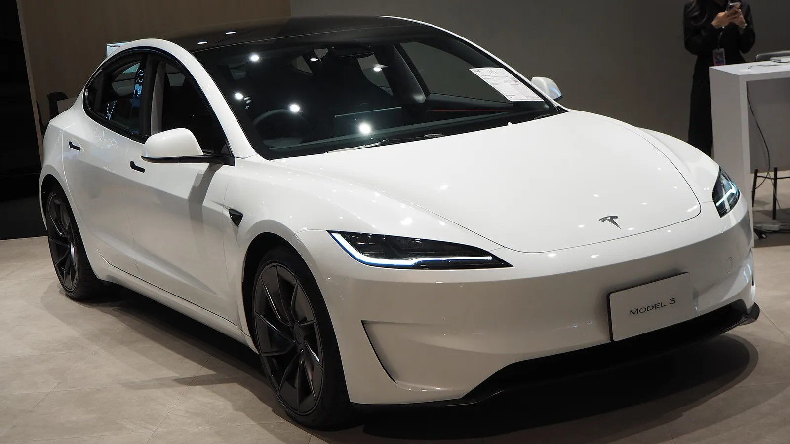

Tesla delivered **486,532 cars** between July and September 2026. The figure beat the consensus of 24 analysts compiled by the company itself, which expected 461,974, and it also topped every individual estimate that had been published. There is a less upbeat reading, though: it is **2.1% lower** than the same quarter of 2025, which remains the brand's all-time record.

## Key facts

- **Deliveries:** 486,532, down 2.1% from Q3 2025.
- **Versus the previous quarter:** up 1.3% from Q2 2026.
- **Production:** 464,391, about 22,000 fewer than deliveries.
- **Model 3 and Model Y:** 478,237 deliveries, 98% of the total.
- **Other models:** 8,295, half the figure of a year ago.
- **Year to date:** 1,324,681 deliveries, up 8.8% from 2025.

## Why it fell against 2025

The comparison is skewed. In Q3 2025, US buyers rushed to claim the US$7,500 federal tax credit, which expired on September 30 of that year. That inflated sales back then.

According to Electrek, what propped up this year's numbers was **high gasoline prices** in the US, which brought back much of the demand lost when the credit ended. In China, exports from the Shanghai factory offset weak local sales.

*The Model 3, the other car holding up Tesla's sales. Photo: Chanokchon, CC BY-SA 4.0, via Wikimedia Commons.*

## Inventory and energy storage

Tesla sold more cars than it built for the second quarter in a row. That cleared the roughly 50,000 surplus cars it produced in the first quarter.

In **stationary storage**, it deployed 13.7 GWh, up 9.6% year over year. That fell short of the 15.9 GWh analysts expected, so the energy business, which Tesla pitches as its other growth engine, did not make up for the dip in cars.

## The competition

In the same quarter, **BYD sold about 276,000 more EVs than Tesla** worldwide, according to Electrek. This is no longer a contested lead: in a single quarter, BYD opened a gap worth more than half of Tesla's volume. Add lower-than-expected second-quarter earnings and a US$30 billion credit line, and Tesla's finances are under pressure just as it ramps up spending on robotaxis and batteries.

## What about Colombia?

In Colombia, Tesla is moving against the global trend: between January and September 2026 it registered **16,542 EVs**, 41.6% of the country's total, and the Model Y is the best-selling electric car by a wide margin. We covered it in [How many Teslas have been sold in Colombia?](/es/notas/cuantos-tesla-se-han-vendido-en-colombia/).

A 2% drop from a record is not a crisis. But the “other models” (Model S, Model X and Cybertruck) halved in a year, which means 98% of sales now rest on two cars that have been on the market for several years.

## FAQ

### How many cars did Tesla deliver in Q3 2026?

486,532, according to the report it published on October 2.

### Was it better or worse than 2025?

Worse by 2.1%, although it beat analyst expectations.

### Which models sell the most?

The Model 3 and Model Y, with a combined 478,237 deliveries.

Compare the Model Y and Model 3 in the [Mejor Eléctrico comparison tool](/es/comparador/?a=tesla-model-y-rwd-2026-eu&b=tesla-model-3-rwd-2026-eu).

---

**Sources:** [Electrek: Q3 2026 deliveries](https://electrek.co/2026/10/02/tesla-q3-2026-deliveries-486532/) · [Drive Tesla Canada: results versus forecasts](https://driveteslacanada.ca/news/tesla-q3-2026-deliveries-results/) · [Infobae: EVs in Colombia, January to September (in Spanish)](https://www.infobae.com/colombia/2026/10/10/crece-la-venta-de-vehiculos-electricos-en-colombia-cerca-de-40000-automotores-en-lo-corrido-del-2026/)
