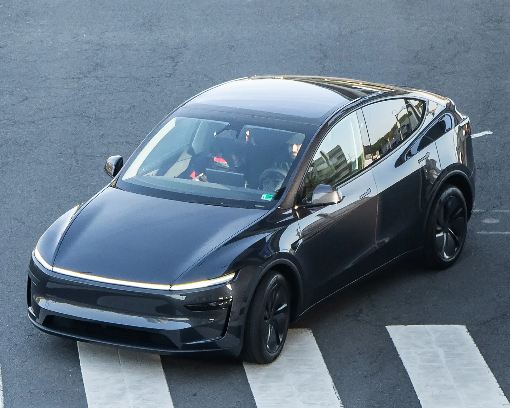

On October 23, 2026, Tesla announced **0% interest** financing in Colombia for the new **Model 3** and **Model Y**, with credit from **Banco Santander**. The condition that filters most buyers is the down payment: you must pay **at least 50% of the car up front**, and the rest is split into up to 36 interest-free installments.

## The conditions

| Condition | Detail |
|---|---|
| Rate | Fixed 0% effective annual |
| Down payment | Minimum 50% of the price, up front |
| Term | Up to 36 months |
| Lender | Banco Santander Colombia, which approves or denies the loan |
| Who qualifies | Individuals only, not companies |
| Type | Traditional loan, new cars only |
| Deadline | Orders between October 22 and December 31, 2026, with delivery before December 31 |

## What the payments come to

| Model | Price | Down payment | 36 payments of |
|---|---|---|---|
| Model 3 Premium RWD | COP 115,990,000 | COP 57,995,000 | About COP 1,610,972 |
| Model Y | COP 120,990,000 | COP 60,495,000 | About COP 1,680,417 |

Simulations published by Tesla and reported by Portafolio. Prices include VAT, transport and registration costs. Payments do not include insurance or other charges, and they do not amount to an approval.

The math is simple: with no interest, each payment is the balance divided by 36. Against a traditional car loan, offered for EVs in 2026 from rates of about 12.5% a year, the saving is large: financing COP 58 million over 36 months at 12.5% effective annual would cost about COP 11.2 million in interest, by our calculation, not counting insurance.

*The offer requires receiving the car before December 31, 2026. Photo: OWS Photography, CC BY 4.0, via Wikimedia Commons.*

## The small print

**0% is not zero cost.** Tesla warns that insurance, fees, guarantees and other charges may apply, and that they must be disclosed before approval. The figure to compare is the total cost of the loan, not the rate.

**The deadline is delivery.** The offer requires receiving the car before December 31, 2026. Tesla had delivery delays in Colombia in 2026: the Superintendence of Industry and Commerce, the country's consumer protection authority, reported in April that more than 1,800 cars due for delivery between February and March were still pending. A year-end order could miss out if the car does not arrive in time. Ask for the estimated delivery date before signing.

**It is not for every budget.** The offer suits people who already have about COP 58 to 60 million available. For those who do not, Tesla offers other plans of 12 to 60 months with down payments from 10%, but those do charge interest, at rates that depend on the term, the down payment and the customer's profile.

## Is it worth it?

For anyone already set on a Tesla who has half the money, yes: it is hard to find a cheaper loan. For anyone comparing, the offer narrows the price gap with cheaper Chinese rivals, but does not eliminate it. A COP 120.99 million Model Y at 0% still costs considerably more than a [Geely EX5 SE](/es/notas/geely-ex5-se-colombia-precio-autonomia-ficha/) at COP 92.9 million paid in cash.

> The offer is also a market signal: Tesla dominates EV sales in Colombia, and using credit to close the year suggests it wants to sustain that volume in the last quarter. The brand's figures are in [how many Teslas have been sold in Colombia](/es/notas/cuantos-tesla-se-han-vendido-en-colombia/).

## Frequently asked questions

### What is Tesla's 0% payment in Colombia?

About COP 1,610,972 a month for the Model 3 Premium RWD and COP 1,680,417 for the Model Y, over 36 months, after paying 50% up front.

### How long does Tesla's 0% financing last?

For orders placed between October 22 and December 31, 2026, with delivery before December 31.

### Which bank provides the loan?

Banco Santander Colombia, which studies and approves each application.

---

**Sources:** [Portafolio: Tesla's 0% financing in Colombia](https://www.portafolio.co/negocios/vehiculo/tesla-ofrece-financiacion-al-0-de-interes-en-colombia-para-model-3-y-model-y-asi-puede-acceder-505120) · [Semana: models with a 0% rate](https://www.semana.com/vehiculos/articulo/que-modelos-de-tesla-reciben-tasa-de-0-en-colombia-estos-son-los-beneficiados/202643/) · [Valora Analitik: Tesla offers 0% financing](https://www.valoraanalitik.com/tesla-ofrece-financiacion-al-0-para-sus-carros-model-3-y-model-y-en-colombia/) · [Portafolio: EV loan rates in 2026](https://www.portafolio.co/negocios/vehiculo/carros-electricos-ganan-terreno-en-colombia-por-tasas-bajas-iva-reducido-y-alivios-tributarios-493822)
