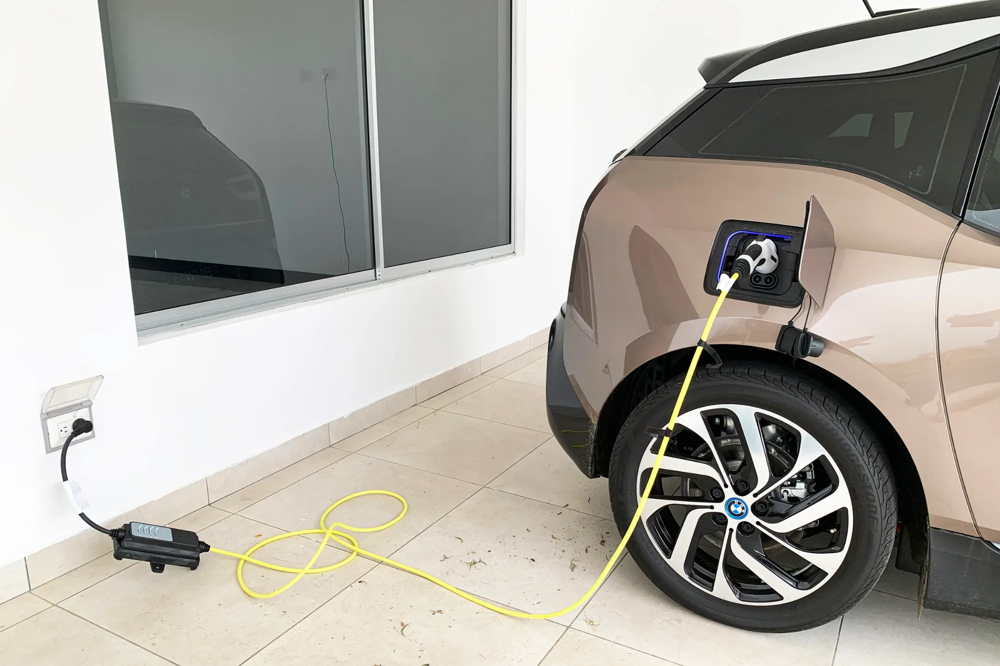

The showroom price of an EV is the figure that says least about what it will cost. To see the full picture, we added up everything a buyer pays over five years for a **COP 89.99 million** EV in Bogotá, financing it and driving 12,000 km (7,500 miles) a year. That is the price of the Kia EV2 or the new BYD Dolphin in Colombia.

## The assumptions

- A **20%** down payment and a **COP 71.99 million loan over 60 months** at a green rate of **12.5% effective annual**, the lowest reported in 2026.
- Charging almost always at home, at **COP 864 per kWh**, Enel's tariff for *estrato* 4, one of Colombia's socioeconomic utility tiers, in August 2026, with consumption of 16.5 kWh per 100 km including charging losses.
- Comprehensive insurance at about **2.07% of the car's value a year**, the cheapest offer for EVs worth COP 90 to 120 million according to Seguro Canguro's 2026 study.
- Bogotá vehicle tax: a maximum of 1% of the valuation for EVs, with a **60% discount** for five years on new private cars.

## The math

| Item | Five years |
|---|---|
| Down payment | COP 18.0 million |
| 60 payments of COP 1,595,473 | COP 95.7 million |
| Energy at home (COP 1.71 million a year) | COP 8.6 million |
| Comprehensive insurance (about COP 1.86 million a year) | COP 9.3 million |
| Vehicle tax (about COP 360,000 a year) | COP 1.8 million |
| Installed wall charger | COP 3.0 million |
| Registration and RUNT entry in Bogotá | COP 0.7 million |
| VAT refund | minus COP 4.3 million |
| **Total** | **about COP 132.8 million** |

Our own calculation. Spread over 60 months, the car costs about **COP 2.2 million a month**, not the COP 1.6 million of the loan payment.

Of the total, about **COP 23.7 million is loan interest**. It is the second item after the car itself, and the only one that can be cut sharply with buying decisions: a bigger down payment, a shorter term or extra payments on principal. All three options are calculated in [how much down payment to make](/es/notas/cuota-inicial-carro-electrico-cuanto-dar/) and [how much paying down principal saves](/es/notas/abonar-a-capital-credito-carro-electrico-ley-1555/).

*Charging at home for 12,000 km (7,500 miles) a year costs about COP 1.71 million at Enel's tier 4 tariff. Photo: Mariordo (Mario Roberto Durán Ortiz), CC BY-SA 4.0, via Wikimedia Commons.*

## What the math does not include

**SOAT and maintenance.** We left out the mandatory accident insurance and maintenance because they depend heavily on the model and the workshop. An EV's SOAT has a discounted premium, and maintenance is usually cheaper than a combustion car's because there are no oil or engine filter changes. We detail it in [what EV maintenance includes](/es/notas/mantenimiento-carro-electrico-que-incluye/).

**What the car is worth at the end.** After five years the car is still yours and has a resale value. Subtracting it would lower the real cost, but used EVs have depreciated quickly in Colombia because of the price war on new ones, and there is no reliable figure for a model from 2026 to 2031.

**The fixed assumptions.** We treated insurance and tax as if they did not fall, although both are calculated on a valuation that drops each year. That is why those two rows are a ceiling, not an average.

## Against a gasoline car

On energy, the same distance in a gasoline car getting 40 km per gallon (25 mpg) costs about **COP 4.9 million a year** with a gallon at COP 16,331, the Bogotá price in October 2026. Over five years that is about **COP 16 million more** than the EV on fuel alone. To that add the higher vehicle tax and, for those who paid it, the "solidarity" fee of **COP 70,294 a day** to skip pico y placa, the driving restrictions. The full math is in [electric or gasoline: how much you save](/es/notas/electrico-vs-gasolina-cuanto-se-ahorra-2026/).

> If the EV costs COP 15 million more than its gasoline equivalent, five years of fuel savings almost make up for it. If it costs COP 30 million more, they do not, and the decision depends on pico y placa, the tax and what the car is worth when you sell it.

## Frequently asked questions

### How much does it cost per month to own a COP 90 million EV?

By our calculation, about COP 2.2 million a month over five years, with the loan, energy, insurance, tax and charger, after subtracting the VAT refund.

### What is the biggest expense after the car?

Loan interest: about COP 23.7 million over five years with 20% down and 12.5% effective annual.

### How much does it cost to charge an EV at home per year?

At 12,000 km (7,500 miles) a year and Enel's tier 4 tariff, about COP 1.71 million. We explain it in [how much it costs to charge at home](/es/notas/cuanto-cuesta-cargar-un-electrico-en-casa/).

---

**Sources:** [Enel Colombia, August 2026 tariffs](https://www.enel.com.co/content/dam/enel-co/español/personas/1-17-1/2026/pliego%20tarifario%20digital%20_agosto_2026.pdf) · [La Nota Económica: Seguro Canguro's study on EV insurance](https://lanotaeconomica.com.co/movidas-empresarial/el-carro-nuevo-mas-cotizado-para-asegurar-en-colombia-en-2026-es-un-tesla-y-asegurar-un-electrico-ya-cuesta-lo-mismo-que-uno-a-gasolina/) · [Valora Analitik: vehicle tax discounts in Bogotá](https://www.valoraanalitik.com/carros-electricos-en-bogota-tendran-hasta-70-de-descuento-en-impuesto-vehicular/) · [Law 1964 of 2019](https://www.alcaldiabogota.gov.co/sisjur/normas/Norma1.jsp?i=85510) · [Cambio: gasoline price in October 2026](https://cambiocolombia.com/economia/articulo/2026/10/gasolina-sube-de-precio-desde-este-1-de-octubre-como-quedo-el-galon-en-las-principales-ciudades-del-pais) · [Infobae: solidarity pico y placa 2026](https://www.infobae.com/colombia/2026/05/07/conductores-podran-quedar-exentos-del-pico-y-placa-en-bogota-sin-pagar-asi-funciona-el-beneficio-para-2026/) · [Blu Radio: cost of installing a charger](https://www.bluradio.com/motor/cuanto-cuesta-cargar-un-carro-electrico-en-colombia-so35) · [Infobae: Bogotá transit fees in 2026](https://www.infobae.com/colombia/2026/01/06/suben-los-precios-de-licencias-de-conduccion-y-tramites-de-transito-en-2026-en-bogota-consulte-las-nuevas-tarifas/)
