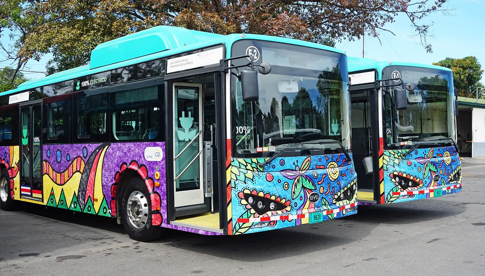

The two countries that electrified fastest in Latin America are not the big markets. They are **Uruguay** and **Costa Rica**, which according to the Latin American and Caribbean Energy Organization (Olade) lead the region in EVs per capita. Both used tax incentives to get started, but in 2026 their paths are heading in opposite directions.

## Uruguay: EVs now outsell gasoline

In **May 2026**, Uruguay sold **2,671 electric cars** and **2,274 gasoline ones**. It was the first time EVs outsold *nafteros*, as gasoline cars are called there: they took **43% of sales** of light vehicles, against 37% for gasoline, 15% for hybrids and 5% for diesel.

The jump had been building. In 2025, Uruguay sold **14,443 EVs**, about 20% of the year's 71,442 new vehicles, 146.7% more than in 2024. By January 2026 they were already 21.1% of the market.

| Uruguay | Figure |
|---|---|
| EVs sold in 2025 | 14,443 |
| Share in 2025 | About 20% |
| EVs sold in May 2026 | 2,671 |
| Share in May 2026 | 43% |

Sources: Bloomberg Línea with data from the Automotive Trade Association of Uruguay, and Ámbito.

### What explains the Uruguayan case

The incentives are concrete and they add up:

- **Lower annual vehicle tax:** in 2026, the *patente* on a new EV is 3% of its value, against 5% for a combustion car.
- **Cheaper insurance:** the state insurer, Banco de Seguros del Estado, gives EVs a 15% discount.
- **Green loans:** Santander, HSBC, Itaú and BBVA offer special loans.
- **Energy:** the state utility UTE has an electric mobility plan with discounts for connecting or expanding power at home and reduced tariffs at certain hours.

*Electric buses in Costa Rica, the other country leading the region in EVs per capita. Photo: Mariordo (Mario Roberto Durán Ortiz), CC BY-SA 4.0, via Wikimedia Commons.*

## Costa Rica: the pioneer withdrawing benefits

In 2018, Costa Rica passed Law 9518 on incentives for electric transport, which exempted EVs from much of the import, sales and ownership taxes. It was one of the most generous laws in the region. Since **June 13, 2025**, those benefits have begun to shrink:

| Tax | Before | Since June 2025 |
|---|---|---|
| Selective consumption tax (30% of value) | Exempt | 25% is paid: 7.5% effective |
| Tariff (1% of CIF value) | Exempt | 25% is paid: 0.25% effective |
| VAT | Reduced | 3% in 2025, rising to the general 13% |
| Marchamo, the annual tax | Exempt | 40% exemption in 2025, falling 20 points a year |

In June 2028, the exemption from import taxes falls to 50%. The sector association, Asomove, projected about 35,000 EVs on the road in 2026. In 2025, Costa Rica sold 14,058 electrified cars, practically the same as in 2024 (−0.4%), while the rest of the region grew at double and triple digits.

## The lesson for the region

Both cases show that purchase price is the strongest lever. Uruguay kept and expanded its benefits and watched EVs overtake gasoline. Costa Rica began withdrawing them and its electrified sales stalled in 2025. There is not enough data to attribute all of the stall to the reduced benefits, but the coincidence is hard to ignore.

For Colombia, which today has 5% VAT and a zero tariff for EVs, the discussion is the same: how long to sustain the incentives and how to withdraw them without slowing the market. We explain this in [the benefits of buying an EV](/es/notas/beneficios-tributarios-carro-electrico-2026/).

## Frequently asked questions

### Which Latin American country has the most EVs per capita?

Uruguay and Costa Rica lead the region per capita, according to Olade.

### Is it true that Uruguay sells more EVs than gasoline cars?

Yes, in May 2026: 2,671 EVs against 2,274 gasoline cars.

### Has Costa Rica removed its benefits for EVs?

It is reducing them gradually since June 2025, with further cuts planned through 2028.

---

**Sources:** [Ámbito: EVs outsell gasoline cars for the first time in Uruguay](https://www.ambito.com/uruguay/las-ventas-autos-electricos-marcaron-un-record-y-superaron-primera-vez-los-nafteros-n6286872) · [Bloomberg Línea: EV sales in Uruguay](https://www.bloomberglinea.com/latinoamerica/uruguay/ventas-de-vehiculos-electricos-se-cuadruplican-en-uruguay-que-explica-el-auge/) · [Delfino: reduced exemptions in Costa Rica](https://delfino.cr/2025/06/a-partir-del-13-de-junio-se-aplicara-reduccion-en-exoneraciones-fiscales-para-vehiculos-electricos) · [La República of Costa Rica: benefits begin to disappear](https://www.larepublica.net/noticia/beneficios-fiscales-para-vehiculos-electricos-empiezan-a-desaparecer) · [Bloomberg Línea: electrified sales by country in 2025](https://www.bloomberglinea.com/2026/02/11/los-paises-lideres-en-ventas-de-autos-electricos-y-estaciones-de-carga-en-latinoamerica/) · [Forbes Perú: Olade data](https://forbes.pe/negocios/2026-09-22/latinoamerica-supera-el-millon-de-vehiculos-electricos-con-mas-de-la-mitad-en-brasil/)
