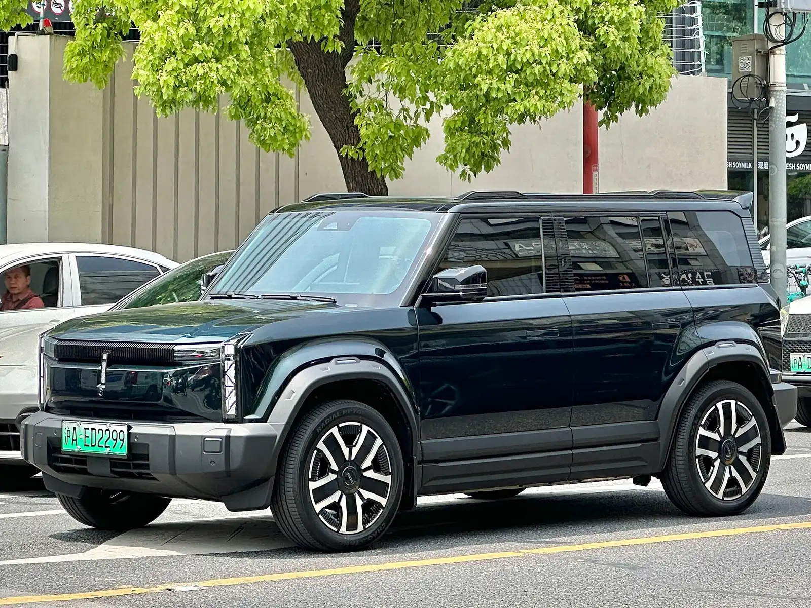

**V2L** stands for *vehicle to load*. It is the feature that lets an electric car's battery power external devices, much like a silent generator. Some cars have an outlet inside the cabin or in the trunk; others use an adapter that plugs into the charging port and ends in a standard household socket.

## How much power it delivers

The maximum outputs published by manufacturers range from **2.2 to 3.6 kW**, according to EVDB, New Zealand's electric vehicle database. For reference, a household fridge uses around 1 kWh a day on average, so a 50 or 60 kWh battery could keep one running for many days if nothing else draws from it.

| V2L output | Example models |
|---|---|
| 2.2 kW | BYD Atto 3, MG4 |
| 3 kW | BYD Seal |
| 3.2 kW | Kia EV5, Polestar 4 |
| 3.3 kW | BYD Dolphin, BYD Sealion 7, Geely EX5, Leapmotor C10 |
| 3.6 kW | Hyundai Ioniq 5 and Ioniq 6, Kia EV3, EV6 and EV9 |

Outputs for the versions sold in New Zealand. They may differ in other markets, and on some models V2L depends on the trim or on an accessory.

In Colombia, published spec sheets confirm V2L on the **BYD Seagull**, the **Chery iCar 03** and the **Geely EX5 Max**, among others.

*The Chery iCar 03 is one of the cars with V2L confirmed on Colombian spec sheets. Photo: JustAnotherCarDesigner, CC0, via Wikimedia Commons.*

## What you can plug in

Three kilowatts is enough for most household appliances, one or two at a time: a fridge, a laptop, lights, a TV, a rice cooker or small power tools. High-draw appliances such as an electric shower heater, an oven or a water heater can exceed the limit, so they are best used only in short bursts, or not at all.

It is useful in a power outage, on a camping trip with a portable cooler and lights, or for working outdoors with tools. Some cars can also charge another electric car, very slowly, in an emergency.

## What to keep in mind

**The car's battery drains.** Many cars let you set a limit, for example shutting V2L off when the battery reaches 20%, so you are not left without range. Set it up before you use it.

**It is not a connection to your home's grid.** V2L powers devices plugged directly into the car or into an extension cord. Connecting the car to a house's electrical system is a different technology, called V2H, which requires special equipment and an electrician. Doing it without them is dangerous for the car, the house and the utility company's technicians.

**Use good-quality extension cords** rated for the load you plan to connect.

> In countries with frequent power cuts, or rural areas without a stable grid, V2L can be as strong a reason to buy as range.

## Frequently asked questions

### What is V2L on an electric car?

A feature that draws energy from the car's battery to power external devices.

### How much power does V2L deliver?

Between 2.2 and 3.6 kW on the most common models, depending on the manufacturer.

### Can I connect the car to my house with V2L?

Not directly. Powering a home's electrical system requires a V2H setup, with special equipment and a certified electrician.

---

**Sources:** [EVDB New Zealand: V2L guide and outputs](https://evdb.nz/v2l) · [El Carro Colombiano: BYD Seagull with V2L](https://www.elcarrocolombiano.com/recomendados/byd-seagull-nuevo-precio-colombia-byd-fest-2026/) · [El Carro Colombiano: Chery iCar 03](https://www.elcarrocolombiano.com/resenas/chery-icar-03-el-4x4-electrico-definitivo-candidato-a-el-carro-del-ano-2025-en-colombia/) · [Geely Colombia: EX5 spec sheet](https://geely.com.co/wp-content/uploads/2026/03/EX5_Bajav4.pdf)
