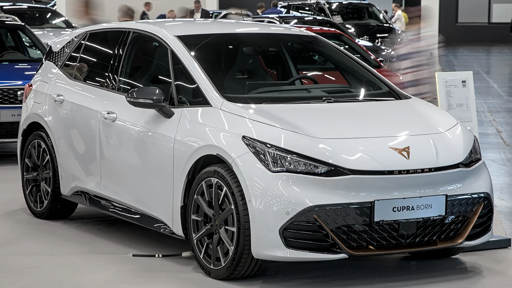

The **Volkswagen Group** has recalled electric cars from Volkswagen's **ID** family and from **Cupra** over a **battery** defect that, in the worst case, could cause a fire. The news was first reported on October 16, 2026 by German public broadcaster NDR and picked up by agencies such as EFE.

## Key facts

- **Brands:** Volkswagen (ID family) and Cupra.
- **Production years:** 2023 and 2024.
- **Defect:** a production fault at a supplier of battery components.
- **Risk:** fire, in the worst case. The brand describes it as an extreme possibility.
- **Units affected:** not published.
- **Country of the announcement:** Germany.

## What is known and what isn't

Volkswagen said it is a **precautionary campaign** and that a fire would be the most serious possible scenario, not the expected behavior of the cars. It has not said how many cars are included, which exact ID and Cupra models are involved, or who the supplier is.

This is not the group's first battery problem this year. In March 2026, Volkswagen had already recalled about **100,000 EVs** over potentially faulty battery modules. Separately, the group has an ongoing recall of more than **4.5 million** Volkswagen, Audi and Skoda cars for a steering problem, which has nothing to do with batteries.

*The Cupra Born, Cupra's compact EV, shares its platform with the Volkswagen ID.3. Photo: Alexander-93, CC BY-SA 4.0, cropped, via Wikimedia Commons.*

## Does it affect Colombia?

The recall was announced in Germany, and there is no announcement for Colombia so far. Volkswagen sells ID-family EVs in some Latin American markets, so if you own an electric ID or Cupra built in 2023 or 2024, the sensible step is to ask your dealer whether your vehicle identification number (VIN) is included.

In Colombia, recalls can be looked up on the website of the **Superintendencia de Industria y Comercio** (SIC), which publishes the campaigns reported by carmakers.

> A recall does not mean the car is dangerous today. It means the brand found a defect and is fixing it for free. The risk lies in ignoring it.

## What to do if you own a Volkswagen or Cupra EV

1. Find the VIN on the vehicle registration card or at the base of the windshield.
2. Check with your dealer or on the SIC's recall page.
3. If your car is included, book the repair and ask whether there are any recommendations in the meantime on how and where to charge it.

## FAQ

### Which cars does the recall include?

Electric cars from Volkswagen's ID family and from Cupra built in 2023 and 2024. The brand has not published the exact list.

### What is the risk?

A battery defect that, in the worst case, could cause a fire.

### Does it apply in Colombia?

There is no announcement for Colombia for now. Check with your dealer using your car's VIN.

Compare EVs and their battery warranties in the [Mejor Eléctrico comparison tool](/es/comparador/).

---

**Sources:** [Infobae and EFE: Volkswagen and Cupra recall (in Spanish)](https://www.infobae.com/america/agencias/2026/10/16/grupo-volkswagen-llama-a-revision-a-modelos-id-y-de-marca-cupra-por-problemas-en-baterias/) · [El Debate: fire risk (in Spanish)](https://www.eldebate.com/motor/20261016/grupo-volkswagen-llama-revision-coches-electricos-grave-fallo-riesgo-incendio_470614.html) · [Electrek: March 2026 recall](https://electrek.co/2026/03/24/volkswagen-recalling-100000-evs-over-potential-battery-issues/)
