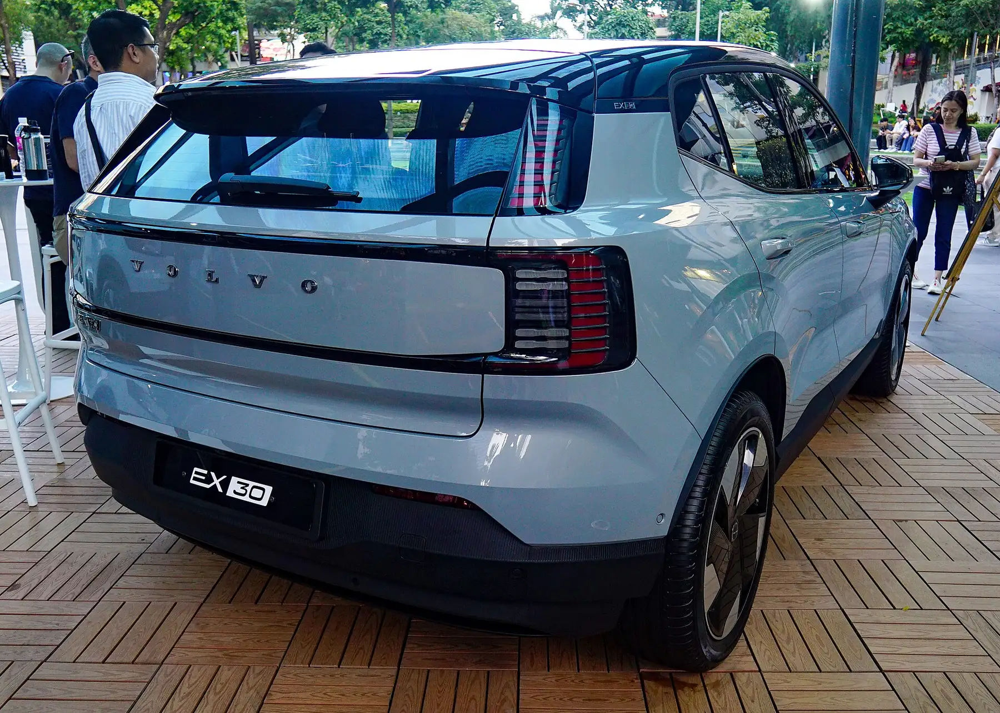

The **Volvo EX30** is the brand's smallest electric SUV: **4,233 mm long, 1,837 mm wide and 1,549 mm tall**, with a **2,650 mm** wheelbase. That makes it 21 centimeters shorter than a Volvo XC40. Its rear trunk holds **318 litres**, a tight figure for its size, and up front, where other EVs have a usable second trunk, there is only a **7-litre** compartment.

## Volvo EX30 dimensions

| Dimension | EX30 | EX30 Cross Country |
|---|---|---|
| Length | 4,233 mm | 4,233 mm |
| Width | 1,837 mm | 1,837 mm |
| Height | 1,549 mm | 1,573 mm |
| Wheelbase | 2,650 mm | 2,650 mm |
| Rear trunk | 318 L | 318 L |
| Trunk with rear seats folded | 904 L | Not given in the source |
| Front trunk (frunk) | 7 L | 7 L |
| Seats | 5 | 5 |

Dimensions from EV Database for the 2026 models; the capacity with the rear seats folded comes from Motor1. Other sources list a height of 1,555 mm for earlier versions.

The **Cross Country** is the adventure-styled version: its body sits 2.4 cm higher, it gets plastic cladding, and its footprint is the same. It is not a bigger car, so interior space and trunk volume do not change.

## How its size compares

| Electric SUV | Length | Rear trunk |
|---|---|---|
| Volvo EX30 | 4.23 m | 318 L |
| Kia EV3 | 4.30 m | 460 L |
| BYD Atto 2 (Yuan Up in Colombia) | 4.31 m | 400 or 450 L, depending on the battery |
| Geely EX5 | 4.61 m | 461 L |
| Tesla Model Y | 4.79 m | 822 to 835 L, plus 116 L up front |

The EX30 is the shortest car in the table and has the smallest trunk. The Kia EV3, just 7 cm longer, offers 142 litres more in the back, and the Atto 2, 8 cm longer, between 82 and 132 litres more. The 38-centimeter length gap with the Geely EX5 translates into 143 fewer litres of cargo space.

*The EX30's rear trunk holds 318 litres, the figure where it falls furthest behind its rivals. Photo: Ethan Llamas, CC BY-SA 4.0, via Wikimedia Commons.*

## What the dimensions mean day to day

At 4.23 meters, the EX30 fits in almost any apartment-complex or shopping-mall parking space, including the narrow spots common in Colombian cities. The 318-litre trunk takes a grocery run or two carry-on suitcases, but not a week's luggage for four people. For a family that travels often, the gap with an EV3 or an EX5 is noticeable.

## The EX30 in Colombia

Volvo launched the EX30 in Colombia in June 2024 in Core, Plus and Ultra trims, with 51 or 69 kWh batteries and launch prices between COP 179.99 million and COP 259.99 million. It holds a five-star Euro NCAP rating, with 88% for adult occupant protection, as we covered in [our safety story](/es/notas/volvo-ex30-euro-ncap-5-estrellas/).

> If trunk space is a priority, bring your luggage to the test drive and check. The EX30's 318 litres are the figure where it falls furthest behind its rivals.

## FAQ

### How big is the Volvo EX30?

4,233 mm long, 1,837 mm wide and 1,549 mm tall, with a 2,650 mm wheelbase.

### How many litres does the Volvo EX30 trunk hold?

318 litres with all five seats in place and 904 with the rear seats folded, plus 7 litres in the front compartment.

### Is the EX30 Cross Country bigger?

Not in length or width. It is 2.4 cm taller because of its raised suspension, and the trunk is the same.

---

**Sources:** [EV Database: Volvo EX30 P5 Long Range](https://ev-database.org/car/3480/Volvo-EX30-P5-Long-Range) · [EV Database: Volvo EX30 Cross Country](https://ev-database.org/car/3482/Volvo-EX30-Cross-Country-P5-Long-Range) · [Motor1: Volvo EX30 dimensions and trunk space](https://www.motor1.com/news/712706/volvo-ex30-dimensions-boot-space-analysis/) · [Valora Analitik: the Volvo EX30 in Colombia (in Spanish)](https://www.valoraanalitik.com/volvo-ex-30-precios-caracteristicas-colombia-cuanto-vale/) · [EV Database: BYD Atto 2](https://ev-database.org/car/3268/BYD-ATTO-2-648-kWh) · [EV Database: Tesla Model Y](https://ev-database.org/car/3741/Tesla-Model-Y-RWD) · [EV Database: Kia EV3](https://ev-database.org/car/3638/Kia-EV3-Long-Range) · [Euro NCAP: Volvo EX30 test datasheet](https://cdn.euroncap.com/media/85377/euroncap-2024-volvo-ex30-datasheet.pdf)
