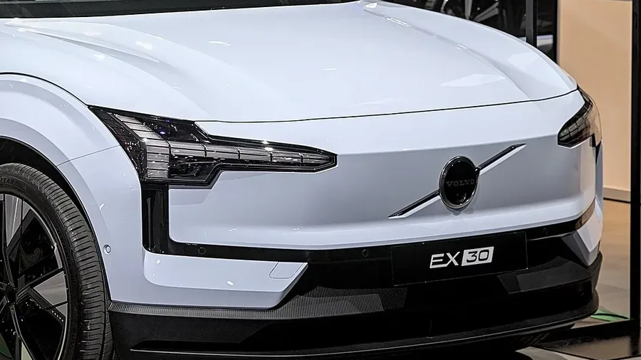

Volvo built its brand around safety, so the **EX30**'s **Euro NCAP** result had to live up to it. It does: **five stars** and **88% for adult occupant protection**. But the test datasheet shows two areas that aren't perfect, and one of them is a surprise in a Volvo.

## Key facts

- **Rating:** 5 stars, published in December 2024.
- **Tested version:** EX30 Plus, single motor, extended-range battery, 1,775 kg.
- **Adult occupant protection:** 88%.
- **Child occupant protection:** 85%.
- **Vulnerable road users:** 79%.
- **Safety assist:** 80%.

## The crash tests

| Test | Result |
|---|---|
| Frontal, mobile barrier | Stable passenger compartment and good knee and leg protection. It lost points because Volvo did not show the same protection for occupants of other sizes |
| Frontal, rigid wall | Rear passenger chest marginal, everything else good |
| Side, against another vehicle | Maximum score |
| Side, pole | Chest weak, everything else good |
| Whiplash | Good front and rear |

Euro NCAP also rated it as a car that is **not very aggressive toward the other vehicle** in a frontal crash, which matters because the EX30 weighs almost 1.8 tonnes.

*The hammer-shaped headlights are the signature of Volvo's electric cars. Photo: Alexander-93, CC BY-SA 4.0, cropped, via Wikimedia Commons.*

## Safety assist: strong braking, weak monitoring

Autonomous emergency braking worked well with other cars (7.8 out of 9), cyclists (7.1 out of 8) and motorcyclists (5.9 out of 6). With pedestrians it was adequate (5.2 out of 9). Lane support scored full marks: 3 out of 3.

The surprise is **driver monitoring**. The EX30 comes standard with a camera that tracks the driver's eyes to detect fatigue and distraction, yet it scored just **0.6 out of 2**. It also lacks **child presence detection** in the cabin, and the system that warns of an approaching cyclist when a door opens isn't switched on by default, so it earned no points.

> With 80% in safety assist, the EX30 comfortably clears the 70% minimum for five stars. The points it loses come from monitoring systems, not from crash protection.

## What to know in Colombia

The EX30 arrived in Colombia in June 2024 in Core, Plus and Ultra trims, with 51 or 69 kWh batteries and launch prices between COP 179.99 million and COP 259.99 million. The structure is the same across the range, so the crash results apply to all of them. For the Colombian market, Volvo announced autonomous emergency braking, door-opening alert and the drowsiness and distraction monitor with an infrared camera, the same systems Euro NCAP assessed.

## FAQ

### How many stars does the Volvo EX30 have from Euro NCAP?

Five stars, published in December 2024.

### What was its weakest point?

Driver monitoring, with 0.6 out of 2 points, and chest protection in the pole impact.

### Does it have child presence detection?

No. Euro NCAP noted that it doesn't, and it lost points in child protection as a result.

Compare the EX30 with the Kia EV3 in the [Mejor Eléctrico comparison tool](/es/comparador/?a=volvo-ex30-p5-2026-eu&b=kia-ev3-long-range-2026-eu).

---

**Sources:** [Euro NCAP: Volvo EX30 test datasheet](https://cdn.euroncap.com/media/85377/euroncap-2024-volvo-ex30-datasheet.pdf) · [Auto Industriya: EX30 five stars](https://www.autoindustriya.com/auto-industry-news/euro-ncap-volvo-scores-perfect-five-stars-with-ex30.html) · [Valora Analitik: Volvo EX30 in Colombia](https://www.valoraanalitik.com/volvo-ex-30-precios-caracteristicas-colombia-cuanto-vale/)
