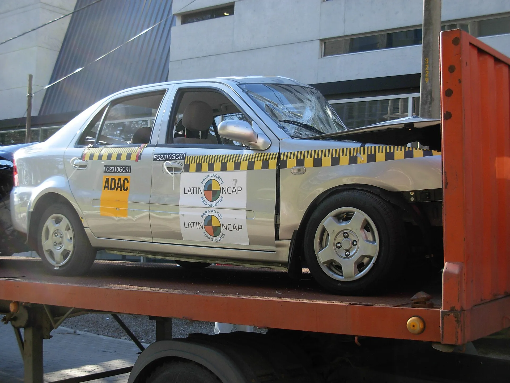

A crash test is an accident staged in a lab to measure how well a car protects the people inside it and those outside it. The car hits a barrier at an exact speed, or gets hit by one, with sensor-laden dummies in the seats. What those sensors record at the head, neck, chest and legs becomes points, and the points become stars.

In Latin America the two benchmarks are **Euro NCAP**, which has published results since 1997, and **Latin NCAP**, which rates the cars sold in the region.

## The crashes Euro NCAP runs

| Test | Speed | What it simulates |
|---|---|---|
| Frontal against a mobile deformable barrier | Car at 50 km/h and the 1,400 kg barrier at 50 km/h | A head-on crash with another car, with half the front end involved |
| Frontal against a rigid wall | 50 km/h | A full-width frontal crash; measures seatbelts and airbags |
| Side impact with a mobile barrier | 60 km/h | Another car hitting from the side at an intersection |
| Side impact against a pole | 32 km/h | A car that skids and hits a pole or tree sideways |
| Far-side impact | On a sled | How far the occupant moves toward the other side |
| Whiplash | Pulses of 16 and 24 km/h | A rear-end hit in a traffic jam |

In the frontal mobile barrier test, an advanced adult dummy called THOR sits at the wheel, another adult rides as passenger, and two child dummies, aged 6 and 10, sit in the back. The rigid wall test uses a small female dummy, because airbags and seatbelts must also protect whoever sits closest to the steering wheel.

## The four areas that decide the stars

The crashes are only part of the score. Euro NCAP rates four areas:

1. **Adult occupant protection**, with the crashes in the table.
2. **Child occupant protection**, with the child dummies and how easy it is to install child seats.
3. **Vulnerable road users**, which measures how hard the front of the car strikes a pedestrian or cyclist, and whether the car brakes on its own for them.
4. **Safety assist**, such as autonomous emergency braking, lane assist and speed assist.

Each area has a minimum for each star level. That is why a car with an excellent body structure can stop at four stars if it lacks standard driver aids: it happened to the Kia EV3, which scored 67% in safety assist without its optional pack, as we covered in [its article](/es/notas/kia-ev3-euro-ncap-4-o-5-estrellas/).

*A Geely CK after its Latin NCAP test in 2010. Photo: NaBUru38, CC BY-SA 3.0, via Wikimedia Commons.*

## Latin NCAP: the same logic, with the region's cars

Latin NCAP also rates on four pillars: adults, children, pedestrians and vulnerable road users, and safety assist systems. The final rating is set by the lowest pillar, so five stars require good results in all four. The systems it assesses include stability control, autonomous braking at low and high speed, blind-spot detection, lane departure warning and the moose test, a sudden maneuver to swerve around an obstacle.

The practical difference from Euro NCAP is which car gets tested. Latin NCAP tests the version sold in the region, with the equipment it carries there. Euro NCAP tests the European version, which by law must come with autonomous emergency braking and lane assist since July 2024. That is why the same model can have five stars in Europe and fewer in Latin America, or no Latin American rating at all. It happened with the [BYD Seagull](/es/notas/byd-seagull-dolphin-surf-euro-ncap-5-estrellas/) and the [Renault Kwid E-Tech](/es/notas/renault-kwid-e-tech-dacia-spring-euro-ncap-1-estrella/).

## Are electric cars tested the same way?

Yes. They go through the same crashes and are rated on the same four areas. Euro NCAP also assesses the rescue information the manufacturer provides to emergency crews, which matters more on an EV because responders need to know how to handle the high-voltage system.

> Before trusting a rating, check three things: who ran the test, in what year and what equipment the tested car had. All three change what the stars mean.

## Frequently asked questions

### What does crash test mean?

A controlled collision in a lab to measure how well occupants and pedestrians are protected.

### How fast are crash tests?

At Euro NCAP, 50 km/h in the frontal tests, 60 km/h in the side barrier test and 32 km/h against the pole.

### Does a European rating apply in Colombia?

Only if the car sold in Colombia has the same structure and the same safety equipment as the one tested. Compare the trim's spec sheet before taking it for granted.

---

**Sources:** [Wikipedia: Euro NCAP test protocols](https://en.wikipedia.org/wiki/Euro_NCAP) · [La Tercera: Latin NCAP's four-pillar protocol](https://www.latercera.com/mtonline/noticia/latin-ncap-endurece-el-protocolo-ahora-evaluable-sobre-cuatro-pilares/FWNAESK5J5BOREUBHNK76QFU5E/) · [Euro NCAP: Kia EV3, 2025 rating](https://www.euroncap.com/en/results/kia/ev3/54845) · [SIMI: systems mandatory in the European Union since 2024](https://www.simi.ie/en/road-safety/gsr)
