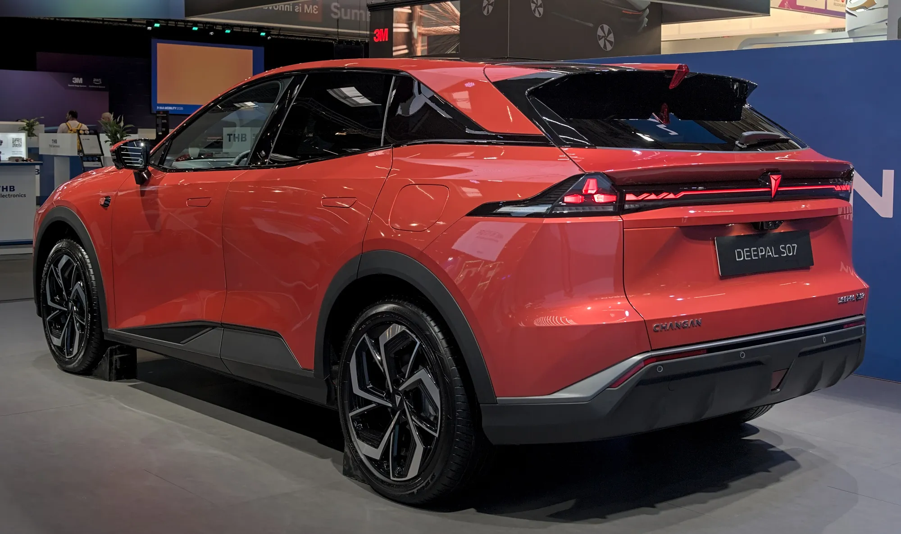

An extended-range electric vehicle, or **EREV**, is an EV that carries a small gasoline engine on board. The difference from a hybrid is what drives the wheels: in an extended-range car, **the electric motor always does**. The gasoline engine works as a generator that recharges the battery when it runs low, and it is not connected to the wheels.

## How it works

The car sets off with a charged battery and drives like any EV. When the battery drops below a certain level, the gasoline engine starts, produces electricity and the battery stops draining. For the driver, it feels like an EV all the time: instant acceleration, no gear changes, with some engine noise when the generator is running.

That is why range figures come in pairs. The **extended-range Leapmotor C10**, for example, has a 28.4 kWh battery, covers up to **145 km (90 miles) WLTP on electricity alone** and, with a full tank, adds up to **950 km (590 miles)** in total. The extended-range version of the **Deepal S07** uses a 31.73 kWh battery and claims **1,120 km (696 miles) CLTC** of total range.

*The Deepal S07 is sold in electric and extended-range versions; in Mexico, the latter accounted for 351 of Changan's 475 sales in the first half of 2026. Photo: Alexander Migl, CC BY-SA 4.0, via Wikimedia Commons.*

## Extended range, plug-in hybrid and full electric

| | Electric | Extended range | Plug-in hybrid |
|---|---|---|---|
| What drives the wheels | Electric motor | Electric motor, always | Electric motor, gasoline engine or both |
| Gasoline engine | None | Only generates electricity | Can drive the wheels |
| Battery in this article's examples | Large | 28.4 kWh (Leapmotor C10) and 31.73 kWh (Deepal S07) | Varies widely by model |
| Plugs in | Yes | Yes | Yes |
| Needs gasoline | No | For long trips | For long trips and for extra power |

On the road, the difference between the last two columns can look small, because some plug-in hybrids run in electric mode much of the time. What defines an extended-range car is that the gasoline engine is never connected to the wheels.

## Pros and cons

The big advantage goes to drivers without a reliable charging network along their routes. In the city, with home charging, the car works like an EV and uses almost no gasoline. On a long trip, if there is no charging station, any gas station will do. In countries where the charging network is just getting started, like most of Latin America, that backup carries weight.

The downside is that you carry two systems: a battery and a combustion engine, with its oil, its filter and its servicing. And when the generator runs, the gasoline also moves the weight of the battery, so highway fuel use depends heavily on the model. The battery, smaller than a pure EV's, also tends to charge more slowly on DC: the extended-range Leapmotor C10 accepts up to 65 kW.

## Which models are sold in Latin America

In **Colombia**, the extended-range Deepal S07 arrived in 2024 priced at COP 155 million, and Leapmotor, together with Astara, announced a lineup with electric and extended-range versions for the 2026 Bogotá Auto Show. In **Mexico**, Changan sold 475 cars between January and June 2026, and 351 of them were the extended-range Deepal S07.

> Before buying an extended-range car in Colombia, ask how it is classified on its registration. It has a gasoline engine, and that classification determines benefits such as reduced VAT or the exemption from pico y placa driving restrictions, which were designed for pure EVs.

## Frequently asked questions

### Is an extended-range car an electric car?

It works like one, because only the electric motor drives the wheels, but it has a gasoline engine. That is why many statistics count it separately, alongside plug-in hybrids.

### Do you have to plug it in?

It is not mandatory, but without plugging in it loses its point: it runs on the generator almost all the time and burns gasoline like a heavy hybrid.

### What do EREV and REEV mean?

Both acronyms mean the same thing: extended-range electric vehicle.

---

**Sources:** [Driven: extended-range Leapmotor C10](https://www.drivencarguide.co.nz/news/leapmotor-launches-hybrid-version-of-c10-ev-suv-with-950km-range/) · [Xataka Colombia: extended-range Deepal S07](https://www.xataka.com.co/vehiculos/hibrida-que-promete-autonomia-1-120-km-suv-deepal-s07-caracteristicas-precio) · [El CEO: electrified vehicle sales in Mexico, first half of 2026](https://elceo.com/negocios/byd-vende-4-de-cada-10-autos-hibridos-y-electricos-en-mexico/) · [El Carro Colombiano: new brands for the 2026 Auto Show](https://www.elcarrocolombiano.com/lanzamientos/carros-nuevas-marcas-vienen-colombia-salon-del-automovil-bogota-2026/)
