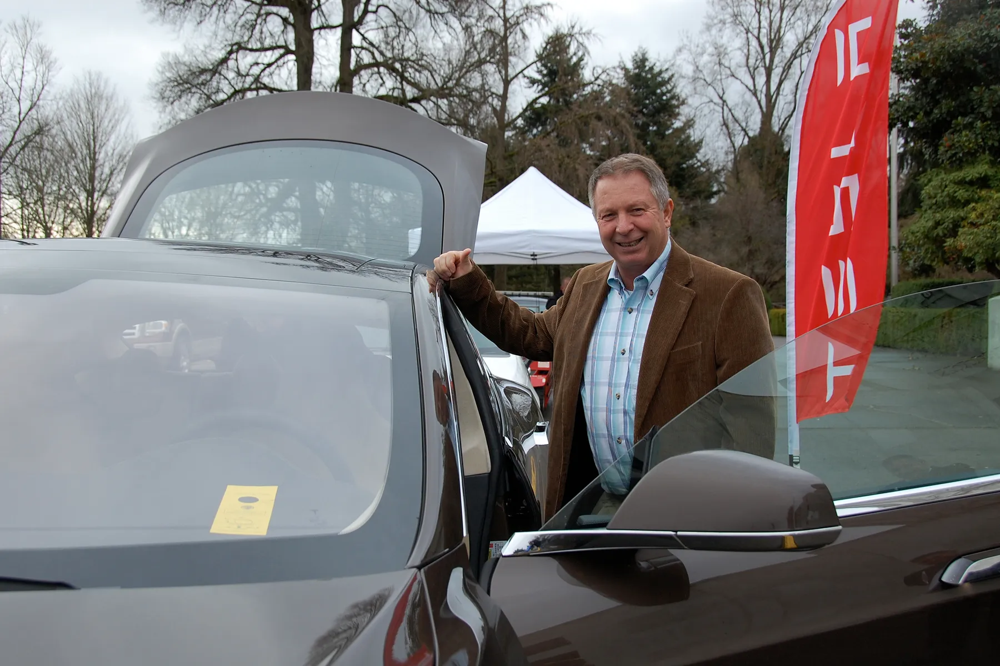

Driving an EV before buying it matters more than with a gasoline car. Acceleration, regenerative braking and the way you charge change the experience, and a spec sheet does not show that. In Colombia there are four ways to do it, and they are not all equally useful.

## 1. The dealer, by appointment

Brands selling EVs in the country offer test drives at their showrooms, and several let you request one from their website. It is the most direct way, with one limit: the advisor sets the route, so it is worth asking for it to include a climb and a stretch of fast road.

**BYD** also has **test drive centers** in Bogotá, Cali and Medellín, four in total according to the information the brand gave for its 2026 BYD Fest. At those centers the test is the main goal, not a step within the sale.

## 2. Tesla, by online booking

Tesla does not sell through dealers. Since its arrival on November 20, 2025, test drives have been booked on its website, and the brand has a store at the **Andino shopping center** in Bogotá and another in Medellín. When booking, confirm which version will be available, because it is not always the one you would buy.

*An EV test drive event in Oregon, United States. Fairs let you try several models on the same day. Photo: Oregon Department of Transportation, CC BY 2.0, via Wikimedia Commons.*

## 3. Fairs and brand events

Fairs are the way to try several models on the same day. **BYD Fest 2026** ran from July 30 to August 11 at 26 showrooms across the country, with a central space in Parque de la 93, in Bogotá, and test drives at its centers. The **Bogotá International Auto Show** returns to Corferias in mid-November 2026, with more than 15 brands that are new or returning to the country, almost all with EVs. The 2025 edition had an outdoor test drive area, and each test was scheduled directly with the brand. If 2026 repeats the format, it is worth booking as soon as you arrive.

## 4. Friends and owners

An owner can show you what the dealer will not: how long a charge lasts in their routine, what they pay for energy each month and how things have gone at the workshop. Owner groups for each model on social media are the fastest way to find someone willing to take you for a spin or answer questions.

## What to check on the drive

A 20-minute test is enough if you plan it. Ask the advisor for these things:

1. **A climb.** In cities such as Bogotá, Medellín or Manizales, a slope shows how hard the motor pulls and how much the range on the dashboard drops.
2. **The regeneration modes.** Try the strongest, which slows the car when you lift off the accelerator. Some people love it and others feel queasy.
3. **The exact trim.** If you are going to buy the entry trim, test that one. Driver aids, battery size and even tires change between trims.
4. **The charging port and cable.** Ask which connector it uses, which cable is included and how long it takes to charge at home.
5. **The camera and sensors at night**, if you are going to drive a lot after dark.

> Before the test, check the car's specs in the [comparison tool](/es/comparador/) so you arrive with specific questions: range with its cycle, charging power and the trim's safety equipment.

## Frequently asked questions

### Does an EV test drive cost anything?

Normally not. You will usually be asked for a valid driver's license and an appointment.

### Can I take a longer test?

Some brands offer extended tests in specific campaigns, but it is not the norm. Ask the dealer whether they have that option.

### Where can I try several EVs on the same day?

At the Bogotá Auto Show or at brand events such as BYD Fest, which bring several models together in one place.

---

**Sources:** [Autocosmos: BYD Fest 2026 at 26 showrooms](https://noticias.autocosmos.com.co/2026/08/01/byd-fest-2026-exhibira-sus-vehiculos-electricos-e-hibridos-enchufables-en-26-vitrinas-de-colombia) · [CarroYa: how to test a Tesla in Colombia](https://www.carroya.com/noticias/noticias-y-lanzamientos/tesla-llego-colombia-conoce-como-puedes-ser-uno-de-los-primeros-en-manejarlo) · [Xataka Colombia: Tesla stores in Bogotá and Medellín](https://www.xataka.com.co/vehiculos/oficial-tesla-llego-a-colombia-esto-todo-que-debes-saber-sus-nuevas-tiendas-bogota-medellin-modelos-disponibles-precios) · [El Espectador: test drives at the 2025 Auto Show](https://www.elespectador.com/punto-de-encuentro/conduzca-sus-suenos-en-el-salon-del-automovil-2025-del-14-al-23-de-noviembre/) · [El Carro Colombiano: new brands for the 2026 Show](https://www.elcarrocolombiano.com/lanzamientos/carros-nuevas-marcas-vienen-colombia-salon-del-automovil-bogota-2026/)
