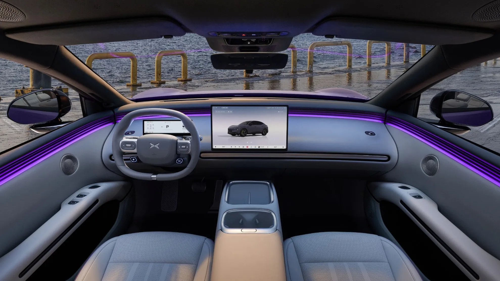
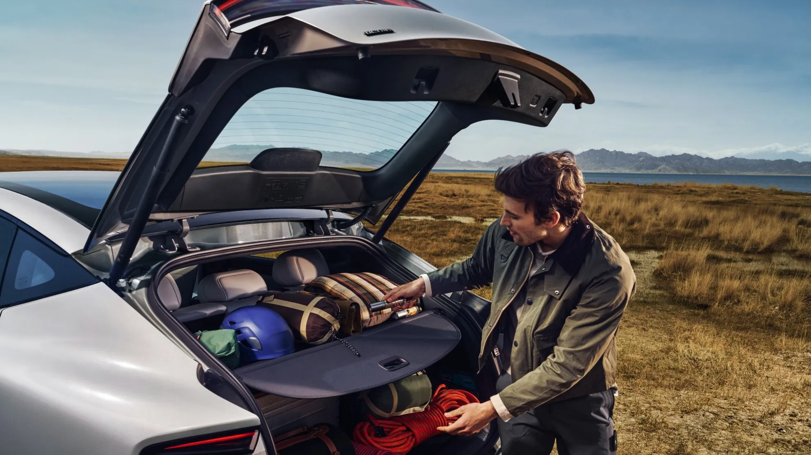
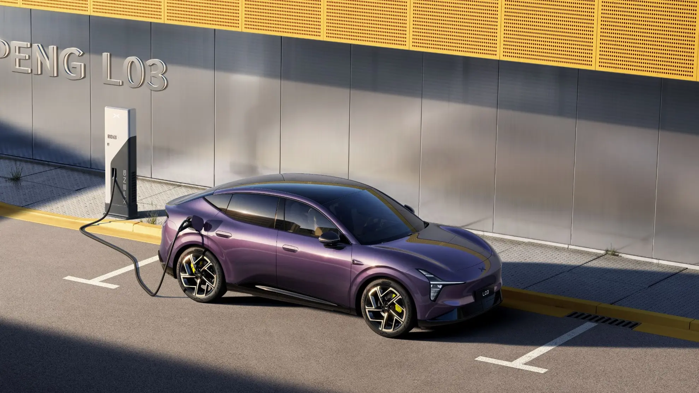

The **XPeng L03** is now on sale in Colombia, just months after its world debut in June 2026. It is a **4.65-meter coupe SUV**, XPeng's entry model below the G6, and it arrives in two versions: a **fully electric** one and a **range-extended** one, in which a gasoline engine only generates electricity. Both appear on the XPeng Colombia website **from COP 115,000,000**, the suggested retail price. The brand is represented in the country by **Inchcape**, which already sells the G6 and G9 here.

## The essentials

- **Price:** from COP 115,000,000, according to the XPeng Colombia website. The page gives the same price for both versions: it is worth confirming with the dealer.
- **Versions:** L03 Long Range Plus (electric) and L03 PowerX Plus (range extender).
- **Range:** up to 520 km (323 miles) WLTP for the electric version and up to 1,017 km (632 miles) WLTP in total for the range extender.
- **Power:** 241 hp (180 kW), with rear-wheel drive on both.
- **Battery:** 71.2 kWh LFP in the electric version and 37.2 kWh LFP in the range extender.
- **Warranty:** 5 years or 120,000 km (75,000 miles) for the car and 8 years or 160,000 km (99,000 miles) for the battery, motor and power electronics.

## The two versions

| | L03 Long Range Plus | L03 PowerX Plus |
|---|---|---|
| Powertrain | Electric | Range extender (1.5 gasoline engine as generator) |
| Battery | 71.2 kWh LFP | 37.2 kWh LFP |
| WLTP range | Up to 520 km (323 miles) | About 215 to 235 km (134 to 146 miles) electric; 1,017 km (632 miles) in total |
| Power | 241 hp (180 kW) | 241 hp (180 kW) |
| 0 to 100 km/h | 6.6 s | 6.8 s |
| Tank | Not applicable | 42 liters |
| Price | From COP 115,000,000 | From COP 115,000,000 |

The PowerX's electric range varies by source: El Carro Colombiano gives 215 km (134 miles) in its text and 235 km (146 miles) in its spec sheet. Either way, it is enough for almost anyone's daily use without starting the engine.

*15.6-inch central screen, 8.88-inch digital cluster and 26.8-inch head-up display, all standard. Photo: XPeng.*

## What the electric version offers

XPeng Colombia's spec sheet for the Long Range Plus includes:

- **Safety:** 7 airbags (with one between the front seats), autonomous emergency braking, blind spot detection, front and rear cross-traffic alerts, door opening warning and 360° cameras.
- **Assistance (XPILOT Assist):** adaptive cruise control, lane centering, sign recognition, autonomous parking and remote parking from the phone or key.
- **Comfort:** electric front seats with heating, ventilation and memory; heated steering wheel; dual-zone air conditioning with rear vents; 1.31 m² panoramic roof with thermal insulation.
- **Technology:** wireless Android Auto and Apple CarPlay, Google navigation, 50 W ventilated wireless charger, digital key in the app and over-the-air (OTA) updates.
- **Other:** power tailgate, 18-inch wheels, built-in dash cam and V2L to power devices from the battery.

## Space and dimensions

| Dimension | Figure |
|---|---|
| Length | 4,650 mm |
| Width | 1,920 mm |
| Height | 1,600 mm |
| Wheelbase | 2,850 mm |
| Ground clearance | 144 mm |
| Trunk | 539 liters |
| Front trunk | 102 liters |
| Weight | 1,940 kg (Long Range Plus) |

The 2.85 m wheelbase is more typical of a midsize SUV than a compact one, which favors second-row space. The trunk adds a 10-liter box under the rear seats, magnetic anchors and a 40/20/40 split rear backrest.

One point to check: **ground clearance is 144 mm**, low for an SUV. With a sloping roof and a height of 1.60 m, the L03 is closer to a raised sedan than an SUV: take care on high speed bumps and dirt roads.

*The 539-liter trunk, plus 102 liters under the hood on the electric version. Photo: XPeng.*

## Charging

The Long Range Plus charges at **11 kW** on AC and on DC goes **from 10 to 80% in about 20 minutes**, according to XPeng. The maximum power figures do not match between sources: the Colombian spec sheet says **123 kW** in its table, while the same sheet, the European website and the international press speak of **up to 236 kW**. The architecture is 400-volt, and the battery, which XPeng calls 3C, is designed to accept sustained fast charging. In practice, the real time will also depend on the power of the charger used.

According to El Carro Colombiano, the PowerX recovers 80% of its battery in about 15 minutes.

*XPeng advertises 10 to 80% in about 20 minutes for the electric version. Photo: XPeng.*

## A global model

In China it is sold as the **Mona L03**, the second line of the Mona sub-brand after the M03 sedan. It went on sale there on July 16, 2026, with pre-sales from 143,800 yuan (about USD 21,100) and 56 or 69 kWh batteries. The same day it was unveiled in Munich for Europe, where it starts at **EUR 34,990** in France and Belgium and **EUR 35,600** in Germany. There is also a dual-motor all-wheel-drive version there, with 382 hp and 0 to 100 km/h in 4.5 seconds, which is not in the Colombian range for now. The first European deliveries were on October 20 in Paris.

Its most striking figure is aerodynamics: XPeng advertises a drag coefficient of **0.228** for the electric version, very low for an SUV, and credits it with up to 59 km (37 miles) of extra range.

## Rivals

On price, El Carro Colombiano sets it against the **Tesla Model Y RWD**, the **Deepal S05** and the **Geely Starray EM-i**. On positioning, also against electric SUVs from premium brands such as the BMW iX1, Mercedes-Benz EQA or Volvo EX30. Its main argument: having in one model an electric version and a range-extended one, for those who still doubt the charging network on the road.

## Frequently asked questions

### How much does the XPeng L03 cost in Colombia?

The XPeng Colombia website shows it from COP 115,000,000 in both versions, as a suggested retail price.

### Is the L03 PowerX a hybrid?

It is a range-extended EV: the electric motor always drives the wheels, and the 1.5-liter gasoline engine only works as a generator to recharge the battery. It can be plugged in like an EV. We explain how it works in [this article](/es/notas/que-es-un-carro-electrico-de-rango-extendido/).

### How much range does it have?

Up to 520 km (323 miles) WLTP for the electric version and up to 1,017 km (632 miles) WLTP in total for the range extender, of which 215 to 235 km (134 to 146 miles) are on the battery alone.

### Who sells XPeng in Colombia?

Inchcape, which also handles the brand's after-sales service and parts.

Compare the electric L03 with the Deepal S05 in the [Mejor Eléctrico comparison tool](/es/comparador/?a=xpeng-l03-long-range-plus-2027-co&b=deepal-s05-max-2026-co), or see both versions on its [specs page](/es/carros/xpeng-l03/).

---

**Sources:** [XPeng Colombia: L03](https://www.xpeng.com/co/vehiculo/xpeng-l03) · [XPeng Colombia: L03 Long Range Plus spec sheet (PDF)](https://www.xpeng.com/co/inchcape/site/docs/20260901/20260901120448/fichas_tecnicas_xpeng_l03_plus.pdf) · [El Carro Colombiano: XPeng L03 reaches Colombia](https://www.elcarrocolombiano.com/lanzamientos/xpeng-l03-colombia-precio-ficha-tecnica-autonomia/) · [CarNewsChina: Mona L03 pre-sale in China](https://carnewschina.com/2026/07/03/xpeng-mona-l03-suv-with-in-house-chip-opens-pre-sale-in-china-starting-at-21100-usd/) · [Electrek: L03 prices in Europe](https://electrek.co/2026/07/16/xpeng-l03-pricing-tesla-model-y-europe/) · [CnEVPost: first deliveries in Europe](https://cnevpost.com/2026/10/20/xpeng-starts-mona-l03-deliveries-europe/)
