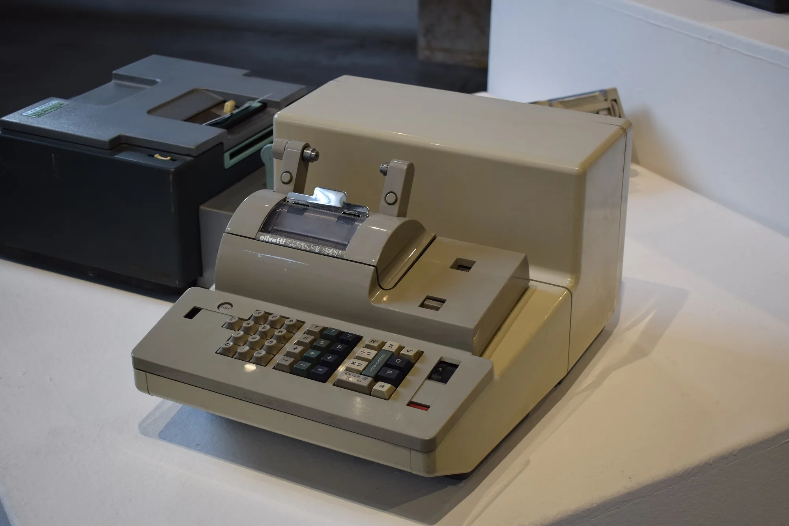

Un abono a capital es un pago extra que va directo a reducir lo que se debe, no a intereses. En Colombia, la **Ley 1555 de 2012** convirtió en derecho del consumidor hacer pagos anticipados **sin penalidad** en los créditos en pesos, y le dio al deudor la decisión de si el abono reduce el **plazo** o la **cuota**. Para quien compra un carro eléctrico, hay una fuente natural para ese abono: la devolución del IVA.

## Lo que dice la ley

La Ley 1555 agregó un derecho al régimen de protección del consumidor financiero:

- se puede pagar de forma anticipada cualquier crédito en moneda nacional **sin penalidad ni compensación** por los intereses que el banco deja de recibir;
- el deudor decide si el pago parcial **reduce el plazo o el valor de la cuota**;
- no aplica a créditos cuyo saldo supere **880 salarios mínimos**, ni a los hipotecarios.

Un crédito de carro de un comprador particular está muy por debajo de ese tope, así que el derecho aplica. La Superintendencia Financiera lo describe como un derecho irrenunciable del consumidor.

## La cuenta: abonar la devolución del IVA

Tomamos un eléctrico de **$89,99 millones** con 20 % de cuota inicial: se financian **$71,99 millones** a 60 meses y 12,5 % efectivo anual. La cuota es de **$1.595.473**. Si el comprador pide la devolución del IVA, la DIAN le reintegra el 5 % pagado en la factura, unos **$4,29 millones**. Supongamos que llega al año de la compra y la abona completa a capital.

| Opción al abonar $4,29 millones en el mes 12 | Resultado | Intereses que se ahorra |
|---|---|---|
| Reducir el plazo | La cuota sigue igual y el crédito termina unos 4 meses antes | Unos $2,47 millones |
| Reducir la cuota | El plazo sigue igual y la cuota baja a unos $1.482.977 | Unos $1,11 millones |

Cálculo propio, sin seguros. El ahorro es la diferencia entre lo que se habría pagado sin el abono y lo que se paga con él, descontando el abono.

**Reducir el plazo ahorra más del doble** que reducir la cuota, porque el saldo baja y deja de generar intereses durante más tiempo. Reducir la cuota tiene sentido si lo que se necesita es aliviar el presupuesto mensual.

*Reducir el plazo con un abono de $4,29 millones ahorra unos $2,47 millones de intereses en nuestro ejemplo, más del doble que reducir la cuota. Foto: Piergiovanna Grossi, CC BY-SA 4.0, vía Wikimedia Commons.*

## Cómo hacer el abono bien

**Dígalo por escrito.** Al hacer el pago extra, indique en la sucursal, la aplicación o un correo al banco que es un **abono a capital** y si quiere reducir plazo o cuota. Si no lo dice, el banco puede aplicarlo como adelanto de las próximas cuotas, que no ahorra intereses.

**Pida el nuevo plan de pagos.** Después del abono, solicite la tabla de amortización actualizada y revise que el saldo haya bajado en el valor abonado.

**Revise que no le cobren comisión.** Por la Ley 1555, el prepago en créditos en pesos por debajo del tope no tiene penalidad. Si aparece un cobro, reclame ante la entidad y, si no responde, ante la Superintendencia Financiera.

## De dónde puede salir el abono

La devolución del IVA es la más obvia para un eléctrico nuevo con certificado de la UPME. Hay que tramitarla antes de que pasen **cinco años** desde la fecha de la factura, como explicamos en [el paso a paso ante la DIAN](/es/notas/devolucion-iva-carro-electrico-dian-paso-a-paso/). La prima de diciembre o lo que se ahorra en gasolina frente a un carro de combustión son otras fuentes.

> Un abono hecho temprano rinde más que el mismo abono hecho al final. En el primer mes de nuestro ejemplo, unos $710.000 de la cuota de $1,6 millones son intereses; al final del crédito, casi toda la cuota es capital.

## Preguntas frecuentes

### ¿Me pueden cobrar por pagar mi crédito de carro antes de tiempo?

No, si es un crédito en pesos con saldo por debajo de 880 salarios mínimos. La Ley 1555 de 2012 prohíbe la penalidad por prepago.

### ¿Qué conviene más, reducir plazo o reducir cuota?

Reducir el plazo ahorra más intereses. En nuestro ejemplo, unos $2,47 millones frente a $1,11 millones.

### ¿Puedo usar la devolución del IVA del carro para abonar al crédito?

Sí. Es dinero suyo una vez la DIAN lo reintegra, y abonarlo a capital es una de las formas en que más rinde.

---

**Fuentes:** [Ley 1555 de 2012, en el normograma de la DIAN](https://normograma.dian.gov.co/dian/compilacion/docs/ley_1555_2012.htm) · [Superintendencia Financiera: concepto sobre el prepago de créditos](https://www.superfinanciera.gov.co/publicaciones/61676) · [Portafolio: plazo y proceso de la devolución del IVA](https://www.portafolio.co/negocios/vehiculo/este-es-el-plazo-y-el-proceso-para-que-le-devuelvan-el-iva-si-compro-un-carro-hibrido-o-electrico-503819)
