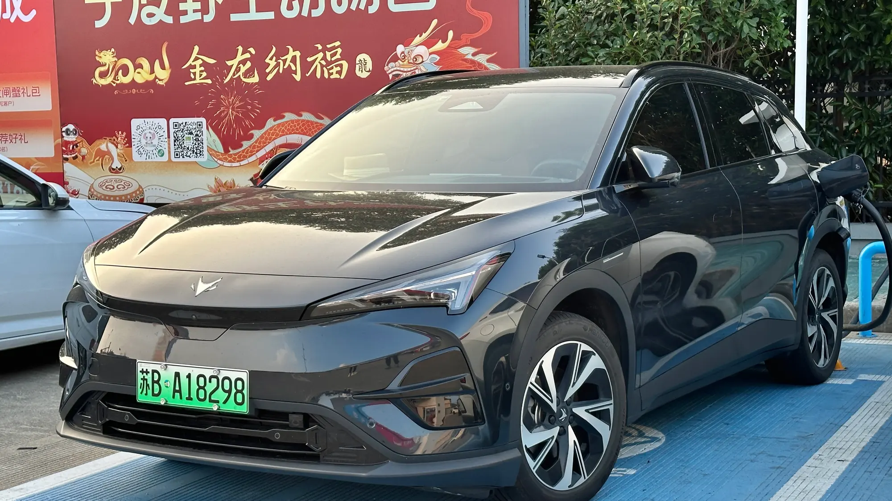

**Arcfox**, la marca de eléctricos de alta gama del grupo chino **BAIC**, empezó a vender en Colombia a finales de agosto de 2026. Llegó con tres modelos, una SUV compacta, una SUV mediana y un sedán, y con un detalle que no todos sus rivales ofrecen: **seis airbags y asistencias a la conducción** desde la versión más barata. La importa **Magma Automotive**.

## Lo esencial

- **T1:** SUV compacta, $99.990.000.
- **T5:** SUV mediana, $144.990.000.
- **S5:** sedán, $139.990.000.
- **Baterías:** LFP en los tres.
- **Vitrinas:** Bogotá, Medellín, Cali y Bucaramanga.
- **Incluye:** cargador portátil para tomas de 110 y 220 V.

## Los tres modelos

| | T1 | T5 | S5 |
|---|---|---|---|
| Precio | $99.990.000 | $144.990.000 | $139.990.000 |
| Largo | 4,34 m | 4,69 m | 4,82 m |
| Potencia | 94 hp | 248 hp | 248 hp |
| Batería | 42,4 kWh | 65 kWh | 65 kWh |
| Autonomía NEDC | 375 km | 475 km | 530 km |
| 0 a 100 km/h | 9 s | 7,5 s | 7 s |
| Carga rápida | Hasta 89 kW | Hasta 167 kW | Hasta 150 kW |
| Baúl | 459 litros | 400 litros | 430 litros |
| Airbags | 6 | 6 | 6 |

Las autonomías están en ciclo **NEDC**, que es optimista. En uso real, sobre todo en carretera, hay que esperar bastante menos. Como cálculo propio y prudente, reste entre 15 % y 25 %.

*La Arcfox T5, la SUV mediana de la marca. Foto: JustAnotherCarDesigner, dominio público (CC0), vía Wikimedia Commons.*

## El T1, el más interesante por precio

Con $99,99 millones, el **T1** entra a competir con el **Kia EV2** ($89,99 millones) y la **Chery E5** (desde $79,99 millones). Tiene un baúl más grande que ambos y trae de serie control crucero adaptativo, mantenimiento de carril y frenado autónomo de emergencia, algo que la Chery E5 solo ofrece en su versión tope. Su punto débil es la potencia: 94 hp se quedan cortos en subidas largas con el carro cargado, aunque, a diferencia de un motor de gasolina, el eléctrico no pierde fuerza por la altura de Bogotá.

## T5 y S5, contra Tesla

La **T5** y el **S5** apuntan al mismo cliente que el **Tesla Model Y** y el **Model 3**, con precios parecidos. La T5 anuncia calificación de cinco estrellas en **C-NCAP**, el programa chino de pruebas de choque, aunque no tiene pruebas de Euro NCAP ni de Latin NCAP.

> Arcfox llega con buena relación entre equipo y precio, pero es una marca nueva en el país. Antes de comprar, pregunte por la red de talleres en su ciudad y por la garantía exacta de la batería: Arcfox solo la confirmó, a 8 años, para el S5.

## Preguntas frecuentes

### ¿Cuánto cuesta un Arcfox en Colombia?

El T1 cuesta $99.990.000, el S5 $139.990.000 y la T5 $144.990.000, según los precios de lanzamiento.

### ¿Quién importa Arcfox?

Magma Automotive.

### ¿Qué autonomía tienen?

Entre 375 y 530 km en ciclo NEDC, según el modelo.

### ¿Dónde se pueden ver?

En vitrinas de Bogotá, Medellín, Cali y Bucaramanga.

Compare el T1 con el Kia EV2 en el [comparador de Mejor Eléctrico](/es/comparador/?a=kia-ev2-air-2026-co&b=chery-e5-luxury-2026-co).

---

**Fuentes:** [Autocosmos: Arcfox llega a Colombia](https://noticias.autocosmos.com.co/2026/08/27/arcfox-llega-a-colombia-con-los-electricos-t1-t5-y-s5-precios-y-caracteristicas) · [El Carro Colombiano: Arcfox en Colombia](https://www.elcarrocolombiano.com/lanzamientos/arcfox-colombia-carros-electricos-premium-t1-s5-t5-precios-datos/) · [El Espectador: los tres modelos](https://www.elespectador.com/autos/arcfox-llega-a-colombia-con-tres-vehiculos-electricos-t1-t5-y-s5/)
