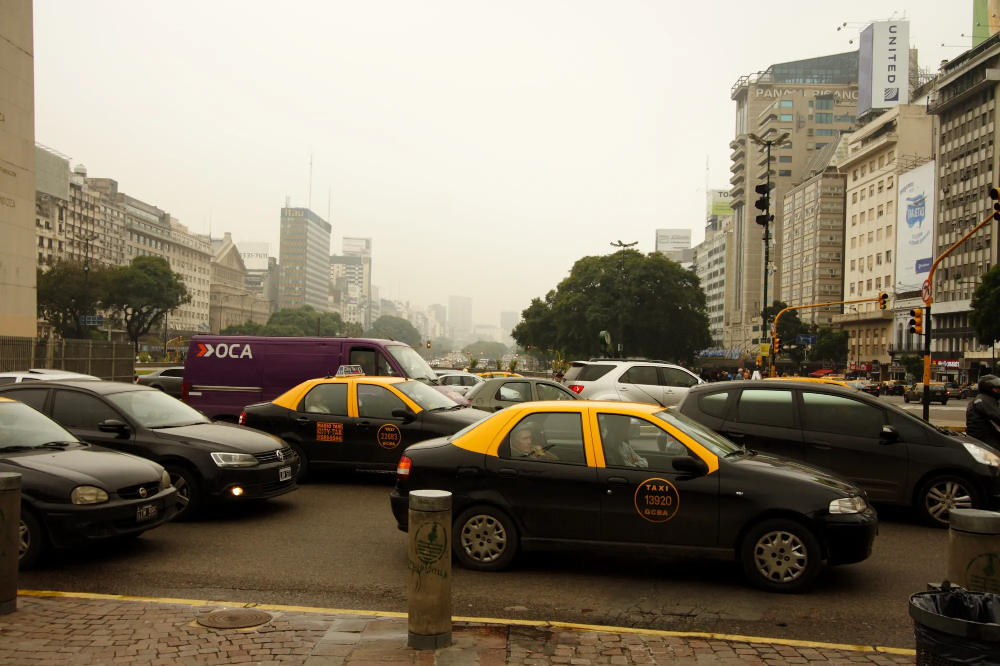

Argentina es el país de Latinoamérica donde más crecieron los carros enchufables en 2026: un **873 %** en el primer semestre frente al mismo periodo de 2025, según la Organización Latinoamericana y Caribeña de Energía (Olade). El crecimiento tiene una explicación concreta, y no es un cambio de gusto de los compradores: es una política de importación.

## El cupo de 50.000 carros sin arancel

Desde 2025, el Gobierno argentino permite importar cada año **50.000 vehículos electrificados sin arancel**, por el Decreto 49 de 2025. El cupo se reparte en licitaciones entre fabricantes e importadores, y solo aplica a carros con un valor FOB de **hasta 16.000 dólares**. Entre los cupos de 2025 y 2026 ya se adjudicaron 100.000 unidades.

El tope de precio explica qué carros llegan. Con 16.000 dólares FOB entran sobre todo eléctricos e híbridos chinos pequeños o medianos, y quedan por fuera los modelos de gama alta, que siguen pagando el arancel completo.

## Las cifras

En el primer semestre de 2026 se patentaron **42.238 carros híbridos y eléctricos**, un 339 % más que un año antes, y ya son el **15,2 % del mercado** de autos y livianos. El mercado total, en cambio, cayó 11,1 %. Dentro de esa cifra, los eléctricos puros fueron **3.877**, el 9 % del segmento; la mayoría son híbridos.

| Dato, primer semestre de 2026 | Cifra |
|---|---|
| Híbridos y eléctricos patentados | 42.238 |
| Crecimiento anual | +339 % |
| Participación en el mercado | 15,2 % |
| Eléctricos puros | 3.877 |

Fuente: Ámbito, con datos del primer semestre de 2026.

*La avenida 9 de Julio, en Buenos Aires. En el primer semestre de 2026, los híbridos y eléctricos fueron el 15,2 % del mercado argentino. Foto: Anastasiya Lvova, CC BY 3.0, vía Wikimedia Commons.*

## El Dolphin Mini, el eléctrico de Argentina

El mercado argentino de eléctricos tiene un dueño. En junio de 2026 se patentaron **865 eléctricos**, y **481 fueron BYD Dolphin Mini**. Los siguieron el BYD Yuan Pro (123), el BAIC EU5 (106) y el Chevrolet Spark EV (51). En septiembre, el Dolphin Mini sumó 495 unidades, el **57,2 %** de todos los eléctricos del mes.

Su precio de lista arranca en **23.990 dólares** con la batería de 30 kWh y 280 km de autonomía, y llega a 24.990 dólares con la de 43,2 kWh y 380 km. Es el mismo carro que en Colombia se vende como Seagull, aunque con otras baterías y equipo. Lo comparamos con sus rivales en [nuestra nota de hatchbacks](/es/notas/hatchback-electrico-latinoamerica-2026/).

## Lo que hay que mirar

El crecimiento argentino depende de una medida de gobierno que se renueva año a año. Si el cupo cambia o desaparece, las ventas pueden caer tan rápido como subieron. La concentración en un solo modelo también es un riesgo: el mercado depende de que BYD mantenga precio y abastecimiento.

> El caso argentino muestra que, en Latinoamérica, el arancel pesa más que cualquier campaña de marketing. Brasil hizo lo contrario en 2026, como contamos en [esta nota](/es/notas/brasil-arancel-carros-electricos-importados-35-por-ciento/).

## Preguntas frecuentes

### ¿Cuántos carros eléctricos se venden en Argentina?

3.877 eléctricos puros en el primer semestre de 2026, dentro de 42.238 híbridos y eléctricos patentados.

### ¿Qué es el cupo sin arancel para eléctricos en Argentina?

Un permiso anual para importar 50.000 vehículos electrificados sin arancel, con un tope de 16.000 dólares FOB por unidad.

### ¿Cuál es el eléctrico más vendido en Argentina?

El BYD Dolphin Mini, con más de la mitad de los eléctricos patentados en septiembre de 2026.

---

**Fuentes:** [Forbes Perú: ventas de enchufables en Latinoamérica, datos de Olade](https://forbes.pe/negocios/2026-09-22/latinoamerica-supera-el-millon-de-vehiculos-electricos-con-mas-de-la-mitad-en-brasil/) · [Ámbito: los híbridos y eléctricos ya son el 15 % del mercado](https://www.ambito.com/autos/boom-electricos-e-hibridos-la-argentina-los-patentamientos-se-cuadruplican-y-ya-representan-el-15-del-mercado-n6304427) · [Ámbito: los eléctricos más vendidos en junio de 2026](https://www.ambito.com/autos/los-electricos-avanzan-el-pais-fuerte-dominio-ventas-y-un-lider-indiscutido-n6294766) · [Autotest: el Dolphin Mini en septiembre de 2026](https://autotest.com.ar/noticias/byd-dolphin-mini-cuanto-cuesta-y-que-ofrece-el-auto-electrico-mas-vendido-en-septiembre-2026/)
