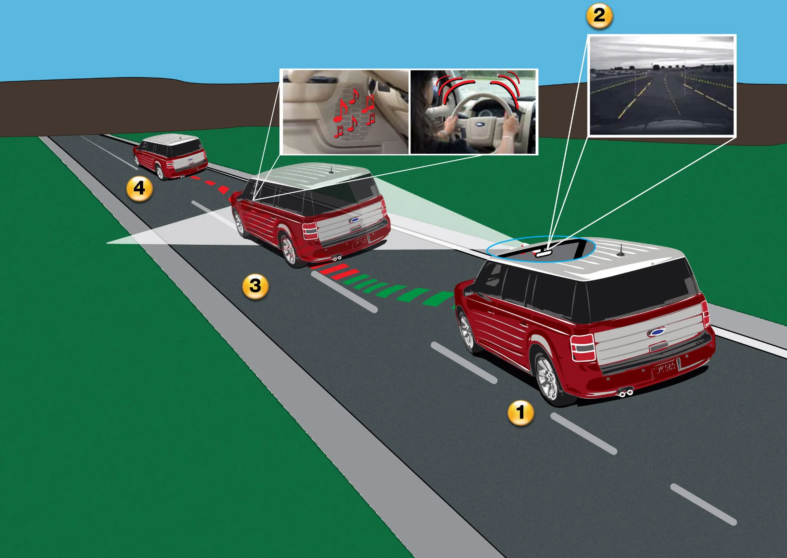

Las fichas técnicas de los carros eléctricos vienen llenas de siglas en inglés: AEB, LKA, ACC, BSM. Todas pertenecen a la familia de los **ADAS**, los sistemas avanzados de asistencia al conductor. Algunos solo avisan, otros frenan o mueven el timón por usted, y ninguno convierte el carro en autónomo. Saber cuál es cuál evita pagar por una versión tope que trae alertas donde se esperaban asistencias.

## La diferencia clave: alertar o actuar

Un sistema de **alerta** avisa con un sonido, una vibración o una luz, y deja todo en manos del conductor. Un sistema de **asistencia** interviene: frena, acelera o corrige la dirección. En la ficha, la palabra lo delata: "alerta de colisión frontal" solo avisa; "frenado autónomo de emergencia" frena.

## Qué hace cada uno

| Sigla | Nombre | Qué hace | ¿Actúa o solo avisa? |
|---|---|---|---|
| AEB | Frenado autónomo de emergencia | Frena si detecta un choque inminente con un carro, un peatón o un ciclista | Actúa |
| FCW | Alerta de colisión frontal | Avisa de un posible choque | Avisa |
| LKA o LKAS | Asistente de mantenimiento de carril | Corrige la dirección si el carro se sale del carril sin direccional | Actúa |
| LDW | Alerta de salida de carril | Avisa si el carro pisa la línea | Avisa |
| ELKS | Sistema de emergencia de mantenimiento de carril | Corrige la dirección en situaciones de riesgo, como invadir el carril contrario | Actúa |
| ACC | Crucero adaptativo | Mantiene la velocidad y la distancia con el carro de adelante, y frena si este frena | Actúa |
| BSD o BSM | Monitor de punto ciego | Enciende una luz en el espejo si hay un vehículo en la zona que no se ve | Avisa |
| RCTA | Alerta de tráfico cruzado trasero | Avisa de carros que se acercan por los lados al salir en reversa | Avisa |
| ISA | Asistente inteligente de velocidad | Lee las señales y avisa, o limita la velocidad, si se pasa del máximo | Depende del modelo |
| DDAW | Alerta de somnolencia y distracción | Detecta señales de cansancio o distracción y pide una pausa | Avisa |

*La alerta de salida de carril usa una cámara que lee las líneas de la vía. El asistente de carril va un paso más allá y corrige la dirección. Ilustración: Ford Motor Company, CC BY 2.0, vía Wikimedia Commons.*

## Cuáles exige la ley europea

Desde el 7 de julio de 2024, el Reglamento General de Seguridad de la Unión Europea obliga a todo carro nuevo de pasajeros a traer, entre otros, **frenado autónomo de emergencia, sistema de emergencia de mantenimiento de carril, asistente inteligente de velocidad, alerta de somnolencia y distracción, detector de reversa** y una **caja negra** que registra los datos de un choque. El monitor de punto ciego es obligatorio solo para buses y camiones.

Latinoamérica no tiene una obligación equivalente para los carros de pasajeros, y eso explica por qué el mismo modelo llega a la región con menos equipo. Euro NCAP, además, castiga en su calificación a los carros que no traen estos sistemas de serie: el **Kia EV3** perdió la quinta estrella porque, sin el paquete opcional de asistencias, sacó **67 % en asistencias**. Lo explicamos en [su nota](/es/notas/kia-ev3-euro-ncap-4-o-5-estrellas/).

## Cuáles valen más la pena

Si hay que elegir uno, la evidencia favorece al **frenado autónomo de emergencia**. Según el Instituto de Seguros para la Seguridad Vial de Estados Unidos (IIHS), los carros con frenado autónomo tuvieron **50 % menos choques por alcance** y 56 % menos choques por alcance con heridos. La alerta sola, sin frenado, los redujo en 27 %. Para quien viaja mucho por carretera, el **crucero adaptativo** reduce el cansancio en trayectos largos, aunque no evita choques por sí solo. El **punto ciego** ayuda sobre todo en vías de varios carriles con motos, que es justo la situación diaria de las grandes ciudades colombianas.

## El "piloto automático" sigue siendo nivel 2

Sistemas como el Autopilot de Tesla o los pilotos de autopista de las marcas chinas combinan crucero adaptativo y asistente de carril. En la escala de automatización de la organización de ingenieros SAE son de **nivel 2**: el carro acelera, frena y gira, pero el conductor tiene que estar atento y con las manos listas todo el tiempo, y responde legalmente por lo que pase. Ningún carro a la venta en Latinoamérica es autónomo.

## Preguntas frecuentes

### ¿Qué significa ADAS?

Sistemas avanzados de asistencia al conductor, por su sigla en inglés. Es el nombre genérico de todas las ayudas electrónicas de esta nota.

### ¿Qué es el lane keep assist?

El asistente de mantenimiento de carril (LKA): mueve un poco el timón para devolver el carro al centro del carril si se sale sin poner la direccional.

### ¿Los ADAS se pueden desactivar?

En la mayoría de carros, sí, desde la pantalla o un botón. En Europa, la norma exige que el asistente de velocidad se vuelva a encender solo cada vez que se prende el carro.

---

**Fuentes:** [SIMI: sistemas obligatorios por el Reglamento General de Seguridad de la UE](https://www.simi.ie/en/road-safety/gsr) · [IIHS: el frenado autónomo reduce los choques por alcance](https://www.iihs.org/news/detail/front-crash-prevention-slashes-police-reported-rear-end-crashes) · [Fleet News: cómo funciona el asistente de velocidad europeo](https://www.fleetnews.co.uk/news/new-eu-vehicle-safety-regulation-and-what-it-means-for-uk-drivers) · [Euro NCAP: Kia EV3, calificación de 2025](https://www.euroncap.com/en/results/kia/ev3/54845) · [Euro NCAP: ficha de la prueba del Kia EV3](https://cdn.euroncap.com/media/87655/euroncap-2025-kia-ev3-datasheet.pdf)
