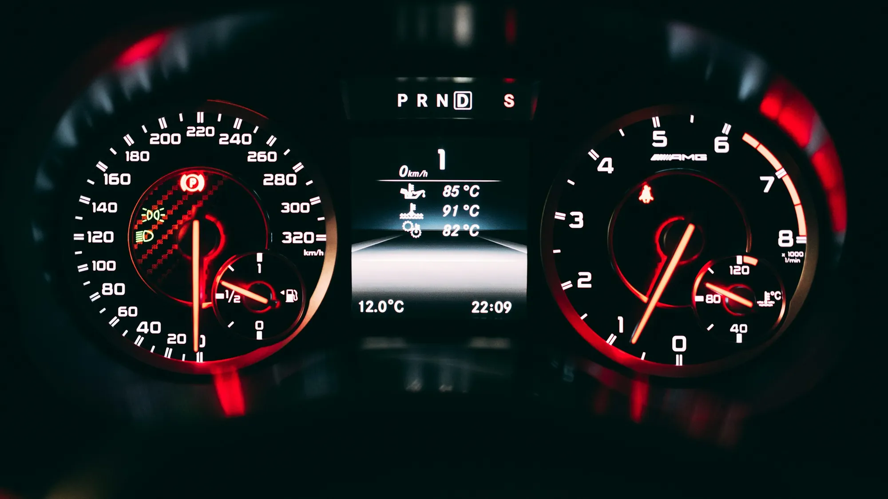

La **Chery E5** que se vende en Colombia anuncia **422 km** de autonomía. También anuncia **350 km**. Las dos cifras son oficiales y las dos corresponden al mismo carro con la misma batería. La diferencia está en el ciclo de medición, y entenderlo evita comprar con expectativas equivocadas.

## Qué es un ciclo de homologación

Es una prueba estandarizada en laboratorio: el carro rueda sobre rodillos siguiendo un patrón fijo de velocidades, aceleraciones y paradas. Sirve para comparar modelos en igualdad de condiciones, pero cada región diseñó el suyo, y unos son más exigentes que otros.

| Ciclo | Origen | Qué tan optimista es |
|---|---|---|
| **CLTC** | China | El más optimista: velocidades bajas y muchas paradas |
| **NEDC** | Europa, ya reemplazado | Optimista: diseñado en los años ochenta, con aceleraciones suaves |
| **WLTP** | Europa y otros mercados | Más realista: más velocidad, más aceleración, más tiempo en carretera |
| **EPA** | Estados Unidos | El más exigente de los cuatro |

## La diferencia en números

Estos son ejemplos con cifras publicadas para modelos que se venden o se anuncian en Colombia:

| Modelo | Ciclo optimista | WLTP | Diferencia |
|---|---|---|---|
| Chery E5 | 422 km NEDC | 350 km | 17 % menos |
| Geely EX5 SE | 410 km NEDC | 345 km | 16 % menos |
| Deepal S05 (batería grande) | 620 km CLTC | 485 km | 22 % menos |

La regla aproximada: **la cifra CLTC suele quedar entre 20 % y 30 % por encima de la WLTP**, y la NEDC, cerca de 20 % por encima.

*La velocidad es lo que más castiga la autonomía: a más de 100 km/h el consumo sube con fuerza por la resistencia del aire. Foto: Claude Gabriel en Unsplash.*

## Y en la vida real, ¿cuánto rinde?

Ningún ciclo reemplaza el uso diario, pero hay patrones que se repiten:

- **En ciudad, con trancón**, un eléctrico suele acercarse a la cifra WLTP o incluso superarla, porque recupera energía en cada frenada y casi no gasta detenido.
- **En carretera, a 100 km/h o más**, lo normal es quedar entre 20 % y 30 % por debajo de la cifra WLTP.
- **Las subidas fuertes** gastan mucha energía, aunque parte se recupera en la bajada. Un viaje de Bogotá a tierra caliente gasta menos de ida que de vuelta.
- **El aire acondicionado** pesa más en Barranquilla que en Bogotá.

## Cómo comparar sin caer en la trampa

1. **Compare siempre en el mismo ciclo.** Una cifra CLTC frente a una WLTP no dice nada.
2. **Si solo hay una cifra NEDC**, réstele cerca de 16 % para acercarse a WLTP. **Si es CLTC**, réstele cerca de 22 %.
3. **Mire el consumo, no solo la autonomía.** Un carro que gasta 14 kWh cada 100 km es más eficiente que uno que gasta 18, aunque el segundo tenga una batería más grande y anuncie más kilómetros.
4. **Calcule con margen.** Planee viajes usando el 70 % de la autonomía WLTP y llegue a cargar con al menos 15 % de batería.

> En el comparador de Garash las autonomías solo se comparan dentro del mismo ciclo de medición, por eso a veces verá "Sin dato" aunque la marca publique una cifra en otro ciclo.

## Preguntas frecuentes

### ¿Por qué las marcas chinas publican CLTC?

Porque es la homologación oficial de su mercado. Cuando el carro se vende en Europa, publican la cifra WLTP, que es la que conviene buscar.

### ¿La autonomía baja con los años?

Sí, porque la batería pierde capacidad con el uso. La pérdida suele ser gradual, y las garantías de batería cubren caídas por debajo de cierto porcentaje.

### ¿Cuánto rinde un eléctrico en Bogotá?

La altura no afecta a un motor eléctrico como a uno de gasolina. Lo que más influye en Bogotá es el tráfico, que en general favorece a los eléctricos.

Compare la autonomía de dos modelos en el mismo ciclo en el [comparador de Garash](/es/comparador/).

---

**Fuentes:** [El Carro Colombiano: Chery E5 en Colombia](https://www.elcarrocolombiano.com/resenas/chery-e5-primer-contacto-suv-electrica-precio-colombia/) · [Portafolio: Geely EX5 SE en Colombia](https://www.portafolio.co/negocios/vehiculo/nueva-suv-electrica-llega-a-colombia-este-es-el-precio-de-lanzamiento-y-las-caracteristicas-de-la-geely-ex5-se-497330) · [Garash: Deepal S05 con LiDAR](/es/notas/deepal-s05-lidar-2027/)
