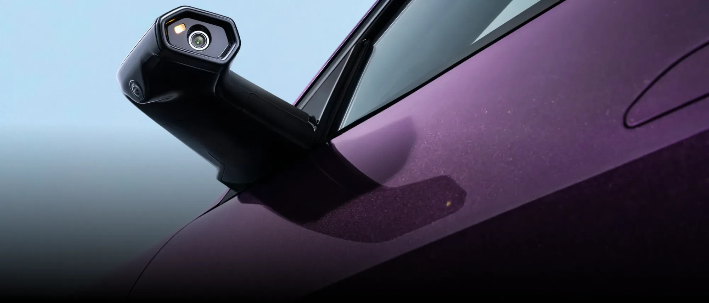

**Avatr**, la marca premium del grupo chino **Changan**, se lanzó en Colombia el **29 de octubre de 2026** con dos SUV: el **Avatr 07** y el **Avatr 11**. La importa **Grupo Vardí**, el mismo de Changan y Deepal en el país, y ya tiene vitrinas en Bella Suiza, en Bogotá, y en la avenida Las Vegas, en Medellín.

## Lo esencial

- **Avatr 07 RWD:** $199.990.000.
- **Avatr 07 AWD:** $224.990.000.
- **Avatr 11 AWD:** $254.990.000.
- **Reserva:** desde $10.000.000, según el sitio de la marca.
- **Socios:** Changan es el accionista principal, CATL el segundo y Huawei aporta tecnología de asistencias y cabina.

Los precios son los de lanzamiento publicados por la prensa especializada y pueden cambiar según la configuración.

## Los modelos

| Dato | 07 RWD | 07 AWD | 11 AWD |
|---|---|---|---|
| Motorización | Rango extendido | Rango extendido | 100 % eléctrico |
| Potencia | 309,7 hp | 494,7 hp | 569,8 hp |
| Torque | 333 Nm | 595 Nm | 650 Nm |
| 0 a 100 km/h | 7,1 s | 5,5 s | 4,5 s |
| Batería | 39,05 kWh | 39,05 kWh | 116,79 kWh |
| Carga rápida | 120 kW | 120 kW | 240 kW |
| Autonomía eléctrica (NEDC) | 207 km | 197 km | 625 km |
| Autonomía total (NEDC) | 932 km | 900 km | 625 km |

La autonomía viene medida en ciclo NEDC, el más optimista de los que se usan hoy, así que en la vía será menor y no se puede comparar con cifras WLTP o EPA de otros carros.

## El 07 no es 100 % eléctrico

El 07 lleva un motor de gasolina 1.5 turbo que no mueve las ruedas: solo genera electricidad para los motores. Por eso puede sumar más de 900 km, pero también depende de gasolina en los viajes largos. Antes de comprarlo, confirme si esa versión tiene los mismos beneficios tributarios y la misma exención de pico y placa de un eléctrico puro.

*El 07 cambia los espejos por cámaras y dos pantallas interiores de 6,7 pulgadas. Foto: Avatr Colombia.*

## Qué trae cada uno

En el 07, el dato que más cambia la cabina es la pantalla panorámica de 35,4 pulgadas, junto a una central de 15,6. La versión AWD suma suspensión neumática adaptativa y sonido Meridian de 25 parlantes; la RWD usa un sistema Pioneer de 16.

El 11 trae pantallas de 10,25 pulgadas para el conductor y el copiloto, una central de 15,6, asientos delanteros con masaje y el mismo sonido Meridian.

La marca ofrece 8 años o 160.000 km de garantía en los componentes de alto voltaje y 5 años o 120.000 km en el resto del vehículo, con las exclusiones de sus términos. Falta conocer qué tan amplia será la red de servicio, un punto que pesa en una marca nueva a estos precios.

## Preguntas frecuentes

### ¿Qué es Avatr?

La marca premium del grupo chino Changan, con CATL como accionista y Huawei como socio tecnológico. Sus carros se fabrican en Chongqing, China.

### ¿Cuánto cuesta en Colombia?

Desde $199.990.000 el 07 RWD, $224.990.000 el 07 AWD y $254.990.000 el 11 AWD.

### ¿Quién la importa?

Grupo Vardí, que también representa a Changan y Deepal en Colombia.

### ¿Cuánto hay que esperar?

Según Full Electric, los carros se fabrican a la medida y llegan en unos tres meses. La marca no lo confirma en su sitio.

Compare con otros eléctricos de lujo en el [comparador de Mejor Eléctrico](/es/comparador/?a=deepal-s05-620-premium-lidar-2027-cn&b=tesla-model-y-premium-awd-2026-eu).

---

**Fuentes:** [Avatr Colombia](https://avatrcolombia.co/) · [Ficha técnica del Avatr 07](https://avatrcolombia.co/docs/ficha-tecnica-avatr07.pdf) · [Ficha técnica del Avatr 11](https://avatrcolombia.co/docs/ficha-tecnica-avatr11.pdf) · [El Carro Colombiano: lanzamiento de Avatr](https://www.elcarrocolombiano.com/lanzamientos/avatr-colombia-lanzamiento-07-11-precios-ficha-tecnica/) · [Full Electric: precios del Avatr 07 y 11](https://www.fullelectric.co/post/avatr-colombia-precios-avatr-07-avatr-11)
