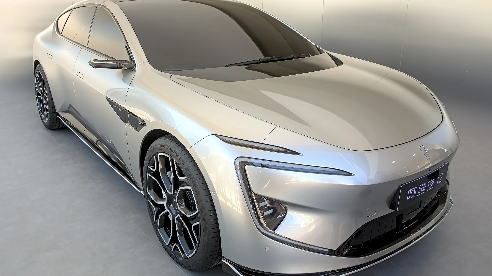

**Avatr**, una marca de lujo creada por el grupo chino **Changan** con tecnología de **Huawei** y baterías de **CATL**, llega a Colombia en **noviembre de 2026**. Su presentación oficial será en el Salón del Automóvil de Bogotá, en Corferias, y la importará **Grupo Vardí**, que ya representa a Changan, Deepal y Farizon en el país.

## Lo esencial

- **Presentación:** Salón del Automóvil de Bogotá, noviembre de 2026.
- **Importador:** Grupo Vardí.
- **Precios estimados:** entre $200 y $350 millones, según la revista Alto Torque.
- **Modelos mencionados:** Avatr 06, 06T y 12. La SUV 07 es candidata, sin confirmar.
- **Tecnología:** software, asistencias y sistema multimedia de Huawei; baterías de CATL.

## Los modelos

| Modelo | Tipo | Precio estimado en Colombia |
|---|---|---|
| Avatr 06 | Sedán eléctrico o de rango extendido | Unos $200 millones |
| Avatr 06T | Versión familiar del 06 | Entre $200 y $220 millones |
| Avatr 12 | Fastback de cuatro puertas, tope de gama | Cerca de $350 millones |
| Avatr 07 | SUV mediana, sin confirmar | Sin precio |

Estos precios son estimados publicados antes del lanzamiento, no precios oficiales.

Varios modelos de Avatr existen en versión **de rango extendido**, que usa un motor de gasolina solo para generar electricidad. Esas versiones no son eléctricos puros y pueden no tener los mismos beneficios tributarios ni la exención de pico y placa. Antes de comprar, confirme qué tipo de motor tiene la versión que le ofrecen.

*El Avatr 12, el modelo más caro de la marca. Foto: Alexander-93, CC BY-SA 4.0, recortada, vía Wikimedia Commons.*

## La parte Huawei

El atractivo principal de Avatr es tecnológico. **Huawei** aporta el sistema de asistencias Qiankun ADS, que en las versiones tope usa LiDAR, radar 4D y cámaras, y el sistema operativo HarmonyOS para la pantalla y la conectividad. Falta saber qué funciones de asistencia quedarán habilitadas en Colombia, porque dependen de mapas y de la regulación local.

Avatr no compite por precio. Su apuesta es la tecnología de Huawei, en un rango donde ya venden marcas que el comprador colombiano conoce mejor, así que tendrá que demostrar con la red de servicio que vale el riesgo de una marca nueva.

## Preguntas frecuentes

### ¿Qué es Avatr?

Una marca de eléctricos de lujo del grupo chino Changan, desarrollada con Huawei y CATL.

### ¿Cuándo llega a Colombia?

En noviembre de 2026, con presentación en el Salón del Automóvil de Bogotá.

### ¿Cuánto costará?

Los precios estimados van de $200 a $350 millones. Los oficiales se conocerán en el lanzamiento.

### ¿Quién la importa?

Grupo Vardí, el mismo de Changan y Deepal en Colombia.

Compare con otros eléctricos de lujo en el [comparador de Mejor Eléctrico](/es/comparador/?a=deepal-s05-620-premium-lidar-2027-cn&b=tesla-model-y-premium-awd-2026-eu).

---

**Fuentes:** [Alto Torque: Avatr llega a Colombia en noviembre](https://revistaaltotorque.com/avatr-colombia-2026-electrico-premium-huawei/) · [Valora Analitik: Avatr en Colombia](https://www.valoraanalitik.com/avatr-llega-colombia-2026-noviembre/) · [El Carro Colombiano: marcas nuevas del Salón 2026](https://www.elcarrocolombiano.com/lanzamientos/carros-nuevas-marcas-vienen-colombia-salon-del-automovil-bogota-2026/)
