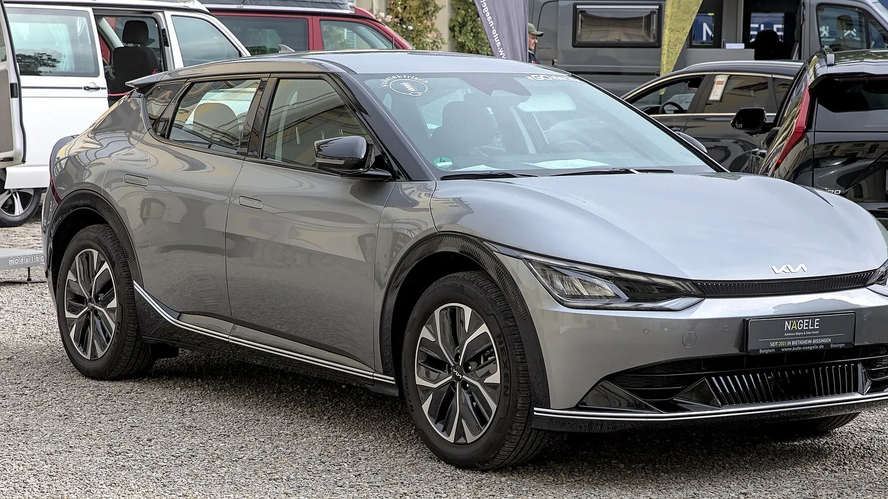

Puede sonar raro, pero un carro eléctrico con la batería grande al 90 % puede quedarse sin encender. La culpa suele ser de la otra batería, la pequeña de **12 voltios**, la misma que tiene cualquier carro de gasolina. Según cifras de asistencia en carretera en Europa citadas por la revista ONMOTOR, el **12 % de las llamadas de auxilio** de eléctricos en el primer trimestre de 2026 se debieron a esta batería.

## Lo esencial

- **Un eléctrico tiene dos baterías:** la de tracción, de alto voltaje, que mueve el carro, y una auxiliar de 12 voltios.
- **La de 12 voltios** alimenta las luces, las pantallas, los seguros de las puertas y los sistemas que “despiertan” al carro.
- **Si se descarga,** el carro no enciende aunque la batería grande esté llena.
- **La solución** suele ser barata: alrededor de 80 euros en Europa, según ONMOTOR. El problema es quedarse varado.

## Por qué se descarga

En un carro de gasolina, el alternador recarga la batería de 12 voltios mientras el motor funciona. En un eléctrico no hay alternador: un convertidor toma energía de la batería grande y la pasa a la pequeña. Si ese convertidor falla, o si el carro pasa mucho tiempo apagado mientras los sistemas conectados consumen energía, la batería de 12 voltios se agota.

Los eléctricos, además, tienen muchos sistemas que funcionan con el carro apagado: conexión a internet, aplicaciones, alarmas y cámaras de vigilancia. Todos consumen de la batería pequeña.

*El Kia EV6 comparte plataforma con el Ioniq 5 y también entró en los llamados a revisión por la unidad de carga. Foto: Alexander Migl, CC BY-SA 4.0, vía Wikimedia Commons.*

## El caso de Hyundai y Kia

El ejemplo más conocido es el de la **ICCU**, la unidad de control de carga integrada de los eléctricos de Hyundai, Kia y Genesis sobre la plataforma E-GMP, como el **Ioniq 5**, el **Ioniq 6** y el **EV6**. Esa unidad, entre otras funciones, mantiene cargada la batería de 12 voltios. Según InsideEVs, cuando falla un transistor de la ICCU se funde el fusible que alimenta la batería pequeña, el carro muestra una advertencia de **potencia limitada** y va perdiendo fuerza hasta detenerse.

Hyundai y Kia hicieron llamados a revisión en Estados Unidos que sumaron más de 200.000 carros fabricados entre 2022 y 2025. La reparación incluye una actualización de software y, si se detecta la falla, el cambio de la ICCU. Algunos dueños reportaron una segunda falla después de la reparación.

## Síntomas que avisan

La batería de 12 voltios rara vez muere de golpe. Antes suele dar señales: el carro tarda en “despertar”, la pantalla se reinicia sola o los seguros de las puertas responden tarde. Si además aparece una advertencia de batería de 12 voltios, el margen ya es corto.

Si aparece una advertencia de potencia limitada mientras maneja, salga de la vía y busque servicio pronto: según el reporte del regulador estadounidense, el conductor puede tener hasta 45 minutos antes de que el carro se detenga, pero no conviene apostar a ese margen.

> Si va a dejar su eléctrico varios días sin usar, revise en el manual cómo reducir el consumo con el carro apagado, por ejemplo desactivando el modo de vigilancia. Y tenga a mano el número de asistencia de la marca.

## Preguntas frecuentes

### ¿Un carro eléctrico tiene batería de 12 voltios?

Sí. Además de la batería grande de tracción, tiene una auxiliar de 12 voltios para luces, pantallas y sistemas de arranque.

### ¿Por qué mi eléctrico no enciende si la batería está cargada?

Lo más probable es que la batería de 12 voltios esté descargada.

### ¿Cuánto cuesta cambiar la batería de 12 voltios?

Mucho menos que la de tracción. En Europa ronda los 80 euros, según ONMOTOR.

### ¿Mi Ioniq 5 o EV6 está en el llamado a revisión?

Consulte con el concesionario usando el VIN del carro, o revise las campañas publicadas por la Superintendencia de Industria y Comercio.

Compare modelos y garantías en el [comparador de Mejor Eléctrico](/es/comparador/?a=hyundai-ioniq-5-84-kwh-rwd-2026-eu&b=kia-ev6-long-range-2wd-2026-eu).

---

**Fuentes:** [ONMOTOR: problemas reales de los eléctricos en 2026](https://onmotor.es/problemas-reales-en-los-coches-electricos-en-2026/) · [InsideEVs: lo que se sabe de la falla de la ICCU](https://insideevs.com/features/752768/hyundai-kia-genesis-iccu-failure/) · [InsideEVs: llamado a revisión de más de 200.000 eléctricos](https://insideevs.com/news/742007/hyunda-kia-iccu-12-volt-recall/)
